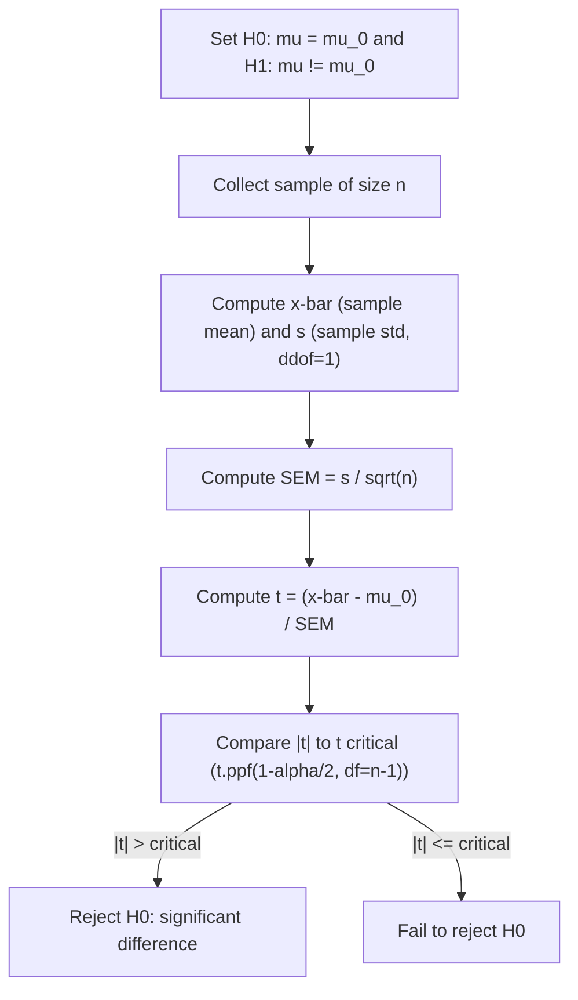

# T-Statistic (1-Sample)

$$
t = \dfrac{\bar{x} - \mu_0}{s / \sqrt{n}}
$$

## Deep Breakdown

What it tells me *(Situation Awareness)*:
The one-sample t-statistic measures how many standard errors the sample mean $\bar{x}$ is away from a hypothesised population mean $\mu_0$. It is used when $\sigma$ (population SD) is unknown and must be estimated from the sample via $s$ (sample SD). The t-statistic follows a t-distribution with $n-1$ degrees of freedom under $H_0$. In DA/DS you use it to test whether a metric (mean revenue, mean session time, mean CTR after normalisation) has changed relative to a known baseline or historical mean.

## Flowchart



## Real-world use

### Where it is used

Testing whether this month's mean order value ($\bar{x} = 47.80$ EUR) is significantly different from last year's mean ($\mu_0 = 45.00$ EUR), with only 40 orders collected.

### Problem it solves

When $\sigma$ is unknown, the Z-test is invalid. The t-test properly accounts for the additional uncertainty of estimating $\sigma$ from the same sample, using heavier tails in the t-distribution.

### How it solves the problem

The denominator $s/\sqrt{n}$ is the estimated SEM. Dividing the observed deviation $(\bar{x} - \mu_0)$ by this estimated SEM gives the t-statistic, which follows a t-distribution under $H_0$. The p-value is computed from this distribution.

### Example in a business

A DA tests whether the mean page load time after a server upgrade ($\bar{x} = 1.8$ s, $s = 0.4$ s, $n = 30$) is significantly less than the pre-upgrade baseline ($\mu_0 = 2.1$ s). The t-statistic guides the decision to roll out the upgrade.

## The formula, piece by piece

| Symbol | Meaning |
|--------|---------|
| $\bar{x}$ | Sample mean |
| $\mu_0$ | Hypothesised population mean under $H_0$ |
| $s$ | Sample standard deviation (with Bessel correction, ddof=1) |
| $\sqrt{n}$ | Square root of sample size |
| $s/\sqrt{n}$ | Estimated Standard Error of the Mean |
| $t$ | Test statistic; follows t-distribution with $df = n-1$ under $H_0$ |

Full formula: $t = \dfrac{\bar{x} - \mu_0}{s / \sqrt{n}}$

## The formula in words

"The t-statistic is how many estimated standard errors the sample mean is away from the hypothesised mean." A large absolute value of $t$ means the sample mean is unlikely to have come from a population with mean $\mu_0$.

## Critical Concepts

- **Degrees of freedom**: $df = n - 1$; more df = t-distribution closer to Normal.
- **Two-tailed vs one-tailed**: two-tailed tests both directions ($H_1: \mu \ne \mu_0$); one-tailed tests one direction ($H_1: \mu > \mu_0$).
- **p-value**: probability of observing $|t|$ as extreme as the calculated value if $H_0$ is true.
- **Effect size**: t-statistic magnitude depends on $n$; report Cohen's d for practical significance: $d = (\bar{x}-\mu_0)/s$.
- **Assumptions**: approximately Normal population (or $n \ge 30$ by CLT), independent observations, continuous data.

## Step-by-step calculation (tiny example)

$\bar{x} = 52$, $\mu_0 = 50$, $s = 5$, $n = 25$.

*Step 1: Compute SEM*
$SE = s/\sqrt{n} = 5/\sqrt{25} = 5/5 = 1.0$

*Step 2: Compute t-statistic*
$t = (52 - 50) / 1.0 = 2.0$

*Step 3: Find critical value and p-value*
$df = 24$; $t_{0.025, 24} = 2.064$ (two-tailed, $\alpha = 0.05$)
$|t| = 2.0 < 2.064$: fail to reject $H_0$ (p $\approx 0.057$).

*Step 4: Interpret*
The sample mean of 52 is not significantly different from 50 at $\alpha = 0.05$.

## Code examples

### Beginner example (Python)

```python
import numpy as np
from scipy import stats

# Sample data: page load times (seconds) after upgrade
load_times = [1.6, 1.9, 1.7, 2.0, 1.8, 1.5, 2.1, 1.8, 1.9, 1.7, 1.6, 1.8, 2.0, 1.7, 1.9, 1.8, 1.6, 2.0, 1.9, 1.7]
mu_0 = 2.1   # baseline mean before upgrade
n = len(load_times)
x_bar = np.mean(load_times)
s = np.std(load_times, ddof=1)   # sample std
sem = s / np.sqrt(n)
t_stat = (x_bar - mu_0) / sem

# Two-tailed p-value from t-distribution
p_value = 2 * stats.t.cdf(t_stat, df=n - 1)   # left-tail * 2 for two-tailed
print(f"Sample mean: {x_bar:.4f}")
print(f"t-statistic: {t_stat:.4f}")
print(f"p-value: {p_value:.6f}")
print(f"Reject H0: {p_value < 0.05}")
```

### Beginner example (R)

```r
load_times <- c(1.6, 1.9, 1.7, 2.0, 1.8, 1.5, 2.1, 1.8, 1.9, 1.7, 1.6, 1.8, 2.0, 1.7, 1.9, 1.8, 1.6, 2.0, 1.9, 1.7)
mu_0 <- 2.1
result <- t.test(load_times, mu = mu_0, alternative = "two.sided")
cat("t-statistic:", round(result$statistic, 4), "\n")
cat("p-value: ", round(result$p.value, 6), "\n")
cat("95% CI: [", round(result$conf.int[1], 4), ",", round(result$conf.int[2], 4), "]\n")
```

### Professional example (Python)

```python
import numpy as np
import pandas as pd
from scipy import stats
from dataclasses import dataclass


@dataclass
class OneSampleTTestResult:
    n: int
    sample_mean: float
    sample_std: float
    sem: float
    null_mean: float
    t_statistic: float
    p_value: float
    cohens_d: float
    ci_lower: float
    ci_upper: float
    reject_null: bool


def one_sample_t_test(
    data: np.ndarray,
    null_mean: float,
    alpha: float = 0.05,
    alternative: str = "two-sided",
) -> OneSampleTTestResult:
    # One-sample t-test with effect size (Cohen's d) and CI.
    # alternative: 'two-sided', 'greater', 'less'
    n = len(data)
    x_bar = float(np.mean(data))
    s = float(np.std(data, ddof=1))
    sem = s / np.sqrt(n)
    t_stat = (x_bar - null_mean) / sem
    df = n - 1
    cohens_d = (x_bar - null_mean) / s
    if alternative == "two-sided":
        p_val = 2 * float(stats.t.cdf(-abs(t_stat), df=df))
    elif alternative == "greater":
        p_val = float(stats.t.sf(t_stat, df=df))
    else:
        # less
        p_val = float(stats.t.cdf(t_stat, df=df))
    t_crit = float(stats.t.ppf(1 - alpha / 2, df=df))
    ci_low = x_bar - t_crit * sem
    ci_high = x_bar + t_crit * sem
    return OneSampleTTestResult(
        n=n,
        sample_mean=round(x_bar, 4),
        sample_std=round(s, 4),
        sem=round(sem, 4),
        null_mean=null_mean,
        t_statistic=round(t_stat, 4),
        p_value=round(p_val, 6),
        cohens_d=round(cohens_d, 4),
        ci_lower=round(ci_low, 4),
        ci_upper=round(ci_high, 4),
        reject_null=p_val < alpha,
    )


if __name__ == "__main__":
    rng = np.random.default_rng(seed=42)
    page_load_data = rng.normal(loc=1.80, scale=0.35, size=40)
    BASELINE_LOAD_TIME = 2.10
    result = one_sample_t_test(page_load_data, null_mean=BASELINE_LOAD_TIME, alternative="less")
    print("One-sample t-test (H1: mean < 2.10 seconds):")
    for field, val in result.__dict__.items():
        print(f" {field}: {val}")
```

---

*Source: domain knowledge*
