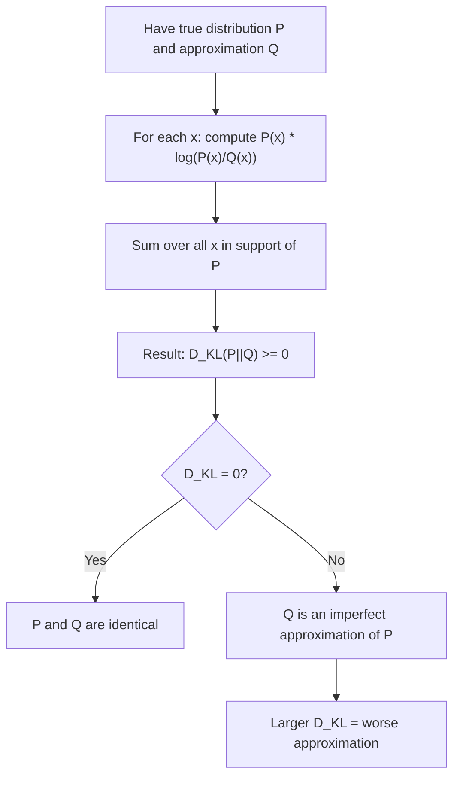

# Kullback-Leibler (KL) Divergence

$$
D_{KL}(P \parallel Q) = \sum_{x \in \mathcal{X}} P(x) \log \left( \dfrac{P(x)}{Q(x)} \right)
$$

## Deep Breakdown

What it tells me *(Situation Awareness)*:
KL divergence (also called relative entropy) measures how much information is lost when you use distribution Q to approximate the true distribution P. It quantifies the "extra bits" needed when encoding data from P using a code designed for Q. In DA/DS and ML it appears everywhere: VAE (variational autoencoders) minimise the KL divergence between the posterior and prior; cross-entropy loss = entropy + KL divergence; it is used in drift detection (comparing today's feature distribution to the training distribution); and it appears in the EM algorithm.

## Flowchart



## Real-world use

### Where it is used

Feature drift monitoring: comparing the distribution of a feature at inference time (Q) to its distribution at training time (P). A high KL divergence triggers a model retraining alert. Also used in information-theoretic regularisation and variational inference.

### Problem it solves

You need a number that tells you how different two probability distributions are. Unlike standard statistical tests, KL divergence works continuously, scales with the magnitude of differences, and connects directly to information theory and ML loss functions.

### How it solves the problem

$P(x) \log(P(x)/Q(x))$ is the extra information needed at outcome $x$ when using Q instead of P. Summing these gives the total expected information loss. When $P = Q$ everywhere, each term is $P(x) \cdot 0 = 0$.

### Example in a business

A production ML pipeline monitors data drift by computing $D_{KL}(P_{train} \parallel P_{current})$ for each feature monthly. When $D_{KL}$ exceeds a threshold (e.g. 0.1 nats), an alert triggers model retraining. This prevents silent accuracy degradation.

## The formula, piece by piece

| Symbol | Meaning |
|--------|---------|
| $D_{KL}(P \parallel Q)$ | KL divergence from Q to P (read: "P given Q") |
| $P(x)$ | True (reference) distribution |
| $Q(x)$ | Approximate (model) distribution |
| $\log(P(x)/Q(x))$ | Log-ratio of probabilities (nats with $\ln$, bits with $\log_2$) |
| $P(x) \log(P(x)/Q(x))$ | Information excess at outcome $x$ |

Full formula: $D_{KL}(P \parallel Q) = \sum_{x} P(x) \log \dfrac{P(x)}{Q(x)}$ Equivalent form: $D_{KL}(P \parallel Q) = H(P, Q) - H(P)$ (cross-entropy minus entropy of P).

## The formula in words

"KL divergence is the expected log-ratio of probabilities under the true distribution P." It equals the average number of extra bits (or nats) needed to encode samples from P using a code designed for Q.

## Critical Concepts

- **Non-symmetric**: $D_{KL}(P \parallel Q) \ne D_{KL}(Q \parallel P)$ in general — it is NOT a distance metric.
- **Non-negative**: $D_{KL}(P \parallel Q) \ge 0$ always (Gibbs' inequality); equals 0 iff $P = Q$.
- **Undefined if Q(x) = 0 where P(x) > 0**: Q must have full support over P's support.
- **Forward vs reverse KL**: choice matters in VI — forward KL is mean-seeking; reverse KL is mode-seeking.
- **Connection to cross-entropy**: $D_{KL}(P \parallel Q) = H(P,Q) - H(P)$; minimising cross-entropy = minimising KL divergence (since $H(P)$ is fixed).

## Step-by-step calculation (tiny example)

$P = [0.5, 0.3, 0.2]$ (true), $Q = [0.4, 0.4, 0.2]$ (model).

*Step 1: Compute each log-ratio*
$\log(0.5/0.4) = \ln(1.25) \approx 0.2231$
$\log(0.3/0.4) = \ln(0.75) \approx -0.2877$
$\log(0.2/0.2) = \ln(1.0) = 0$

*Step 2: Weight by P(x)*
$0.5 \times 0.2231 = 0.1116$
$0.3 \times (-0.2877) = -0.0863$
$0.2 \times 0 = 0$

*Step 3: Sum*
$D_{KL}(P \parallel Q) = 0.1116 - 0.0863 + 0 = 0.0253$ nats

## Code examples

### Beginner example (Python)

```python
import numpy as np
from scipy.stats import entropy   # True distribution P and approximation Q
p_dist = np.array([0.5, 0.3, 0.2])
q_dist = np.array([0.4, 0.4, 0.2])   # Manual KL divergence (in nats)
kl_manual = np.sum(p_dist * np.log(p_dist / q_dist))
# scipy: entropy(pk, qk) computes KL(pk||qk) in nats by default
kl_scipy = entropy(p_dist, q_dist)
print(f"D_KL(P||Q) manual: {kl_manual:.6f} nats")
print(f"D_KL(P||Q) scipy: {kl_scipy:.6f} nats")
print(f"D_KL is symmetric? D_KL(Q||P) = {entropy(q_dist, p_dist):.6f} nats")
```

### Beginner example (R)

```r
p_dist <- c(0.5, 0.3, 0.2)
q_dist <- c(0.4, 0.4, 0.2)
kl_divergence <- function(p, q) {
  # KL(P||Q) in nats; requires Q(x)>0 wherever P(x)>0
  sum(p * log(p / q))
}
cat("D_KL(P||Q):", round(kl_divergence(p_dist, q_dist), 6), "nats\n")
cat("D_KL(Q||P):", round(kl_divergence(q_dist, p_dist), 6), "nats (different!)\n")
```

### Professional example (Python)

```python
import numpy as np
import pandas as pd
from scipy.stats import entropy

DRIFT_ALERT_THRESHOLD = 0.10   # nats; common rule-of-thumb for feature drift


def kl_divergence(p: np.ndarray, q: np.ndarray, epsilon: float = 1e-10) -> float:
    # KL(P||Q) in nats. Adds epsilon to avoid log(0).
    p_safe = np.clip(p, epsilon, None)
    q_safe = np.clip(q, epsilon, None)
    # Renormalise after clipping
    p_safe /= p_safe.sum()
    q_safe /= q_safe.sum()
    return float(np.sum(p_safe * np.log(p_safe / q_safe)))


def feature_drift_report(
    train_df: pd.DataFrame,
    prod_df: pd.DataFrame,
    cat_features: list[str],
    alert_threshold: float = DRIFT_ALERT_THRESHOLD,
) -> pd.DataFrame:
    # Compute KL divergence per categorical feature for drift detection.
    rows = []
    all_categories = {col: list(set(train_df[col].unique()) | set(prod_df[col].unique())) for col in cat_features}
    for col in cat_features:
        cats = all_categories[col]
        p_counts = train_df[col].value_counts().reindex(cats, fill_value=0).values.astype(float)
        q_counts = prod_df[col].value_counts().reindex(cats, fill_value=0).values.astype(float)
        p_probs = p_counts / p_counts.sum()
        q_probs = q_counts / q_counts.sum()
        kl_val = kl_divergence(p_probs, q_probs)
        rows.append({
            "feature": col,
            "kl_divergence_nats": round(kl_val, 6),
            "drift_alert": kl_val > alert_threshold,
        })
    return pd.DataFrame(rows).sort_values("kl_divergence_nats", ascending=False)


if __name__ == "__main__":
    rng = np.random.default_rng(seed=42)
    n_train, n_prod = 5_000, 2_000
    train_data = pd.DataFrame({
        "device": rng.choice(["mobile", "desktop"], size=n_train, p=[0.60, 0.40]),
        "segment": rng.choice(["A", "B", "C"], size=n_train, p=[0.50, 0.30, 0.20]),
    })
    # Production shift: more desktop, segment B disappears
    prod_data = pd.DataFrame({
        "device": rng.choice(["mobile", "desktop"], size=n_prod, p=[0.35, 0.65]),
        "segment": rng.choice(["A", "B", "C"], size=n_prod, p=[0.70, 0.05, 0.25]),
    })
    report = feature_drift_report(train_data, prod_data, cat_features=["device", "segment"])
    print("Feature drift report (KL divergence, training vs production):")
    print(report.to_string(index=False))
```

---

*Source: domain knowledge*
