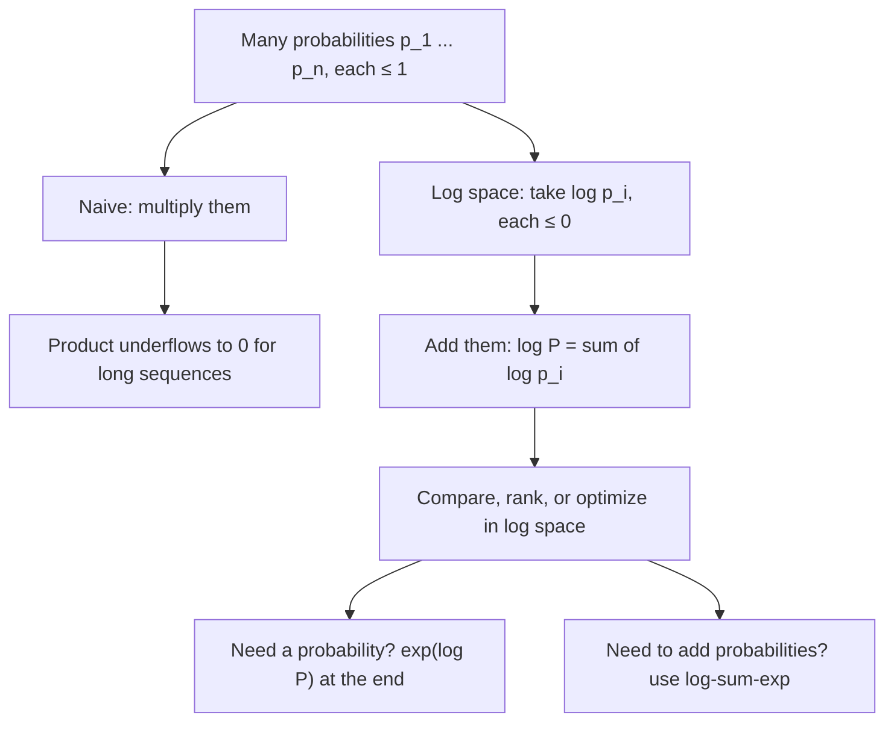

# Log Probabilities

$$
\log \prod_{i=1}^{n} p_i = \sum_{i=1}^{n} \log p_i
$$

, where each $p_i \in (0, 1]$, so every $\log p_i \le 0$

## Deep Breakdown

What it tells me *(Situation Awareness)*:
A log probability is simply $\log p$ instead of $p$. Because the logarithm turns products into sums, the probability of many independent (or chained conditional) events, which is a product of many numbers below 1, becomes a sum of negative numbers. That one identity solves three problems at once: numerical underflow (a product of 400 probabilities of 0.01 is $10^{-800}$, which is $0$ in float64, while its log is a perfectly ordinary $-1842.07$), numerical precision (adding is more accurate than multiplying tiny numbers), and calculus (derivatives of sums are easier than derivatives of products, which is why every likelihood is maximized in log form). The log is monotonic, so ranking by $\log p$ is the same as ranking by $p$. In DA/DS: log-likelihood for model fitting (logistic regression, MLE, Naive Bayes), log-loss / cross-entropy as a metric, scoring and comparing LLM outputs with the `logprobs` returned by APIs (confidence of a classification label, sequence likelihood, detecting hallucination-prone low-confidence tokens), HMMs and beam search, and Bayesian updating where the log posterior is log prior plus log likelihood.

## Flowchart



## Real-world use

### Where it is used

Every maximum-likelihood fit (the optimizer sees the log-likelihood); Naive Bayes text classifiers; HMM Viterbi decoding and beam search in speech/translation; LLM APIs that return `logprobs` for each generated token and its top alternatives; log-loss as a classification metric; Bayesian models (log prior + log likelihood); anomaly scores ("how unlikely is this session under my model").

### Problem it solves

Probabilities of long sequences are astronomically small. A 300-token LLM answer, a 2,000-word email under a Naive Bayes model, or a 10,000-row dataset likelihood all multiply hundreds or thousands of numbers below 1, and float64 cannot represent anything below about $10^{-308}$ (or $5 \times 10^{-324}$ subnormal). The product becomes $0$, every candidate looks equally impossible, and comparisons break.

### How it solves the problem

Take logs first, then add: $\log(p_1 p_2 \cdots p_n) = \log p_1 + \cdots + \log p_n$. Each term is a moderate negative number, and their sum stays in range even for millions of terms. Since $\log$ is strictly increasing, $\arg\max_k P_k = \arg\max_k \log P_k$, so decisions do not change. Only when a final probability is needed do we exponentiate, and when probabilities must be *added* (marginalizing, mixtures) we use the [[log_sum_exp_trick_prevents_underflowoverflow]].

### Example in a business

An e-commerce team uses an LLM to classify reviews as `positive`, `neutral` or `negative`, asking for a one-token answer with `logprobs` enabled. The API returns `logprob = -0.105` for `positive`, so the model's confidence is $e^{-0.105} = 0.90$. The team routes reviews whose top-label probability is below 0.6 (logprob below $\ln 0.6 = -0.51$) to human review, turning raw logprobs into a calibrated-ish confidence gate without training a separate model.

## The formula, piece by piece

- $p_i$: probability of the $i$-th event or token, in $(0, 1]$
- $\prod_{i=1}^{n} p_i$: joint probability of all $n$ events (independent, or conditional probabilities chained by the chain rule)
- $\log$: natural log by default (nats); $\log_2$ gives bits; the identity holds in any base
- $\log p_i$: log probability; $0$ when $p_i = 1$, $-\infty$ when $p_i = 0$, e.g. $\ln 0.5 = -0.693$
- $\sum_{i=1}^{n} \log p_i$: log-likelihood of the whole sequence; always $\le 0$
- $-\sum_i \log p_i$: negative log-likelihood (NLL), the usual loss to minimize (see [[negative_log_likelihood]])
- $\frac{1}{n}\sum_i \log p_i$: length-normalized log-probability; exponentiating its negative gives [[perplexity]]
- $e^{\log p} = p$: how to go back to the probability scale

## The formula in words

"To get the probability of a long chain of events, instead of multiplying many small numbers, add up their logs; the bigger (closer to zero) the total, the more likely the chain." Tiny example: $p = 0.9, 0.6, 0.8$. Product $= 0.432$. Logs: $-0.1054 + (-0.5108) + (-0.2231) = -0.8393$, and $e^{-0.8393} = 0.432$. Same answer, but the sum never underflows.

## Critical Concepts

- **Products become sums:** the core identity. Also $\log(p^k) = k \log p$ and $\log(p/q) = \log p - \log q$, so likelihood ratios become differences (log-odds, log Bayes factors).
- **Monotonic, so rankings are preserved:** argmax, sorting and thresholding work identically in log space; you just translate thresholds ($p \ge 0.6 \iff \log p \ge -0.51$).
- **Sums of probabilities need log-sum-exp:** $\log(p_1 + p_2) \ne \log p_1 + \log p_2$. Use $\text{logsumexp}(\log p_1, \log p_2)$ to stay in log space safely.
- **Reading LLM logprobs:** a token logprob of $-0.01$ means $p \approx 0.99$; $-0.69$ means $p = 0.5$; $-2.3$ means $p \approx 0.1$. Summing token logprobs gives the log-probability of the whole answer; divide by the number of tokens before comparing answers of different lengths, otherwise longer answers are always penalized.
- **Underflow thresholds:** float64 underflows below about $10^{-308}$ ($\log \approx -709$), float32 below about $10^{-38}$ ($\log \approx -87$). Any sequence of a few hundred tokens crosses these limits in probability space.
- **Log of zero:** $\log 0 = -\infty$. Smooth probabilities (add-$k$, clipping with a small $\varepsilon$) before taking logs in count-based models and in log-loss.

## Step-by-step calculation (tiny example)

*A shopper journey has three steps with conditional probabilities: view product $0.9$, add to cart $0.6$, checkout $0.8$.*

*Step 1: Probability space*
$P = 0.9 \times 0.6 \times 0.8 = 0.432$.

*Step 2: Log space*
$\ln 0.9 = -0.1054$, $\ln 0.6 = -0.5108$, $\ln 0.8 = -0.2231$.

*Step 3: Add*
$\ln P = -0.1054 - 0.5108 - 0.2231 = -0.8393$.

*Step 4: Back to probability*
$e^{-0.8393} = 0.432$. $\checkmark$

*Step 5: Why it matters at scale*
400 events each with $p = 0.01$: the product $0.01^{400} = 10^{-800}$ prints as `0.0` in float64, but $\ln P = 400 \times \ln 0.01 = -1842.07$ is exact and comparable.

## Code examples

### Beginner example (Python)

```python
import numpy as np

probs = np.array([0.9, 0.6, 0.8])
log_probs = np.log(probs)
print("log p_i:", log_probs.round(4))                    # [-0.1054 -0.5108 -0.2231]
print(f"Product: {np.prod(probs):.3f}")                  # 0.432
print(f"Sum of logs: {log_probs.sum():.4f}")             # -0.8393
print(f"exp(sum of logs): {np.exp(log_probs.sum()):.3f}")  # 0.432

# Underflow: 400 events with p = 0.01
long_seq = np.full(400, 0.01)
print(f"Product of 400 x 0.01: {np.prod(long_seq)}")      # 0.0 (underflow)
print(f"Sum of logs: {np.log(long_seq).sum():.2f}")      # -1842.07

# Reading an LLM logprob
print(f"logprob -0.105 -> p = {np.exp(-0.105):.2f}")     # 0.90
```

### Beginner example (R)

```r
probs <- c(0.9, 0.6, 0.8)
log_probs <- log(probs)
cat(sprintf("Product = %.3f | sum of logs = %.4f | exp = %.3f\n",
            prod(probs), sum(log_probs), exp(sum(log_probs))))
long_seq <- rep(0.01, 400)
cat("Product of 400 x 0.01:", prod(long_seq), "\n")          # 0 (underflow)
cat(sprintf("Sum of logs: %.2f\n", sum(log(long_seq))))      # -1842.07
```

### Professional example (Python)

```python
import numpy as np
from scipy.special import logsumexp

rng = np.random.default_rng(42)

# 1) Naive Bayes spam scoring: probability space vs log space
vocab_size = 2_000
p_word_spam = rng.dirichlet(np.ones(vocab_size))
p_word_ham = rng.dirichlet(np.ones(vocab_size))
prior_spam, prior_ham = 0.3, 0.7
email = rng.choice(vocab_size, size=600, p=p_word_spam)   # a long email drawn from the spam model

naive_spam = prior_spam * np.prod(p_word_spam[email])
naive_ham = prior_ham * np.prod(p_word_ham[email])
log_spam = np.log(prior_spam) + np.log(p_word_spam[email]).sum()
log_ham = np.log(prior_ham) + np.log(p_word_ham[email]).sum()
log_evidence = logsumexp([log_spam, log_ham])            # log(P(spam, x) + P(ham, x))
posterior_spam = np.exp(log_spam - log_evidence)

print("Naive Bayes on a 600-word email")
print(f"  probability space: spam={naive_spam}, ham={naive_ham}  (both underflow)")
print(f"  log space: log P(spam,x)={log_spam:.1f}, log P(ham,x)={log_ham:.1f}")
print(f"  posterior P(spam | x) = {posterior_spam:.6f}")

# 2) LLM answer scoring with per-token logprobs (as returned by an API)
answers = {
    "short": np.array([-0.05, -0.30, -0.10]),
    "long": np.array([-0.04, -0.20, -0.08, -0.15, -0.10, -0.06, -0.12]),
}
print("\nLLM answer scoring")
for name, lp in answers.items():
    total = lp.sum()
    mean = lp.mean()
    print(f"  {name:<5} tokens={len(lp)}  sum logprob={total:.2f}  P(seq)={np.exp(total):.3f}  "
          f"mean logprob={mean:.3f}  per-token PPL={np.exp(-mean):.3f}")

# 3) Confidence gate on a one-token classification
label_logprobs = {"positive": -0.105, "neutral": -2.66, "negative": -3.69}
probs = {k: np.exp(v) for k, v in label_logprobs.items()}
top = max(label_logprobs, key=label_logprobs.get)
print(f"\nTop label: {top} with p = {probs[top]:.3f}; "
      f"route to human: {label_logprobs[top] < np.log(0.6)}")
print(f"Probability mass covered by the three labels: {sum(probs.values()):.3f}")
```

---

*Source: domain knowledge*
