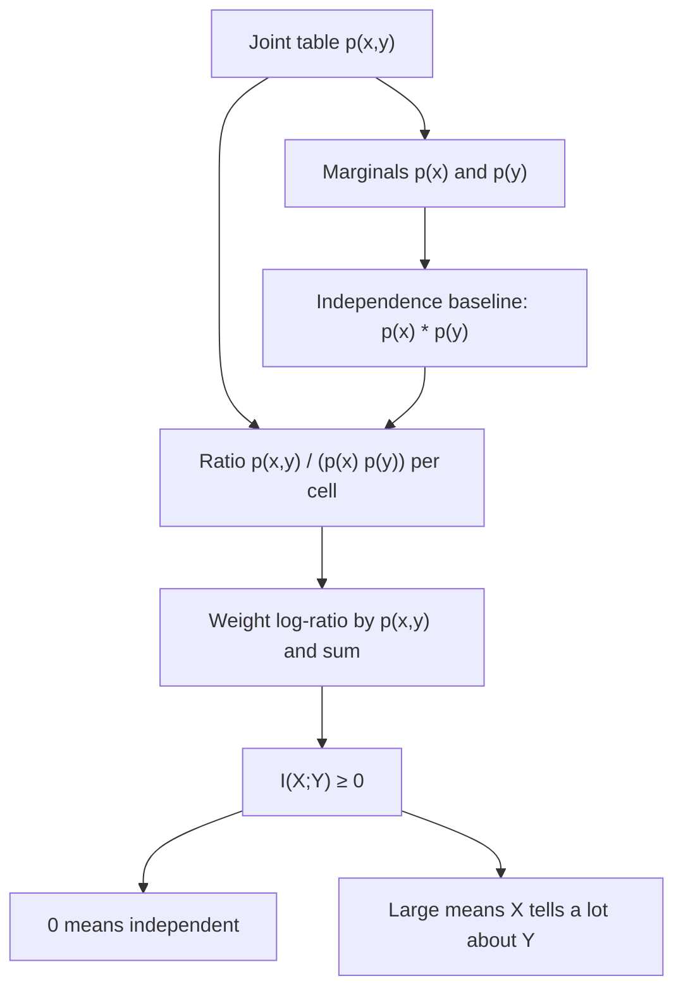

# Mutual Information

$$
I(X;Y) = \sum_{x}\sum_{y} p(x,y)\,\log \frac{p(x,y)}{p(x)\,p(y)} = H(Y) - H(Y \mid X)
$$

, where $p(x,y)$ is the joint distribution and $p(x)$, $p(y)$ are its marginals

## Deep Breakdown

What it tells me *(Situation Awareness)*:
Mutual information (MI) measures how many bits (or nats) of uncertainty about $Y$ disappear once I know $X$. It is zero if and only if $X$ and $Y$ are independent, it is symmetric ($I(X;Y) = I(Y;X)$), it is never negative, and unlike Pearson correlation it captures *any* kind of dependence: linear, monotonic, U-shaped, categorical. Formally it is the KL divergence between the joint distribution and the product of the marginals, $I(X;Y) = D_{\text{KL}}(p(x,y) \,\|\, p(x)p(y))$, i.e. "how far is reality from the world where the two variables ignore each other". The price is that it has no sign and no natural scale (it is bounded by $\min(H(X), H(Y))$), so it is often normalized. In DA/DS: feature selection (rank features by MI with the target, `mutual_info_classif`), detecting non-linear relationships that correlation misses, comparing two clusterings (normalized MI, adjusted MI), choosing which survey question or event best predicts churn, decision-tree splits (information gain is MI between the split and the label), and representation learning (InfoNCE / contrastive losses maximize a lower bound on MI).

## Flowchart



## Real-world use

### Where it is used

Feature screening before modelling (scikit-learn `mutual_info_classif` / `mutual_info_regression`); information gain in decision trees; normalized mutual information (NMI) to compare a clustering with ground-truth segments; selecting sensors or survey items; word co-occurrence statistics in NLP (pointwise MI, PMI); contrastive learning objectives for embeddings.

### Problem it solves

Correlation only sees straight lines. A feature such as "hours since last login" can have a U-shaped relationship with churn (both brand-new and long-dormant users churn), so Pearson's $r$ is near zero even though the feature is highly informative. Also, many business variables are categorical (channel, device, plan), where correlation is not even defined.

### How it solves the problem

MI compares the observed joint probabilities with what independence would predict, cell by cell. Every cell where the pair appears more (or less) often than $p(x)p(y)$ contributes; the weighting by $p(x,y)$ makes the result an expectation of the log-ratio, which is always $\ge 0$. No assumption about the shape of the relationship is needed.

### Example in a business

A CRM team wants to know which signal tells them most about whether a customer buys: "opened the campaign email" or "visited the pricing page". They build the 2×2 joint table of each signal with `purchase`, compute MI in bits, and prioritize the signal with the higher MI for the lead-scoring model. In the worked example below, email opening yields $I = 0.0745$ bits out of $H(\text{purchase}) = 0.6098$ bits, so knowing it removes about 12% of the uncertainty about purchase.

## The formula, piece by piece

- $X$, $Y$: two random variables (e.g. email opened, purchase made)
- $p(x,y)$: joint probability of seeing $X=x$ and $Y=y$ together
- $p(x)$, $p(y)$: marginal probabilities (row and column sums of the joint table)
- $p(x)\,p(y)$: what the joint probability would be if $X$ and $Y$ were independent
- $\log \frac{p(x,y)}{p(x)p(y)}$: pointwise mutual information (PMI) of one cell; positive if the pair co-occurs more than chance, negative if less
- $\sum_x \sum_y p(x,y)\,(\cdot)$: average PMI under the true joint distribution; individual cells can be negative but the total cannot
- $\log$ base: base 2 gives bits, natural log gives nats ($1$ nat $= 1.4427$ bits)
- $H(Y) - H(Y \mid X)$: equivalent form; entropy of $Y$ minus the entropy that remains after observing $X$ (see [[shannon_entropy]])
- $D_{\text{KL}}(p(x,y)\,\|\,p(x)p(y))$: equivalent form; divergence of the joint from independence (see [[kullback_leibler_kl_divergence]])

## The formula in words

"Mutual information is the average surprise saved: for every combination of values, compare how often it really happens with how often it would happen if the two variables were unrelated, take the log of that ratio, and average it using the real frequencies." Tiny example: if $X$ and $Y$ are two independent coin flips, every cell has $p(x,y) = 0.25 = 0.5 \times 0.5$, every log-ratio is $\log 1 = 0$, so $I = 0$. If $Y$ is an exact copy of a fair coin $X$, the cells are $0.5, 0, 0, 0.5$ and $I = 2 \times 0.5 \log_2 \frac{0.5}{0.25} = 1$ bit: knowing $X$ tells me everything about $Y$.

## Critical Concepts

- **Non-negative and zero only at independence:** $I(X;Y) \ge 0$ follows from Gibbs' inequality on the KL form. $I = 0$ exactly characterizes independence, something correlation cannot do.
- **No sign, no direction:** MI says "related", not "positively related". Look at the PMI of individual cells or at the conditional rates to see the direction.
- **Upper bound and normalization:** $I(X;Y) \le \min(H(X), H(Y))$. Common normalizations: $I/H(Y)$ (uncertainty coefficient, "fraction of $Y$ explained"), and NMI $= I / \sqrt{H(X)H(Y)}$ for clustering comparison.
- **Estimation is the hard part:** for discrete data use the plug-in estimate from counts (biased upward for small samples and many categories). For continuous data, binning is sensitive to bin choice; scikit-learn uses the k-nearest-neighbour (Kraskov) estimator.
- **Information gain = MI:** the information gain of a decision-tree split on feature $X$ is exactly $I(X;Y)$ estimated on the node's data.
- **Pointwise MI (PMI):** the single-cell term $\log \frac{p(x,y)}{p(x)p(y)}$ is used in NLP for word associations; it is noisy for rare pairs, which is why positive PMI (PPMI) clips negatives to 0.

## Step-by-step calculation (tiny example)

*10,000 customers. $X$ = opened the email (yes/no), $Y$ = purchased (yes/no). Joint probabilities:*
$p(\text{open},\text{buy}) = 0.10$, $p(\text{open},\text{no buy}) = 0.20$, $p(\text{no open},\text{buy}) = 0.05$, $p(\text{no open},\text{no buy}) = 0.65$.

*Step 1: Marginals*
$p(\text{open}) = 0.10 + 0.20 = 0.30$, $p(\text{no open}) = 0.70$.
$p(\text{buy}) = 0.10 + 0.05 = 0.15$, $p(\text{no buy}) = 0.85$.

*Step 2: Independence baseline $p(x)p(y)$*
$0.30 \times 0.15 = 0.045$; $0.30 \times 0.85 = 0.255$; $0.70 \times 0.15 = 0.105$; $0.70 \times 0.85 = 0.595$.

*Step 3: Cell contributions $p(x,y)\log_2 \frac{p(x,y)}{p(x)p(y)}$*
open, buy: $0.10 \log_2(0.10/0.045) = 0.1152$
open, no buy: $0.20 \log_2(0.20/0.255) = -0.0701$
no open, buy: $0.05 \log_2(0.05/0.105) = -0.0535$
no open, no buy: $0.65 \log_2(0.65/0.595) = 0.0829$

*Step 4: Sum*
$I(X;Y) = 0.1152 - 0.0701 - 0.0535 + 0.0829 = 0.0745$ bits ($= 0.0516$ nats).

*Step 5: Put it on a scale*
$H(Y) = -0.15\log_2 0.15 - 0.85 \log_2 0.85 = 0.6098$ bits.
Uncertainty coefficient $= 0.0745 / 0.6098 = 0.122$: opening the email removes about 12% of the uncertainty about purchase.

## Code examples

### Beginner example (Python)

```python
import numpy as np

# Joint table: rows = opened email (yes, no), cols = purchased (yes, no)
joint = np.array([[0.10, 0.20],
                  [0.05, 0.65]])

p_x = joint.sum(axis=1)          # [0.30, 0.70]
p_y = joint.sum(axis=0)          # [0.15, 0.85]
independent = np.outer(p_x, p_y)

contrib = joint * np.log2(joint / independent)
mi_bits = contrib.sum()
h_y = -(p_y * np.log2(p_y)).sum()

print("Cell contributions (bits):\n", contrib.round(4))
print(f"I(X;Y) = {mi_bits:.4f} bits")            # 0.0745
print(f"I(X;Y) = {mi_bits * np.log(2):.4f} nats")  # 0.0516
print(f"H(Y)   = {h_y:.4f} bits")                # 0.6098
print(f"Fraction of purchase uncertainty removed: {mi_bits / h_y:.3f}")  # 0.122
```

### Beginner example (R)

```r
joint <- matrix(c(0.10, 0.20,
                  0.05, 0.65), nrow = 2, byrow = TRUE)
p_x <- rowSums(joint)
p_y <- colSums(joint)
independent <- outer(p_x, p_y)
mi_bits <- sum(joint * log2(joint / independent))
h_y <- -sum(p_y * log2(p_y))
cat(sprintf("I(X;Y) = %.4f bits\n", mi_bits))   # 0.0745
cat(sprintf("H(Y) = %.4f bits, ratio = %.3f\n", h_y, mi_bits / h_y))
```

### Professional example (Python)

```python
import numpy as np
from sklearn.feature_selection import mutual_info_classif
from sklearn.metrics import mutual_info_score, normalized_mutual_info_score

rng = np.random.default_rng(42)
n = 5_000

# Synthetic churn data with three features:
#  - days_inactive: U-shaped effect (new AND dormant users churn) -> correlation misses it
#  - support_tickets: linear-ish effect
#  - noise: unrelated
days_inactive = rng.uniform(0, 60, n)
support_tickets = rng.poisson(2, n)
noise = rng.normal(size=n)
logit = 0.004 * (days_inactive - 30) ** 2 - 2.0 + 0.35 * support_tickets
churn = (rng.uniform(size=n) < 1 / (1 + np.exp(-logit))).astype(int)

X = np.column_stack([days_inactive, support_tickets, noise])
names = ["days_inactive", "support_tickets", "noise"]

mi = mutual_info_classif(X, churn, discrete_features=[False, True, False], random_state=42)
pearson = [np.corrcoef(X[:, j], churn)[0, 1] for j in range(X.shape[1])]

print(f"Churn rate: {churn.mean():.3f}\n")
print(f"{'feature':<16}{'MI (nats)':>10}{'Pearson r':>11}")
for name, m, r in zip(names, mi, pearson):
    print(f"{name:<16}{m:>10.4f}{r:>11.3f}")

# Discrete MI from counts + normalized MI between two segmentations
channel = rng.choice(["email", "ads", "organic"], size=n, p=[0.3, 0.5, 0.2])
segment_a = np.where(channel == "email", 0, np.where(channel == "ads", 1, 2))
flip = rng.uniform(size=n) < 0.2               # second segmentation agrees 80% of the time
segment_b = np.where(flip, rng.integers(0, 3, n), segment_a)
print(f"\nMI(channel, churn) from counts: {mutual_info_score(channel, churn):.5f} nats")
print(f"NMI(segment_a, segment_b):      {normalized_mutual_info_score(segment_a, segment_b):.3f}")
```

---

*Source: domain knowledge*
