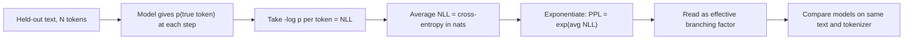

# Perplexity

$$
\text{PPL} = \exp\!\left(-\frac{1}{N}\sum_{i=1}^{N} \log p(w_i \mid w_{1}, \dots, w_{i-1})\right) = \left(\prod_{i=1}^{N} p(w_i \mid w_{1}, \dots, w_{i-1})\right)^{-1/N}
$$

, where $N$ is the number of tokens scored and $p(w_i \mid \cdot)$ is the probability the model gave to the token that actually occurred

## Deep Breakdown

What it tells me *(Situation Awareness)*:
Perplexity is the exponential of the average negative log-likelihood (NLL) per token, which is the exponential of the cross-entropy between the real text and the model. It turns an abstract loss in nats into an intuitive count: "the model is, on average, as uncertain as if it were choosing uniformly among PPL equally likely tokens at every step". A perfect model that assigns probability 1 to every true token has PPL $= 1$; a model that guesses uniformly over a vocabulary of $V$ tokens has PPL $= V$. Lower is better, and because it is the exponential of the training loss, a small drop in loss (e.g. from 3.0 to 2.9 nats) becomes a visible change in PPL (20.1 to 18.2). In DA/DS: comparing language models on the same held-out text, monitoring LLM pre-training and fine-tuning curves, detecting domain shift (PPL of production prompts drifting upward), filtering low-quality or out-of-distribution documents from a training corpus, flagging possibly machine-generated text, and evaluating topic models and n-gram models.

## Flowchart



## Real-world use

### Where it is used

Language-model evaluation (GPT-style models report validation loss and PPL); n-gram and topic-model evaluation; speech-recognition language models; data curation pipelines that drop documents with very high PPL under a reference model; drift monitoring of the text an LLM application receives.

### Problem it solves

A raw likelihood $\prod_i p(w_i \mid \cdot)$ shrinks towards zero as the text gets longer, so it cannot compare a 100-token evaluation set with a 10,000-token one, and the average log-loss in nats is hard to explain to stakeholders. We need a length-normalized, interpretable number for "how surprised is the model by real text".

### How it solves the problem

Averaging the log-probabilities removes the dependence on length (it is a per-token quantity), and exponentiating maps the average back from log space to the "number of choices" scale. Equivalently, PPL is the geometric mean of the inverse probabilities $1/p(w_i \mid \cdot)$.

### Example in a business

A support team fine-tunes a small LLM on 50k past tickets. On a held-out set of tickets the base model has PPL 24.5 and the fine-tuned model has PPL 9.8: on average the fine-tuned model is choosing among about 10 plausible next tokens instead of about 25, i.e. it has learned the product vocabulary and ticket style. Two weeks later, PPL on new incoming tickets jumps to 15; the analyst investigates and finds a new product launch with terms the model has never seen, a signal to refresh the fine-tune.

## The formula, piece by piece

- $w_1, \dots, w_N$: the tokens of the evaluation text, in order
- $p(w_i \mid w_1, \dots, w_{i-1})$: probability the model assigned to the token that really came next, given the previous tokens
- $\log p(\cdot)$: log-probability; $\le 0$, closer to 0 means less surprise (see [[log_probabilities]])
- $-\log p(\cdot)$: negative log-likelihood (NLL) of one token, in nats when using natural log
- $\frac{1}{N}\sum_i (\cdot)$: average NLL per token = cross-entropy between the data and the model (see [[cross_entropy]])
- $\exp(\cdot)$: undoes the log, giving a number on the "count of choices" scale; with $\log_2$ use $2^{(\cdot)}$ instead, the result is identical
- $\left(\prod_i p_i\right)^{-1/N}$: equivalent form; geometric mean of $1/p_i$
- Bounds: $\text{PPL} \ge 1$; uniform guessing over $V$ tokens gives exactly $V$

## The formula in words

"Look at how much probability the model gave to each word that actually appeared, take the average of minus the log of those probabilities, and exponentiate: the result is how many options the model was effectively hesitating between at each step." Tiny example: a model gives probability $0.25$ to every true token. Then each NLL is $-\log 0.25 = 1.3863$, the average is $1.3863$, and $\text{PPL} = e^{1.3863} = 4$: as confused as a fair four-sided die.

## Critical Concepts

- **Same tokenizer, same text:** PPL is per *token*. A model with a larger vocabulary splits text into fewer, harder tokens, so PPLs across different tokenizers are not directly comparable. Compare on the same evaluation set, or convert to bits per character/byte.
- **PPL = exp(cross-entropy):** minimizing training cross-entropy is exactly minimizing log-perplexity. A loss of $2.0$ nats means PPL $= e^{2} = 7.39$.
- **Zero probabilities explode it:** a single token with $p = 0$ gives infinite NLL and infinite PPL. N-gram models need smoothing (add-$k$, Kneser-Ney); neural models with softmax never output exact zeros.
- **Lower PPL is not "better answers":** PPL measures fit to a text distribution, not helpfulness, factuality or instruction following. A chat model tuned with RLHF often has *higher* PPL on raw web text than its base model.
- **Context length matters:** the same model scores lower PPL with longer context windows (more information to condition on); report the context length and the striding used.
- **Geometric mean intuition:** one very badly predicted token hurts a lot; PPL is sensitive to the worst predictions, which is why it is good at flagging out-of-domain text.

## Step-by-step calculation (tiny example)

*A model scores the 4-token sentence "the order has shipped". The probabilities it gave to the true tokens were $0.5, 0.25, 0.1, 0.4$.*

*Step 1: NLL per token*
$-\ln 0.5 = 0.6931$, $-\ln 0.25 = 1.3863$, $-\ln 0.1 = 2.3026$, $-\ln 0.4 = 0.9163$.

*Step 2: Average NLL (cross-entropy)*
$(0.6931 + 1.3863 + 2.3026 + 0.9163)/4 = 5.2983/4 = 1.3246$ nats per token.

*Step 3: Exponentiate*
$\text{PPL} = e^{1.3246} = 3.7606$.

*Step 4: Check with the product form*
$\prod p_i = 0.5 \times 0.25 \times 0.1 \times 0.4 = 0.005$; $0.005^{-1/4} = 3.7606$. $\checkmark$
Interpretation: on this sentence the model behaves like it is choosing among about 3.8 equally likely tokens at each step.

## Code examples

### Beginner example (Python)

```python
import numpy as np

# Probability the model assigned to each true token
token_probs = np.array([0.5, 0.25, 0.1, 0.4])

nll = -np.log(token_probs)
avg_nll = nll.mean()
ppl = np.exp(avg_nll)
ppl_product_form = np.prod(token_probs) ** (-1 / len(token_probs))

print("NLL per token:", nll.round(4))          # [0.6931 1.3863 2.3026 0.9163]
print(f"Average NLL (cross-entropy): {avg_nll:.4f} nats")  # 1.3246
print(f"Perplexity: {ppl:.4f}")                  # 3.7606
print(f"Product form: {ppl_product_form:.4f}")   # 3.7606
print(f"Uniform over 50,000 tokens -> PPL = {np.exp(-np.log(1 / 50_000)):.0f}")
```

### Beginner example (R)

```r
token_probs <- c(0.5, 0.25, 0.1, 0.4)
nll <- -log(token_probs)
avg_nll <- mean(nll)
cat(sprintf("Average NLL: %.4f nats\n", avg_nll))      # 1.3246
cat(sprintf("Perplexity: %.4f\n", exp(avg_nll)))       # 3.7606
cat(sprintf("Product form: %.4f\n", prod(token_probs)^(-1 / length(token_probs))))
```

### Professional example (Python)

```python
import numpy as np
from collections import Counter

# Tiny "support ticket" corpus: compare a unigram and a bigram language model by perplexity
train_text = """
my order has not arrived yet
my order has shipped but not arrived
the refund has not arrived yet
i want a refund for my order
the package has shipped today
my package has not arrived
i want to track my order
the order has shipped today
""".strip().split("\n")
test_text = ["my refund has not arrived", "the package has shipped", "i want to cancel my order"]


def tokenize(line: str) -> list[str]:
    return ["<s>"] + line.split() + ["</s>"]


train_tokens = [tokenize(line) for line in train_text]
vocab = sorted({w for sent in train_tokens for w in sent} | {"<unk>"})
V = len(vocab)


def norm(w: str) -> str:
    return w if w in vocab else "<unk>"


unigram = Counter(w for sent in train_tokens for w in sent[1:])
bigram = Counter((a, b) for sent in train_tokens for a, b in zip(sent[:-1], sent[1:]))
context = Counter(a for sent in train_tokens for a in sent[:-1])
total = sum(unigram.values())


def p_unigram(w: str, k: float = 1.0) -> float:
    return (unigram[w] + k) / (total + k * V)                       # add-k smoothing


def p_bigram(prev: str, w: str, k: float = 0.1) -> float:
    return (bigram[(prev, w)] + k) / (context[prev] + k * V)


def perplexity(sentences: list[str], model: str) -> float:
    nll, n = 0.0, 0
    for line in sentences:
        toks = [norm(w) for w in tokenize(line)]
        for prev, w in zip(toks[:-1], toks[1:]):
            p = p_unigram(w) if model == "unigram" else p_bigram(prev, w)
            nll -= np.log(p)
            n += 1
    return float(np.exp(nll / n))


print(f"Vocabulary size V = {V} (uniform guessing -> PPL = {V})")
for model in ["unigram", "bigram"]:
    print(f"{model:>8}: train PPL = {perplexity(train_text, model):6.2f} | "
          f"test PPL = {perplexity(test_text, model):6.2f}")

# Drift check: an off-domain sentence is far more 'perplexing' to the bigram model
off_domain = ["quarterly revenue grew in emerging markets"]
print(f"Off-domain text bigram PPL = {perplexity(off_domain, 'bigram'):.2f}")
```

---

*Source: domain knowledge*
