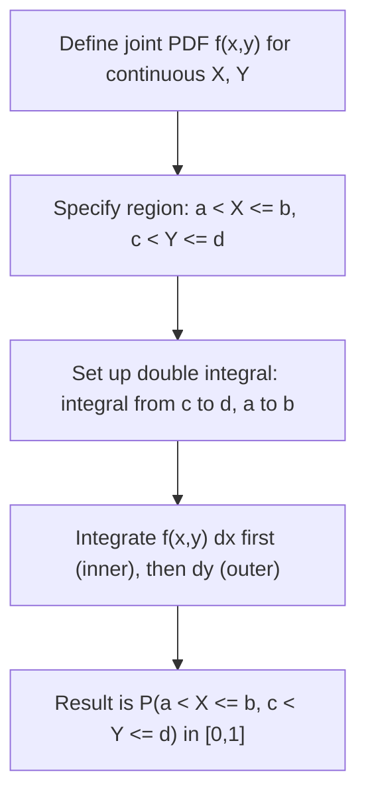

# Joint Probability (Continuous)

$$
P(a < X \le b, c < Y \le d) = \int_c^d \int_a^b f(x,y) \, dx \, dy
$$

## Deep Breakdown

What it tells me *(Situation Awareness)*:
For two continuous random variables, the joint probability density function (joint PDF) $f(x,y)$ describes the relative likelihood of every (x,y) outcome. You cannot ask for the probability of an exact point (it is zero); you ask for the probability of a rectangular region by integrating the joint PDF over that region. In DA/DS this is the foundation for multivariate Gaussian models, copulas, kernel density estimation of bivariate distributions, and 2D histogram analysis.

## Flowchart



## Real-world use

### Where it is used

You have two continuous measurements (session duration and page depth, or height and weight of customers) and want to find the probability they jointly fall in some range.

### Problem it solves

Individual CDFs only describe one variable at a time. The joint PDF and its integral describe the probability that both variables simultaneously fall within specified ranges, enabling region-based probability queries and density estimation.

### How it solves the problem

Integrating the joint PDF over a 2D rectangle computes the volume under the surface $f(x,y)$, which equals the probability of that rectangular region.

### Example in a business

A data scientist models the joint distribution of (session_duration, pages_visited) for e-commerce users. Using a bivariate Gaussian fit, they compute the probability that a user has both high session duration and high page depth — the core "high engagement" segment.

## The formula, piece by piece

| Symbol | Meaning |
|--------|---------|
| $f(x,y)$ | Joint probability density function |
| $\int_c^d \int_a^b$ | Double integral over the rectangle $[a,b] \times [c,d]$ |
| $dx\,dy$ | Integration over x first (inner), then y (outer) |
| Result | Probability the pair $(X,Y)$ falls in the specified rectangle |

Full formula: $P(a < X \le b, c < Y \le d) = \int_c^d \int_a^b f(x,y) \, dx \, dy$ Normalisation: $\int_{-\infty}^\infty \int_{-\infty}^\infty f(x,y) \, dx \, dy = 1$

## The formula in words

"The probability that X is between a and b AND Y is between c and d equals the double integral of the joint PDF over that rectangular region." This is the 2D analogue of a single integral for a 1D CDF.

## Critical Concepts

- **PDF vs probability**: $f(x,y) \ge 0$ but can exceed 1; probability comes from integrating over a region.
- **Order of integration**: for most standard joint PDFs, you can integrate in either order (Fubini's theorem).
- **Marginal PDFs**: obtained by integrating out the other variable over $(-\infty, \infty)$.
- **Bivariate normal**: the most common joint continuous distribution; defined by $\mu_X, \mu_Y, \sigma_X, \sigma_Y, \rho$.
- **Copulas**: separate marginal distributions from the dependency structure in joint modelling.

## Step-by-step calculation (tiny example)

Joint PDF: $f(x,y) = x + y$ for $0 \le x \le 1$, $0 \le y \le 1$ (verify: $\int_0^1 \int_0^1 (x+y)\,dx\,dy = 1$). Find $P(0 \le X \le 0.5, \, 0 \le Y \le 0.5)$.

*Step 1: Set up the double integral*
$\int_0^{0.5} \int_0^{0.5} (x+y) \, dx \, dy$

*Step 2: Integrate with respect to x (inner integral)*
$\int_0^{0.5} (x+y) \, dx = [x^2/2 + xy]_0^{0.5} = 1/8 + y/2$

*Step 3: Integrate with respect to y (outer integral)*
$\int_0^{0.5} (1/8 + y/2) \, dy = [y/8 + y^2/4]_0^{0.5} = 1/16 + 1/16 = 1/8 = 0.125$

## Code examples

### Beginner example (Python)

```python
from scipy import integrate

# Joint PDF: f(x,y) = x + y on [0,1] x [0,1]
def joint_pdf(x: float, y: float) -> float:
    return x + y


# P(0 <= X <= 0.5, 0 <= Y <= 0.5)
probability, error = integrate.dblquad(
    joint_pdf,
    0, 0.5,   # y limits (outer)
    0, 0.5,   # x limits (inner)
)
print(f"P(0<=X<=0.5, 0<=Y<=0.5) = {probability:.6f}")   # expected: 0.125
print(f"Integration error bound: {error:.2e}")
```

### Beginner example (R)

```r
library(cubature)

# Joint PDF: f(x,y) = x + y on [0,1] x [0,1]
joint_pdf <- function(xy) {
  x <- xy[1]; y <- xy[2]
  x + y
}
result <- hcubature(joint_pdf, lowerLimit = c(0, 0), upperLimit = c(0.5, 0.5))
cat("P(0<=X<=0.5, 0<=Y<=0.5) =", result$integral, "\n")  # expected: 0.125
```

### Professional example (Python)

```python
import numpy as np
from scipy import integrate
from scipy.stats import multivariate_normal


def bivariate_gaussian_region_probability(
    mean: list[float],
    cov: list[list[float]],
    x_bounds: tuple[float, float],
    y_bounds: tuple[float, float],
) -> float:
    # P(x_low < X <= x_high, y_low < Y <= y_high) for a bivariate Gaussian.
    dist = multivariate_normal(mean=mean, cov=cov)

    def integrand(x: float, y: float) -> float:
        return dist.pdf([x, y])

    probability, _ = integrate.dblquad(
        integrand,
        y_bounds[0], y_bounds[1],
        x_bounds[0], x_bounds[1],
        epsabs=1e-6, epsrel=1e-6,
    )
    return probability


def engagement_segment_probability(
    mean_duration: float,
    mean_pages: float,
    std_duration: float,
    std_pages: float,
    correlation: float,
    min_duration: float,
    min_pages: float,
) -> float:
    # P(session_duration > min_duration AND pages > min_pages).
    cov_matrix = [
        [std_duration ** 2, correlation * std_duration * std_pages],
        [correlation * std_duration * std_pages, std_pages ** 2],
    ]
    return bivariate_gaussian_region_probability(
        mean=[mean_duration, mean_pages],
        cov=cov_matrix,
        x_bounds=(min_duration, np.inf),
        y_bounds=(min_pages, np.inf),
    )


if __name__ == "__main__":
    prob = engagement_segment_probability(
        mean_duration=4.5,
        mean_pages=6.0,
        std_duration=1.5,
        std_pages=2.0,
        correlation=0.65,
        min_duration=6.0,
        min_pages=8.0,
    )
    print(f"P(session_duration > 6 min AND pages > 8): {prob:.4f}")
```

---

*Source: AIO p. 85`*
