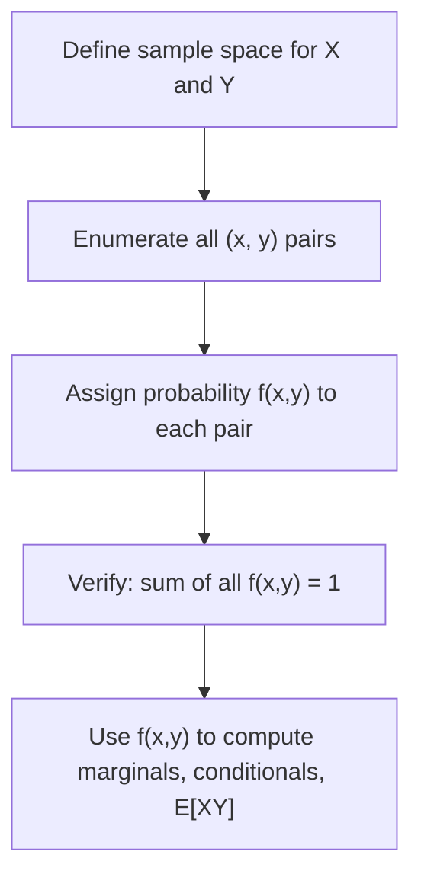

# Joint Probability (Discrete)

$$
P(X=x, Y=y) = f(x,y)
$$

## Deep Breakdown

What it tells me *(Situation Awareness)*:
The joint probability mass function (joint PMF) $f(x,y)$ assigns a probability to each possible combination of values that two discrete random variables X and Y can simultaneously take. It is the full description of the bivariate distribution: from it you can derive marginals, conditionals, covariance, and any other distributional property of the pair. In DA/DS it models two categorical or integer features jointly: click type and device, customer segment and product category, etc.

## Flowchart



## Real-world use

### Where it is used

You have two discrete variables and want to describe their full joint distribution: e.g., (device_type, purchase_flag) or (ad_format, conversion_outcome) in digital marketing.

### Problem it solves

Univariate distributions only describe each variable separately. The joint PMF captures the dependency structure between two variables simultaneously, enabling conditional analysis and covariance computation.

### How it solves the problem

It enumerates every (x, y) pair and assigns it a probability. All probabilities sum to 1. From the joint table you can read off any conditional probability, compute the marginal for either variable, and detect dependence.

### Example in a business

A DA builds a joint frequency table for (device: mobile/desktop) and (purchase: yes/no). The joint PMF reveals that mobile users have a lower joint probability of purchase even when they represent a large share of traffic, justifying a device-specific conversion optimisation strategy.

## The formula, piece by piece

| Symbol | Meaning |
|--------|---------|
| $P(X=x, Y=y)$ | Probability that X takes value x AND Y takes value y simultaneously |
| $f(x,y)$ | Joint probability mass function evaluated at (x,y) |
| $\sum_x \sum_y f(x,y) = 1$ | Normalisation condition |

Full formula: $P(X=x, Y=y) = f(x,y)$ where $\sum_x \sum_y f(x,y) = 1$

## The formula in words

"The joint PMF assigns a probability to every possible (x, y) pair. All these probabilities add up to one." Knowing $f(x,y)$ for all pairs completely describes the bivariate discrete distribution.

## Critical Concepts

- **Normalisation**: all probabilities must sum to 1 across all (x, y) pairs.
- **Non-negativity**: $f(x,y) \ge 0$ for all pairs.
- **Marginal recovery**: summing over all y values gives the marginal PMF of X.
- **Conditional probability**: $P(X=x | Y=y) = f(x,y) / f_Y(y)$.
- **Independence check**: if $f(x,y) = f_X(x) \cdot f_Y(y)$ for all pairs, X and Y are independent.

## Step-by-step calculation (tiny example)

Two fair coins, $X$ = heads on coin 1, $Y$ = heads on coin 2.

*Step 1: Enumerate all (x, y) pairs*
$(0,0),(0,1),(1,0),(1,1)$ — each corresponds to (tails-tails, tails-heads, heads-tails, heads-heads).

*Step 2: Assign probabilities*
Each pair has probability $1/4 = 0.25$.

*Step 3: Verify normalisation*
$0.25 + 0.25 + 0.25 + 0.25 = 1.0$ ✓

*Step 4: Read a joint probability*
$P(X=1, Y=0) = f(1,0) = 0.25$ — probability of heads on coin 1 and tails on coin 2.

## Code examples

### Beginner example (Python)

```python
import numpy as np

# Joint PMF for (Device, Purchase) as a 2D table
# Rows: device = [mobile, desktop]
# Cols: purchase = [no, yes]
joint_pmf = np.array([
    [0.40, 0.10],  # mobile: 40% no-purchase, 10% purchase
    [0.25, 0.25],  # desktop: 25% no-purchase, 25% purchase
])
devices = ["mobile", "desktop"]
purchases = ["no", "yes"]
print("Joint PMF table:")
print(f"{'':8s} {'no':>6} {'yes':>6}")
for i, device in enumerate(devices):
    row = " ".join(f"{joint_pmf[i, j]:>6.2f}" for j in range(len(purchases)))
    print(f"{device:8s} {row}")
print(f"\nSum of all probabilities: {joint_pmf.sum():.2f}")
print(f"P(mobile, purchase=yes) = {joint_pmf[0, 1]:.2f}")
```

### Beginner example (R)

```r
# Joint PMF as a matrix
joint_pmf <- matrix(c(0.40, 0.10, 0.25, 0.25), nrow = 2, byrow = TRUE, dimnames = list(device = c("mobile", "desktop"), purchase = c("no", "yes")))
print("Joint PMF table:")
print(joint_pmf)
cat("Sum of all probabilities:", sum(joint_pmf), "\n")
cat("P(mobile, purchase=yes):", joint_pmf["mobile", "yes"], "\n")
```

### Professional example (Python)

```python
import numpy as np
import pandas as pd


class DiscreteJointDistribution:
    # Discrete bivariate joint PMF with marginal and conditional extraction.

    def __init__(
        self,
        pmf: np.ndarray,
        row_labels: list[str],
        col_labels: list[str],
        row_name: str = "X",
        col_name: str = "Y",
    ) -> None:
        assert np.isclose(pmf.sum(), 1.0), f"PMF must sum to 1, got {pmf.sum():.6f}"
        assert (pmf >= 0).all(), "PMF must be non-negative."
        self._pmf = pmf
        self._row_labels = row_labels
        self._col_labels = col_labels
        self.row_name = row_name
        self.col_name = col_name

    def marginal_row(self) -> pd.Series:
        return pd.Series(self._pmf.sum(axis=1), index=self._row_labels, name=self.row_name)

    def marginal_col(self) -> pd.Series:
        return pd.Series(self._pmf.sum(axis=0), index=self._col_labels, name=self.col_name)

    def conditional_col_given_row(self, row_label: str) -> pd.Series:
        row_idx = self._row_labels.index(row_label)
        marginal_val = self._pmf[row_idx, :].sum()
        cond = self._pmf[row_idx, :] / marginal_val
        return pd.Series(cond, index=self._col_labels, name=f"P({self.col_name}|{self.row_name}={row_label})")

    def as_dataframe(self) -> pd.DataFrame:
        return pd.DataFrame(self._pmf, index=self._row_labels, columns=self._col_labels)


if __name__ == "__main__":
    pmf_data = np.array([[0.40, 0.10], [0.25, 0.25]])
    dist = DiscreteJointDistribution(
        pmf=pmf_data,
        row_labels=["mobile", "desktop"],
        col_labels=["no_purchase", "purchase"],
        row_name="device",
        col_name="purchase",
    )
    print("Joint PMF:")
    print(dist.as_dataframe())
    print("\nMarginal P(device): ")
    print(dist.marginal_row().round(3))
    print("\nMarginal P(purchase):")
    print(dist.marginal_col().round(3))
    print("\nP(purchase | mobile):")
    print(dist.conditional_col_given_row("mobile").round(4))
```

---

*Source: domain knowledge*
