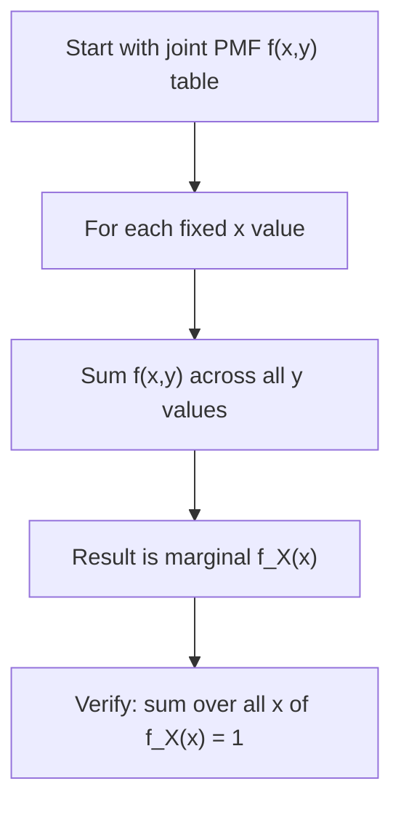

# Marginal Distribution (Discrete)

$$
f_X(x) = \sum_{y} f(x,y)
$$

## Deep Breakdown

What it tells me *(Situation Awareness)*:
The marginal PMF $f_X(x)$ is the distribution of X alone, obtained by summing the joint PMF over all possible values of Y. It "marginalises out" Y. In practice, computing a marginal from a joint table is the same as collapsing a pivot table to a row total. In DA/DS it appears whenever you have a joint frequency table or a joint model and you want the individual distribution of one variable, ignoring the other.

## Flowchart



## Real-world use

### Where it is used

You have a joint distribution over two categorical variables (e.g., device type × purchase) and want the standalone distribution of one of them (e.g., just device type frequencies).

### Problem it solves

When you only care about the distribution of one variable and want to ignore the other, you need to collapse the joint table. The marginal PMF does exactly this.

### How it solves the problem

For each value $x$, you sum the joint probabilities across all $y$. This recovers the probability that $X = x$ regardless of what Y is doing.

### Example in a business

A DA has a joint distribution of (customer segment, product category). The marginal over segments gives the overall segment distribution, useful for budget allocation. The marginal over categories gives the overall product category mix.

## The formula, piece by piece

| Symbol | Meaning |
|--------|---------|
| $f_X(x)$ | Marginal PMF of X at value x |
| $\sum_{y}$ | Sum over all possible values of Y |
| $f(x,y)$ | Joint PMF |

Full formula: $f_X(x) = \sum_{y} f(x,y)$

## The formula in words

"The probability that X equals x (ignoring Y) equals the sum of joint probabilities across all possible Y values, with X fixed at x." You are collapsing one dimension of the joint table.

## Critical Concepts

- **Row/column sums**: in a joint PMF table, the marginal of X is the row sum and the marginal of Y is the column sum.
- **Marginals do not determine the joint**: two different joint distributions can have the same marginals (dependence structure is lost).
- **Normalisation check**: $\sum_x f_X(x) = 1$ always.
- **From marginals to conditionals**: $f_{Y|X}(y|x) = f(x,y) / f_X(x)$ — requires the joint, not just the marginals.

## Step-by-step calculation (tiny example)

Joint PMF for (X = device: 0=mobile, 1=desktop) × (Y = purchase: 0=no, 1=yes):

| | Y=0 | Y=1 |
|---|---|---|
| X=0 | 0.40 | 0.10 |
| X=1 | 0.25 | 0.25 |

*Step 1: Marginal for X=0 (mobile)*
$f_X(0) = f(0,0) + f(0,1) = 0.40 + 0.10 = 0.50$

*Step 2: Marginal for X=1 (desktop)*
$f_X(1) = f(1,0) + f(1,1) = 0.25 + 0.25 = 0.50$

*Step 3: Verify*
$f_X(0) + f_X(1) = 0.50 + 0.50 = 1.0$ ✓

## Code examples

### Beginner example (Python)

```python
import numpy as np

# Joint PMF: rows = device (mobile, desktop), cols = purchase (no, yes)
joint_pmf = np.array([
    [0.40, 0.10],
    [0.25, 0.25],
])

# Marginal of X (device) = row sums
marginal_x = joint_pmf.sum(axis=1)
# Marginal of Y (purchase) = column sums
marginal_y = joint_pmf.sum(axis=0)
device_labels = ["mobile", "desktop"]
purchase_labels = ["no", "yes"]
print("Marginal P(device):")
for label, prob in zip(device_labels, marginal_x):
    print(f" {label}: {prob:.2f}")
print("Marginal P(purchase):")
for label, prob in zip(purchase_labels, marginal_y):
    print(f" {label}: {prob:.2f}")
```

### Beginner example (R)

```r
joint_pmf <- matrix(c(0.40, 0.10, 0.25, 0.25), nrow = 2, byrow = TRUE,
                    dimnames = list(device = c("mobile", "desktop"), purchase = c("no", "yes")))

# Marginal of rows (device)
marginal_device <- rowSums(joint_pmf)
# Marginal of columns (purchase)
marginal_purchase <- colSums(joint_pmf)
cat("Marginal P(device):\n"); print(marginal_device)
cat("Marginal P(purchase):\n"); print(marginal_purchase)
```

### Professional example (Python)

```python
import numpy as np
import pandas as pd


def compute_joint_and_marginals(
    df: pd.DataFrame, col_x: str, col_y: str
) -> dict[str, pd.Series | pd.DataFrame]:
    # Compute empirical joint PMF and marginals from categorical data.
    # Returns joint, marginal_x, marginal_y as normalised Series/DataFrames.
    n = len(df)
    joint_counts = pd.crosstab(df[col_x], df[col_y])
    joint_pmf = joint_counts / n
    marginal_x = joint_pmf.sum(axis=1).rename(col_x)
    marginal_y = joint_pmf.sum(axis=0).rename(col_y)
    assert np.isclose(marginal_x.sum(), 1.0), "Marginal X must sum to 1"
    assert np.isclose(marginal_y.sum(), 1.0), "Marginal Y must sum to 1"
    return {"joint": joint_pmf, "marginal_x": marginal_x, "marginal_y": marginal_y}


if __name__ == "__main__":
    rng = np.random.default_rng(seed=42)
    n_users = 10_000
    user_df = pd.DataFrame({
        "device": rng.choice(["mobile", "desktop"], p=[0.60, 0.40], size=n_users),
        "purchase": rng.choice(["no", "yes"], p=[0.70, 0.30], size=n_users),
    })

    # Induce some dependence: desktop users purchase more
    mask_desktop_purchase = (user_df["device"] == "desktop") & (rng.random(n_users) < 0.15)
    user_df.loc[mask_desktop_purchase, "purchase"] = "yes"
    results = compute_joint_and_marginals(user_df, col_x="device", col_y="purchase")
    print("Joint PMF:\n", results["joint"].round(4))
    print("\nMarginal device:\n", results["marginal_x"].round(4))
    print("\nMarginal purchase:\n", results["marginal_y"].round(4))
```

---

*Source: domain knowledge*
