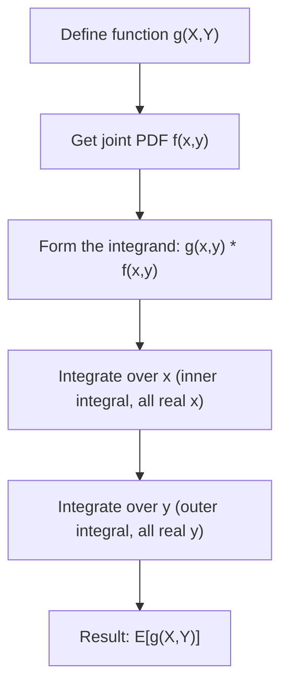

# Joint Expected Value (Continuous)

$$
E[g(X,Y)] = \int_{-\infty}^\infty \int_{-\infty}^\infty g(x,y) \, f(x,y) \, dx \, dy
$$

## Deep Breakdown

What it tells me *(Situation Awareness)*:
The continuous bivariate LOTUS: to compute the expected value of any function $g(X,Y)$ of two continuous random variables, you weight $g(x,y)$ by the joint PDF $f(x,y)$ and integrate over the entire $(x,y)$ plane. Key special cases: $g(x,y) = xy$ gives $E[XY]$ for covariance; $g(x,y) = (x-\mu_X)(y-\mu_Y)$ gives the covariance directly; $g(x,y) = x^2 + y^2$ gives the second moment of the Euclidean distance from the origin. Used in multivariate Gaussian analysis, copula modelling, and computing moments of complex feature interactions.

## Flowchart



## Real-world use

### Where it is used

Computing moments of bivariate continuous distributions: $E[XY]$ for covariance in a bivariate Gaussian model, $E[\max(X,Y)]$ for order statistics in reliability analysis, $E[X/Y]$ in ratio models for media ROI.

### Problem it solves

Just as univariate LOTUS computes $E[g(X)]$ without deriving the distribution of $g(X)$ first, the bivariate version computes $E[g(X,Y)]$ directly from the joint PDF — no change-of-variables needed.

### How it solves the problem

The double integral sweeps over the entire joint density surface, weighting $g(x,y)$ at each point by how much probability mass $f(x,y)$ places there.

### Example in a business

A risk analyst models (daily revenue X, daily cost Y) as a bivariate Gaussian. They compute $E[\max(0, X - Y)]$ — the expected daily profit — via numerical double integration of $\max(0, x-y) \cdot f(x,y)$ over the full plane. This is more direct than deriving the distribution of the profit variable first.

## The formula, piece by piece

| Symbol | Meaning |
|--------|---------|
| $E[g(X,Y)]$ | Expected value of g applied to the pair (X,Y) |
| $g(x,y)$ | Function of the two variables |
| $f(x,y)$ | Joint PDF |
| $\int_{-\infty}^\infty \int_{-\infty}^\infty$ | Double integral over all real (x,y) |
| $dx\,dy$ | Integration variables |

Full formula: $E[g(X,Y)] = \int_{-\infty}^\infty \int_{-\infty}^\infty g(x,y) \, f(x,y) \, dx \, dy$

## The formula in words

"The expected value of g(X,Y) equals the weighted integral of g(x,y) over all possible (x,y) pairs, where the weight is the joint probability density at each point." This is the continuous generalisation of the weighted average in the discrete case.

## Critical Concepts

- **Bivariate LOTUS**: you do not need to find the distribution of $g(X,Y)$ first — you can compute its expectation directly.
- **Fubini's theorem**: order of integration can be reversed for well-behaved $f$ and $g$.
- **Independence simplification**: if independent, $E[g(X) h(Y)] = E[g(X)] \cdot E[h(Y)]$.
- **Numerical computation**: for complex $g$ or non-standard $f$, use `scipy.integrate.dblquad` or Monte Carlo integration.

## Step-by-step calculation (tiny example)

Joint PDF: $f(x,y) = x + y$ on $[0,1] \times [0,1]$. Compute $E[XY]$.

*Step 1: Set up the double integral*
$E[XY] = \int_0^1 \int_0^1 xy(x+y) \, dx \, dy$

*Step 2: Expand the integrand*
$xy(x+y) = x^2 y + xy^2$

*Step 3: Integrate over x (inner)*
$\int_0^1 (x^2 y + xy^2) \, dx = [x^3 y/3 + x^2 y^2/2]_0^1 = y/3 + y^2/2$

*Step 4: Integrate over y (outer)*
$\int_0^1 (y/3 + y^2/2) \, dy = [y^2/6 + y^3/6]_0^1 = 1/6 + 1/6 = 1/3 \approx 0.333$

## Code examples

### Beginner example (Python)

```python
from scipy import integrate   # Joint PDF: f(x,y) = x + y on [0,1] x [0,1]

def integrand(x: float, y: float) -> float:
    return x * y * (x + y)   # E[XY]
result, error = integrate.dblquad( integrand, 0, 1,   # y outer limits
    0, 1,   # x inner limits
)
print(f"E[XY] = {result:.6f}")   # expected: 1/3 ≈ 0.3333
print(f"Integration error: {error:.2e}")   # Verify: E[X] and E[Y] via marginal approach

def e_x_integrand(x: float, y: float) -> float:
    return x * (x + y)
e_x, _ = integrate.dblquad(e_x_integrand, 0, 1, 0, 1)
print(f"E[X] = {e_x:.6f}")   # expected: 7/12 ≈ 0.5833
```

### Beginner example (R)

```r
library(cubature)  # E[XY] for joint PDF f(x,y) = x + y on [0,1]^2
integrand_exy <- function(xy) { x <- xy[1]; y <- xy[2] x * y * (x + y)
}
result <- hcubature(integrand_exy, lowerLimit = c(0, 0), upperLimit = c(1, 1))
cat("E[XY] =", result$integral, "\n")  # expected: 1/3
```

### Professional example (Python)

```python
from __future__ import annotations
import numpy as np
from scipy import integrate
from scipy.stats import multivariate_normal

def expected_profit_bivariate_gaussian( mean_revenue: float, mean_cost: float, std_revenue: float, std_cost: float, correlation: float, integration_range: float = 5.0,
) -> float:
    # E[max(0, X - Y)] where (X,Y) ~ BivariateNormal.
    # Represents expected daily profit when revenue and cost are jointly normal.
    mean = [mean_revenue, mean_cost]
    sigma = std_revenue * std_cost
    cov = [[std_revenue**2, correlation * sigma], [correlation * sigma, std_cost**2]]
    dist = multivariate_normal(mean=mean, cov=cov)

def integrand(x: float, y: float) -> float:
    profit = max(0.0, x - y)
    return profit * dist.pdf([x, y])
lower_x = mean_revenue - integration_range * std_revenue
upper_x = mean_revenue + integration_range * std_revenue
lower_y = mean_cost - integration_range * std_cost
upper_y = mean_cost + integration_range * std_cost
e_profit, error = integrate.dblquad( integrand, lower_y, upper_y, lower_x, upper_x, epsabs=1e-4, epsrel=1e-4 )
return float(e_profit)

if __name__ == "__main__":
    e_profit = expected_profit_bivariate_gaussian( mean_revenue=1200.0, mean_cost=1000.0, std_revenue=200.0, std_cost=150.0, correlation=0.5, )
    print(f"Expected daily profit E[max(0, Revenue - Cost)] = {e_profit:.2f}")
```

---

*Source: domain knowledge*
