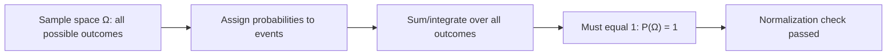

# Probability Measure Constraint

$$
P(\Omega) = 1
$$

## Deep Breakdown

What it tells me *(Situation Awareness)*:
This is Kolmogorov's first axiom of probability. The total probability of the entire sample space $\Omega$ (all possible outcomes) is exactly 1. Every valid probability distribution must satisfy this normalization constraint. It is the reason probability is "closed" — something must happen.

## Flowchart



## Real-world use

### Where it is used

Validating that a probability distribution is properly normalized: softmax outputs in classification, predicted class probabilities in a model, or probability density functions that integrate to 1.

### Problem it solves

Ensures that a function claiming to be a probability distribution is actually a valid one — it cannot assign more or less than 100% total probability.

### How it solves the problem

Acts as the normalization axiom: any function $P$ must be normalized so all probabilities sum/integrate to exactly 1 over the complete event space.

### Example in a business

After fitting a softmax classifier, the predicted class probabilities for each sample must sum to 1. This is verified as a sanity check in model evaluation. If `np.sum(probs) != 1.0`, the model output has a numerical error.

## The formula, piece by piece

$P(\Omega) = 1$
- $P$: the probability measure.
- $\Omega$: the sample space (universe of all possible outcomes).
- $1$: the total probability, representing certainty.

## The formula in words

"The probability of something happening (any outcome in the sample space) is exactly 1, i.e., 100%."

## Critical Concepts

- This is an axiom, not derived — it's assumed.
- For discrete distributions: $\sum_x P(X=x) = 1$.
- For continuous distributions: $\int_{-\infty}^{\infty} f(x) dx = 1$.
- Violation means your "distribution" is not a valid probability measure.
- In ML: softmax enforces this; sigmoid for binary classification also respects it via $P(y=1) + P(y=0) = 1$.

## Step-by-step calculation (tiny example)

*Step 1: Define sample space*
Coin flip: $\Omega = \{H, T\}$.

*Step 2: Assign probabilities*
$P(H) = 0.5$, $P(T) = 0.5$.

*Step 3: Verify axiom*
$P(\Omega) = P(H) + P(T) = 0.5 + 0.5 = 1$. Valid.

## Code examples

### Beginner example (Python)

```python
import numpy as np   # Verify softmax outputs satisfy P(Ω) = 1
logits = np.array([2.0, 1.0, 0.1])
probs = np.exp(logits) / np.sum(np.exp(logits))
print(f"Probabilities: {probs}")
print(f"Sum: {probs.sum():.10f}")   # Should be 1.0
```

### Beginner example (R)

```r
logits <- c(2.0, 1.0, 0.1)
probs <- exp(logits) / sum(exp(logits))
cat("Probabilities:", round(probs, 4), "\n")
cat("Sum:", sum(probs), "\n")  # 1
```

### Professional example (Python)

```python
import numpy as np
from scipy.special import softmax

def validate_probability_distribution( probs: np.ndarray, tolerance: float = 1e-6, name: str = "distribution" ) -> bool:
    """Validate that an array represents a valid probability distribution. Checks: all values non-negative, sum equals 1. Args: probs: Array of probability values. tolerance: Numeric tolerance for sum check. name: Name for error messages. Returns: True if valid, raises ValueError otherwise. """
    if np.any(probs < 0):
        raise ValueError(f"{name}: negative probabilities found: {probs[probs < 0]}")
    total = np.sum(probs)
    if abs(total - 1.0) > tolerance:
        raise ValueError(f"{name}: P(Omega) = {total:.8f} != 1.0 (tolerance={tolerance})")
    return True   # Test on classifier output
BATCH_SIZE = 5
N_CLASSES = 3
raw_logits = np.random.randn(BATCH_SIZE, N_CLASSES)
class_probs = softmax(raw_logits, axis=1)
for idx in range(BATCH_SIZE):
    validate_probability_distribution(class_probs[idx], name=f"sample_{idx}")
print(f"Sample {idx}: {class_probs[idx].round(4)} | sum={class_probs[idx].sum():.8f} OK")
```

---

*Source: MML2 p. 410*
