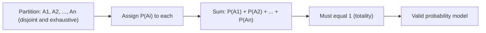

# Totality Sum Rule

$$
\sum_{i} P(A_i) = 1
$$

## Deep Breakdown

What it tells me *(Situation Awareness)*:
When events $A_1, A_2, \ldots, A_n$ form a partition of the sample space (mutually exclusive and exhaustive), their probabilities must sum to exactly 1. This is the discrete analog of $P(\Omega) = 1$. It appears in every probability model: class probabilities in classification, category distributions in Bayesian priors, multinomial distributions.

## Flowchart



## Real-world use

### Where it is used

Checking that a multiclass classifier's output probabilities sum to 1, verifying a Bayesian prior is proper, ensuring a PMF over discrete outcomes integrates to 1, or constructing valid probability tables.

### Problem it solves

Enforces that any probability model is correctly normalized across all exhaustive, mutually exclusive outcomes.

### How it solves the problem

By Kolmogorov's axioms: if $A_i$ are mutually exclusive and their union is $\Omega$, then $P(\Omega) = \sum P(A_i) = 1$.

### Example in a business

4-class product categorization model: predicted probabilities [0.65, 0.20, 0.10, 0.05] must sum to 1. Post-deployment monitoring should check this numerically to catch floating-point drift in model inference.

## The formula, piece by piece

$\sum_i P(A_i) = 1$
- $A_i$: events forming a partition (mutually exclusive, collectively exhaustive).
- $P(A_i)$: probability of each event.
- $\sum_i$: sum over all events in the partition.

## The formula in words

"The probabilities of all mutually exclusive, exhaustive events sum to exactly one."

## Critical Concepts

- Requires events to be both mutually exclusive (no overlap) AND exhaustive (no gaps).
- Discrete distribution check: `np.sum(pmf_values) == 1.0` (within tolerance).
- Continuous: $\int f(x) dx = 1$.
- Softmax enforces this by construction: `exp(logits) / sum(exp(logits))`.

## Step-by-step calculation (tiny example)

*Step 1: Define partition*
Customer segment membership: Low-value (L), Mid-value (M), High-value (H).

*Step 2: Assign*
$P(L) = 0.55$, $P(M) = 0.30$, $P(H) = 0.15$.

*Step 3: Verify*
$0.55 + 0.30 + 0.15 = 1.00$. Valid.

## Code examples

### Beginner example (Python)

```python
import numpy as np   # Check that a discrete distribution is valid
pmf = np.array([0.1, 0.3, 0.4, 0.2])   # 4-class probabilities
total = np.sum(pmf)
print(f"Sum: {total}")   # 1.0
print(f"Valid: {np.isclose(total, 1.0)}")   # True
```

### Beginner example (R)

```r
pmf <- c(0.1, 0.3, 0.4, 0.2)
cat("Sum:", sum(pmf), "\n")  # 1
cat("Valid:", isTRUE(all.equal(sum(pmf), 1.0)), "\n")  # TRUE
```

### Professional example (Python)

```python
import numpy as np
from typing import Optional

def assert_valid_distribution( probs: np.ndarray, tolerance: float = 1e-6, distribution_name: Optional[str] = None ) -> None:
    """Assert that probability array forms a valid distribution. Checks non-negativity and normalization (sum = 1). Args: probs: 1-D array of probabilities summing to 1. tolerance: Acceptable deviation from sum=1. distribution_name: Name for error reporting. Raises: AssertionError: If checks fail. """
    name = distribution_name or "distribution"
    assert np.all(probs >= 0), f"{name}: negative probabilities {probs[probs < 0]}"
    assert abs(probs.sum() - 1.0) < tolerance, f"{name}: sum={probs.sum():.8f} != 1.0"   # Monitor model output validity in production
SAMPLES = np.array([ [0.7, 0.2, 0.1], [0.5, 0.3, 0.2], [0.9, 0.05, 0.05],
])
for sample_idx, sample_probs in enumerate(SAMPLES):
    assert_valid_distribution(sample_probs, distribution_name=f"sample_{sample_idx}")
print(f"Sample {sample_idx}: {sample_probs} | sum={sample_probs.sum():.6f} PASS")
```

---

*Source: AIO p. 84*
