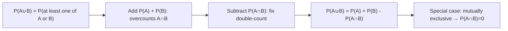

# Union (General)

$$
P(A \cup B) = P(A) + P(B) - P(A \cap B)
$$

## Deep Breakdown

What it tells me *(Situation Awareness)*:
The inclusion-exclusion principle for two events. When computing the probability that at least one of $A$ or $B$ occurs, simply adding $P(A) + P(B)$ overcounts the region where both occur. Subtracting $P(A \cap B)$ corrects this. Used in any scenario involving "at least one of these two things happens."

## Flowchart



## Real-world use

### Where it is used

Fraud detection: $P(\text{flag by rule 1 OR rule 2})$. A/B test multi-arm scenarios. Email deliverability: $P(\text{spam} \cup \text{promotion folder})$. Any Boolean OR of probabilistic events.

### Problem it solves

Computes the probability that at least one of two overlapping events occurs, avoiding double-counting their intersection.

### How it solves the problem

Venn diagram logic: $A \cup B$ = region covered by $A$ plus region covered by $B$ minus the overlapping region counted twice.

### Example in a business

Two fraud detection rules each have 10% false positive rates and share 3% of flagged cases. Combined false positive rate: $P(\text{flag 1} \cup \text{flag 2}) = 0.10 + 0.10 - 0.03 = 0.17$.

## The formula, piece by piece

$P(A \cup B) = P(A) + P(B) - P(A \cap B)$
- $P(A \cup B)$: probability that A OR B (or both) occur.
- $P(A) + P(B)$: sum of individual probabilities.
- $-P(A \cap B)$: remove the double-counted intersection.

## The formula in words

"The probability of $A$ OR $B$ equals the probability of $A$ plus the probability of $B$ minus the probability of both $A$ and $B$ occurring together."

## Critical Concepts

- If $A$ and $B$ are mutually exclusive: $P(A \cap B) = 0$, so $P(A \cup B) = P(A) + P(B)$.
- Extends to $n$ events via inclusion-exclusion: alternating sum of intersections.
- Upper bound (union bound): $P(A \cup B) \leq P(A) + P(B)$.
- Python: compute each term separately, then combine.

## Step-by-step calculation (tiny example)

*Step 1: Define events*
$P(A) = 0.4$, $P(B) = 0.3$, $P(A \cap B) = 0.1$.

*Step 2: Apply formula*
$P(A \cup B) = 0.4 + 0.3 - 0.1 = 0.6$

*Step 3: Sanity check*
$P(A \cup B) < P(A) + P(B)$ because events overlap: correct.

## Code examples

### Beginner example (Python)

```python
# Combined fraud detection rate
p_rule1 = 0.10
p_rule2 = 0.10
p_both = 0.03   # Both rules trigger on same transaction
p_flagged = p_rule1 + p_rule2 - p_both
print(f"P(flagged by either rule) = {p_flagged:.2f}")   # 0.17
```

### Beginner example (R)

```r
p_rule1 <- 0.10; p_rule2 <- 0.10; p_both <- 0.03
p_flagged <- p_rule1 + p_rule2 - p_both
cat("P(flagged by either rule) =", p_flagged, "\n")  # 0.17
```

### Professional example (Python)

```python
import numpy as np

def union_probability(p_a: float, p_b: float, p_a_and_b: float) -> float:
    """Compute P(A∪B) via inclusion-exclusion. Args: p_a: P(A), probability of event A. p_b: P(B), probability of event B. p_a_and_b: P(A∩B), probability of both events. Returns: P(A∪B). Raises: ValueError: If inputs are invalid probabilities. """
    for val, name in [(p_a, "P(A)"), (p_b, "P(B)"), (p_a_and_b, "P(A∩B)")]:
        if not 0 <= val <= 1:
            raise ValueError(f"{name}={val} is not a valid probability")
        return p_a + p_b - p_a_and_b   # Multi-rule alert system analysis
detection_scenarios = [ ("Rule A + Rule B", 0.15, 0.12, 0.04), ("Model + Rule", 0.30, 0.20, 0.08), ("Independent", 0.10, 0.08, 0.10 * 0.08),
]
print(f"{'Scenario':<22} {'P(A)':>6} {'P(B)':>6} {'P(A∩B)':>8} {'P(A∪B)':>8}")
for scenario_name, p_a, p_b, p_ab in detection_scenarios:
    p_union = union_probability(p_a, p_b, p_ab)
print(f"{scenario_name:<22} {p_a:>6.3f} {p_b:>6.3f} {p_ab:>8.4f} {p_union:>8.4f}")
```

---

*Source: AIO p. 84*
