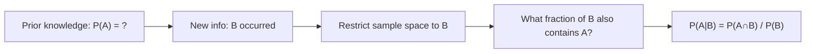

# Conditional Probability

$$
P(A \mid B) = \frac{P(A \cap B)}{P(B)}
$$

(assuming $P(B) > 0$)

## Deep Breakdown

What it tells me *(Situation Awareness)*:
Conditional probability measures how the probability of event $A$ changes given that we know $B$ has occurred. It "updates" our probability estimate based on new information. This is the cornerstone of Bayesian inference, Naive Bayes classifiers, causal reasoning, and any sequential decision-making model.

## Flowchart



## Real-world use

### Where it is used

Spam filtering: $P(\text{spam} \mid \text{contains 'free'})$. Medical: $P(\text{disease} \mid \text{positive test})$. Recommender: $P(\text{buys Y} \mid \text{bought X})$. Churn: $P(\text{churn} \mid \text{usage < 5 min/day})$.

### Problem it solves

How should I update my belief about $A$ after observing $B$?

### How it solves the problem

Restricts the sample space to $B$ (normalizes by $P(B)$) and computes what proportion of that restricted space is covered by $A$.

### Example in a business

CTR prediction: $P(\text{click} \mid \text{user is mobile, category=tech}) = P(\text{click, mobile, tech}) / P(\text{mobile, tech})$. Used in targeting model evaluation.

## The formula, piece by piece

$P(A \mid B) = \frac{P(A \cap B)}{P(B)}$
- $P(A \mid B)$: probability of $A$ given that $B$ has occurred.
- $P(A \cap B)$: joint probability of both $A$ and $B$.
- $P(B)$: probability of the conditioning event (must be $> 0$).

## The formula in words

"The probability of $A$ given $B$ equals the probability that both occur, divided by the probability of $B$."

## Critical Concepts

- $P(A \mid B) \neq P(B \mid A)$ in general — this confusion is the **base rate fallacy**.
- If $A$ and $B$ are independent: $P(A \mid B) = P(A)$.
- Conditional probability is itself a valid probability measure.
- Derived from the chain rule: $P(A \cap B) = P(A \mid B) P(B)$.

## Step-by-step calculation (tiny example)

*Step 1: Joint probability table*
In 1000 users: 200 clicked AND were mobile (joint), 400 were mobile total.

*Step 2: Compute conditional*
$P(\text{click} \mid \text{mobile}) = 200/1000 \div 400/1000 = 0.20/0.40 = 0.50$

*Step 3: Interpret*
50% of mobile users click — higher than the overall rate.

## Code examples

### Beginner example (Python)

```python
# P(click | mobile) from joint frequencies
joint_click_mobile = 200 / 1000   # P(click ∩ mobile)
p_mobile = 400 / 1000   # P(mobile)
p_click_given_mobile = joint_click_mobile / p_mobile
print(f"P(click | mobile) = {p_click_given_mobile:.2f}")   # 0.50
```

### Beginner example (R)

```r
joint_click_mobile <- 200 / 1000
p_mobile <- 400 / 1000
p_click_given_mobile <- joint_click_mobile / p_mobile
cat("P(click | mobile) =", p_click_given_mobile, "\n")  # 0.5
```

### Professional example (Python)

```python
import numpy as np
import pandas as pd

def conditional_probability( joint_prob: float, conditioning_prob: float ) -> float:
    """Compute P(A|B) = P(A∩B) / P(B). Args: joint_prob: P(A∩B). conditioning_prob: P(B). Must be > 0. Returns: P(A|B). """
    if conditioning_prob <= 0:
        raise ValueError(f"P(B)={conditioning_prob} must be > 0")
    return joint_prob / conditioning_prob   # Segment CTR analysis via conditional probability
rng = np.random.default_rng(seed=42)
N_USERS = 10_000
is_mobile = rng.binomial(1, 0.45, N_USERS).astype(bool)
ctr_mobile = 0.08
ctr_desktop = 0.04
clicked = np.where( is_mobile, rng.binomial(1, ctr_mobile, N_USERS), rng.binomial(1, ctr_desktop, N_USERS) ).astype(bool)   # Compute conditional probabilities
for segment_name, segment_mask in [("mobile", is_mobile), ("desktop", ~is_mobile)]:
    p_segment = segment_mask.mean()
p_click_and_segment = (clicked & segment_mask).mean()
p_click_given_segment = conditional_probability(p_click_and_segment, p_segment)
print(f"P(click | {segment_name}): {p_click_given_segment:.4f} | n={segment_mask.sum()}")
```

---

*Source: AIO p. 84*
