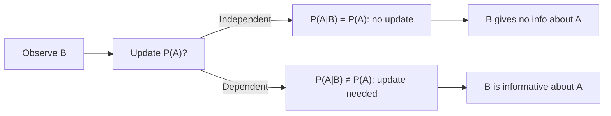

# Independent Events (Conditional)

$$
P(A \mid B) = P(A)
$$

## Deep Breakdown

What it tells me *(Situation Awareness)*:
When $A$ and $B$ are independent, knowing $B$ occurred does NOT change your estimate of $P(A)$. This is the conditional form of the independence definition. It means $B$ provides zero information about $A$. Used to validate feature redundancy, check confounding in causal models, and define the Naive Bayes conditional independence assumption.

## Flowchart



## Real-world use

### Where it is used

Feature selection: if knowing feature $X_2$ doesn't change the distribution of $X_1$, they carry redundant information. Causal inference: checking if treatment assignment is independent of pre-treatment covariates. Naive Bayes assumption validation.

### Problem it solves

Identifies when observing one variable provides no predictive signal about another — enabling model simplification or flagging potential confounders.

### How it solves the problem

By definition: $A \perp B$ iff $P(A \mid B) = P(A)$. Equivalently, $P(A \cap B) = P(A) P(B)$.

### Example in a business

A/B test validity: $P(\text{purchase} \mid \text{treatment group})$ should equal $P(\text{purchase} \mid \text{control group})$ only if treatment has no effect. We test this hypothesis; if $P$ changes, the treatment has a causal effect.

## The formula, piece by piece

$P(A \mid B) = P(A)$
- Left side: probability of $A$ after conditioning on $B$.
- Right side: marginal probability of $A$.
- Equality indicates independence: $B$ carries no information about $A$.

## The formula in words

"If A and B are independent, learning that B occurred does not change our probability estimate for A."

## Critical Concepts

- Contrast: dependent events have $P(A \mid B) \neq P(A)$ — conditioning shifts probability.
- $P(A \mid B) = P(A) \iff P(B \mid A) = P(B)$ (symmetric).
- Conditional independence: $P(A \mid B, C) = P(A \mid C)$ — given $C$, $B$ adds no info.
- In ML: feature importance partly tests whether $P(y \mid X_j)$ differs from $P(y)$.

## Step-by-step calculation (tiny example)

*Step 1: Are shoe size and salary independent?*
$P(\text{salary} > 50k \mid \text{shoe size}) \approx P(\text{salary} > 50k)$ — shoe size is uninformative about salary.

*Step 2: Are height and salary correlated (dependent)?*
$P(\text{salary} > 50k \mid \text{height} > 180cm) \neq P(\text{salary} > 50k)$ — height correlates with salary via gender confounding.

*Step 3: Implication*
Height and salary are NOT independent — conditioning changes the probability.

## Code examples

### Beginner example (Python)

```python
import numpy as np   # Check if P(A|B) ≈ P(A) for two features
rng = np.random.default_rng(seed=42)
n = 5000
feature_b = rng.binomial(1, 0.5, n).astype(bool)   # Independent: feature_a generated without dependence on b
feature_a_indep = rng.binomial(1, 0.3, n).astype(bool)
p_a = feature_a_indep.mean()
p_a_given_b = feature_a_indep[feature_b].mean()
print(f"P(A) = {p_a:.4f}")
print(f"P(A|B) = {p_a_given_b:.4f}")
print(f"Independent: {abs(p_a - p_a_given_b) < 0.02}")
```

### Beginner example (R)

```r
set.seed(42)
n <- 5000
feature_b <- as.logical(rbinom(n, 1, 0.5))
feature_a_indep <- as.logical(rbinom(n, 1, 0.3))
p_a <- mean(feature_a_indep)
p_a_given_b <- mean(feature_a_indep[feature_b])
cat("P(A) =", round(p_a, 4), "\n")
cat("P(A|B) =", round(p_a_given_b, 4), "\n")
```

### Professional example (Python)

```python
import numpy as np
from scipy.stats import chi2_contingency

def measure_information_gain( feature: np.ndarray, target: np.ndarray, n_bins: int = 5 ) -> dict[str, float]:
    """Quantify departure from independence P(target|feature) = P(target). Computes mutual information and chi-square p-value. Args: feature: Continuous or discrete feature values. target: Binary target variable. n_bins: Bins for continuous feature discretization. Returns: Dict with p_target marginal, conditional probs per bin, chi2 p-value. """
    binned_feature = np.digitize(feature, np.percentile(feature, np.linspace(0, 100, n_bins + 1)[1:-1]))
    p_target_marginal = target.mean()
    conditional_probs = {}
    for bin_val in np.unique(binned_feature):
        mask = binned_feature == bin_val
    conditional_probs[f"bin_{bin_val}"] = float(target[mask].mean())
    contingency = np.array([ [np.sum((binned_feature == b) & (target == 0)) for b in np.unique(binned_feature)], [np.sum((binned_feature == b) & (target == 1)) for b in np.unique(binned_feature)], ])
    _, p_value, _, _ = chi2_contingency(contingency)
    return { "p_target": p_target_marginal, "conditional_probs": conditional_probs, "chi2_p_value": p_value, "independent": p_value > 0.05, }
rng = np.random.default_rng(seed=42)
n_samples = 2_000
informative_feature = rng.normal(0, 1, n_samples)
target = (informative_feature + rng.normal(0, 0.5, n_samples) > 0).astype(int)
result = measure_information_gain(informative_feature, target)
print(f"P(target) marginal: {result['p_target']:.4f}")
print(f"Chi2 p-value: {result['chi2_p_value']:.6f}")
print(f"Independent: {result['independent']}")
```

---

*Source: AIO p. 84*
