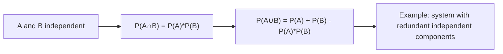

# Independent Events (Union)

$$
P(A \cup B) = P(A) + P(B) - P(A)P(B)
$$

## Deep Breakdown

What it tells me *(Situation Awareness)*:
When $A$ and $B$ are independent, the intersection term in the union formula $P(A \cup B) = P(A) + P(B) - P(A \cap B)$ simplifies: $P(A \cap B) = P(A)P(B)$. This gives the union probability for independent events without needing to observe the joint directly.

## Flowchart



## Real-world use

### Where it is used

System reliability: probability that at least one redundant component works. A/B test multi-metric: probability of detecting a significant result on at least one independent metric. Ensemble model: probability that at least one model flags an anomaly.

### Problem it solves

Computes the union probability when events are known to be independent, without needing empirical joint observations.

### How it solves the problem

Substitutes $P(A \cap B) = P(A) P(B)$ (from independence) into the inclusion-exclusion formula.

### Example in a business

Two independent fraud signals each detect fraud with probability 0.70. Combined probability of detection: $0.70 + 0.70 - 0.70 \times 0.70 = 0.91$. Ensemble models use this logic to increase recall.

## The formula, piece by piece

$P(A \cup B) = P(A) + P(B) - P(A) \cdot P(B)$
- Valid ONLY when $A$ and $B$ are independent.
- Equivalent to: $1 - P(A^c) P(B^c) = 1 - (1-P(A))(1-P(B))$ — probability neither fails.

## The formula in words

"For independent A and B, the probability that at least one occurs equals A plus B minus their product." $P = 0.7 + 0.7 - 0.49 = 0.91$.

## Critical Concepts

- The "neither occurs" form is sometimes cleaner: $P(A \cup B) = 1 - (1-p_A)(1-p_B)$.
- Generalizes: $P(\bigcup_i A_i) = 1 - \prod_i (1 - P(A_i))$ for mutually independent events.
- Used in ensemble methods: $P(\text{ensemble correct}) = 1 - \prod_i P(\text{model}_i \text{ wrong})$.

## Step-by-step calculation (tiny example)

*Step 1: Two independent classifiers, each 70% accurate*
$P(A) = P(B) = 0.70$. Independent.

*Step 2: P(at least one correct)*
$P(A \cup B) = 0.70 + 0.70 - 0.70 \times 0.70 = 1.40 - 0.49 = 0.91$

*Step 3: Verify using complement*
$1 - (1 - 0.70)^2 = 1 - 0.09 = 0.91$. Consistent.

## Code examples

### Beginner example (Python)

```python
# Ensemble: P(at least one of 3 classifiers is correct)

def p_union_independent(probabilities: list[float]) -> float:
    """P(at least one occurs) for independent events."""
    p_none = 1.0
    for p in probabilities:
        p_none *= (1 - p)
    return 1 - p_none   # 3 classifiers with different individual accuracies
acc = [0.70, 0.75, 0.80]
ensemble_prob = p_union_independent(acc)
print(f"P(at least one correct) = {ensemble_prob:.4f}")
```

### Beginner example (R)

```r
p_union_independent <- function(probabilities) { 1 - prod(1 - probabilities)
}
acc <- c(0.70, 0.75, 0.80)
cat("P(at least one correct) =", round(p_union_independent(acc), 4), "\n")
```

### Professional example (Python)

```python
import numpy as np

def ensemble_detection_probability( individual_recalls: np.ndarray, assume_independent: bool = True ) -> float:
    """Compute P(at least one model detects event) for an ensemble. Under independence: P(union) = 1 - prod(1 - recall_i). Args: individual_recalls: Array of per-model recall values. assume_independent: If True, use independence product formula. Returns: Ensemble-level detection probability. """
    if not assume_independent:
        raise NotImplementedError("Dependent case requires joint distribution data.")
    p_no_detection = np.prod(1 - individual_recalls)
    return float(1 - p_no_detection)   # Analyze ensemble recall vs number of independent models
baseline_recall = 0.70
for n_models in [1, 2, 3, 5, 10]:
    recalls = np.full(n_models, baseline_recall)
ensemble_recall = ensemble_detection_probability(recalls)
print(f"n_models={n_models:>3}: ensemble recall = {ensemble_recall:.4f}")
```

---

*Source: domain knowledge*
