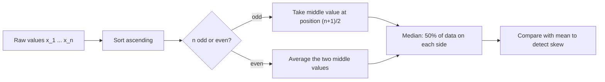

# Median

$$
\text{median}(x) = \begin{cases} x_{((n+1)/2)} & n \text{ odd} \\ \tfrac{1}{2}\left(x_{(n/2)} + x_{(n/2+1)}\right) & n \text{ even} \end{cases}
$$

, where $x_{(1)} \le x_{(2)} \le \dots \le x_{(n)}$ are the sorted values (order statistics)

## Deep Breakdown

What it tells me *(Situation Awareness)*:
The median is the middle value of a sorted dataset: half the observations sit at or below it, half at or above it. For a random variable it is any $m$ with $P(X \le m) \ge 0.5$ and $P(X \ge m) \ge 0.5$, i.e. the 50th percentile, $F^{-1}(0.5)$. Unlike the mean, it depends only on the *rank order* of the data, not on the magnitudes of the extremes, so a single outlier (a 10,000 USD order, a 30-second page load) cannot drag it around. Its breakdown point is 50%: almost half the data can be corrupted before the median becomes arbitrarily wrong, versus 0% for the mean (one bad value suffices). It is also the value that minimizes total absolute deviation $\sum_i |x_i - m|$, which is why it is the optimal point forecast under MAE / L1 loss, while the mean is optimal under squared (L2) loss. In DA/DS: reporting typical order value, salary, house price or session length (all right-skewed); robust imputation of missing values; median-based outlier rules (MAD); quantile regression at $\tau = 0.5$; comparing mean vs median as a quick skewness check (mean much larger than median means a long right tail).

## Flowchart



## Real-world use

### Where it is used

KPI dashboards for skewed metrics (median order value, median time-to-first-purchase, median support resolution time); housing and income statistics; robust missing-value imputation (`SimpleImputer(strategy="median")`); median absolute deviation (MAD) for outlier detection; L1-loss regression and quantile regression; median-of-means estimators in streaming systems.

### Problem it solves

The arithmetic mean is hypersensitive to extreme values. In heavy-tailed business data (revenue per customer, latency, claim sizes) a handful of whales or glitches make the mean describe nobody. The median gives a "typical" value that is stable under outliers.

### How it solves the problem

It throws away magnitude information and keeps only order: after sorting, only the middle position matters. Moving the largest value from 250 to 250,000 does not change which observation is in the middle, so the median does not move.

### Example in a business

An e-commerce analyst reports average order value. Five orders: 12, 15, 18, 22 and one bulk B2B order of 250 USD. Mean $= 63.4$ USD, which is larger than four of the five orders and misleads the marketing team planning free-shipping thresholds. Median $= 18$ USD, the real "typical basket". The team sets the free-shipping threshold just above the median to nudge typical customers to add one more item.

## The formula, piece by piece

- $x_{(k)}$: the $k$-th smallest value after sorting (an order statistic).
- $n$: number of observations.
- $(n+1)/2$: the middle position when $n$ is odd (e.g. position 3 of 5).
- $n/2$ and $n/2 + 1$: the two middle positions when $n$ is even (e.g. positions 3 and 4 of 6).
- $\tfrac{1}{2}(\cdot + \cdot)$: average of the two middle values, the usual convention for even $n$ (any value between them minimizes absolute deviation).
- Population version: $m = F^{-1}(0.5)$, the point where the CDF crosses one half.
- Optimality: $\text{median} = \arg\min_m \sum_i |x_i - m|$.

## The formula in words

"Sort the numbers and take the one in the middle; if there are two in the middle, take their average." Tiny example: orders $[12, 15, 18, 22, 30, 250]$ ($n = 6$, even). Middle positions 3 and 4 hold 18 and 22, so the median is $(18 + 22)/2 = 20$, while the mean is $347/6 = 57.83$.

## Critical Concepts

- **Robustness (breakdown point 50%):** the median only fails when about half the data is contaminated; the mean fails with one bad point.
- **Mean vs median as a skew diagnostic:** mean greater than median suggests right skew (revenue, latency); mean less than median suggests left skew. For symmetric distributions they coincide.
- **L1 optimality:** the median minimizes the sum of absolute errors, so a model trained with MAE loss predicts conditional medians, not conditional means.
- **Not additive:** the median of a sum is not the sum of medians, and you cannot average medians across segments to get the overall median. Store raw data or histograms/sketches instead.
- **Computation:** exact median needs sorting, $O(n \log n)$, or quickselect, $O(n)$ average. For streaming or distributed data use approximate sketches (t-digest, KLL), as in `APPROX_PERCENTILE` in SQL engines.
- **Standard error:** for large $n$ and a continuous density $f$, $\text{SE}(\text{median}) \approx 1/(2 f(m)\sqrt{n})$; for Normal data that is about $1.25\,\sigma/\sqrt{n}$, so the median is less efficient than the mean when data are truly Normal. Use the bootstrap for confidence intervals in practice.

## Step-by-step calculation (tiny example)

*Step 1: Collect order values*
$[22, 12, 250, 15, 18]$ USD, $n = 5$.

*Step 2: Sort*
$[12, 15, 18, 22, 250]$.

*Step 3: Find the middle position*
$n$ is odd, so position $(5+1)/2 = 3$.

*Step 4: Read the value*
$x_{(3)} = 18$. Median $= 18$ USD.

*Step 5: Compare with the mean*
Mean $= (12+15+18+22+250)/5 = 317/5 = 63.4$ USD. The gap ($63.4$ vs $18$) flags strong right skew caused by the 250 USD order.

## Code examples

### Beginner example (Python)

```python
import statistics

orders_odd = [22, 12, 250, 15, 18]
orders_even = [12, 15, 18, 22, 30, 250]

print("Sorted (odd):", sorted(orders_odd))
print("Median (odd n):", statistics.median(orders_odd))     # 18
print("Mean (odd n):", statistics.mean(orders_odd))         # 63.4
print("Median (even n):", statistics.median(orders_even))   # 20.0
print("Mean (even n):", round(statistics.mean(orders_even), 2))  # 57.83
```

### Beginner example (R)

```r
orders_odd <- c(22, 12, 250, 15, 18)
orders_even <- c(12, 15, 18, 22, 30, 250)
cat("Median (odd n):", median(orders_odd), "\n")    # 18
cat("Mean (odd n):", mean(orders_odd), "\n")        # 63.4
cat("Median (even n):", median(orders_even), "\n")  # 20
```

### Professional example (Python)

```python
import numpy as np


def robust_summary(values: np.ndarray, n_boot: int = 2000, seed: int = 0) -> dict[str, float]:
    """Median, MAD-based outlier flags and a bootstrap 95% CI for the median.

    Args:
        values: 1-D array of a skewed business metric (e.g. order value).
        n_boot: number of bootstrap resamples.
        seed: RNG seed for reproducibility.

    Returns:
        Dict with mean, median, MAD, outlier count and median CI.
    """
    rng = np.random.default_rng(seed)
    med = float(np.median(values))
    mad = float(np.median(np.abs(values - med)))
    robust_z = 0.6745 * (values - med) / mad          # MAD scaled to sigma under Normality
    boot_medians = np.median(
        rng.choice(values, size=(n_boot, values.size), replace=True), axis=1
    )
    lo, hi = np.percentile(boot_medians, [2.5, 97.5])
    return {
        "mean": float(values.mean()),
        "median": med,
        "mad": mad,
        "n_outliers_robust_z_gt_3.5": int(np.sum(np.abs(robust_z) > 3.5)),
        "median_ci_low": float(lo),
        "median_ci_high": float(hi),
    }


rng = np.random.default_rng(42)
order_values = rng.lognormal(mean=3.5, sigma=0.8, size=5_000)   # right-skewed, like real AOV
order_values[:10] = 5_000.0                                      # a few B2B whales
summary = robust_summary(order_values)
for key, val in summary.items():
    print(f"{key:>28}: {val:,.2f}")
print("Mean is pulled up by whales; the median barely moves.")
```

---

*Source: domain knowledge*
