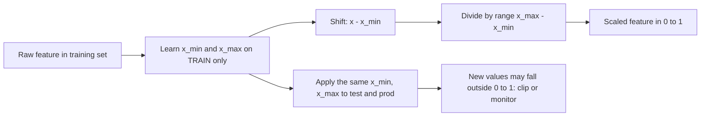

# Min-Max Normalization

$$
x' = \frac{x - x_{\min}}{x_{\max} - x_{\min}}
$$

, which maps the training range $[x_{\min}, x_{\max}]$ onto $[0, 1]$; for a target range $[a, b]$ use $x'' = a + (b - a)\,x'$

## Deep Breakdown

What it tells me *(Situation Awareness)*:
Min-max normalization is a linear feature-scaling transform that shifts a feature so its minimum becomes 0 and divides by the range so its maximum becomes 1. It preserves the shape of the distribution and the relative ordering and spacing of values (it is an affine map), but it removes units, so features measured in dollars, clicks and days end up on a comparable 0 to 1 scale. Contrast with z-score standardization, $z = (x - \mu)/\sigma$, which centres at 0 with unit variance but is unbounded: min-max guarantees a bounded range, z-score is more robust to a single extreme value and is the natural choice when a model assumes centred inputs. Both are fitted parameters: $x_{\min}$ and $x_{\max}$ must be learned on the training set only and then reused on validation, test and production data, otherwise information leaks from the evaluation data into the model. In DA/DS: preparing inputs for distance-based models (k-NN, k-means, SVM with RBF kernel), neural networks and image pixels ($/255$), composite scores and indices (rescaling KPIs before weighting them), and visual encodings (colour scales, bar widths).

## Flowchart



## Real-world use

### Where it is used

`sklearn.preprocessing.MinMaxScaler` in pipelines; pixel scaling for CNNs; k-NN and k-means where Euclidean distance would otherwise be dominated by the feature with the largest units; building composite health or lead scores from several KPIs; normalizing inputs to sigmoid or tanh layers; scaling bounded signals (percentages, ratings) for dashboards.

### Problem it solves

Features on different scales distort algorithms that compare magnitudes. In a churn model, "annual spend" (0 to 20,000 USD) swamps "support tickets" (0 to 10) in any distance or gradient computation, so the model effectively ignores the small-scale feature. Gradient descent also converges slowly on badly scaled inputs.

### How it solves the problem

Subtracting $x_{\min}$ anchors every feature at 0; dividing by the range gives every feature the same span of 1. Each feature then contributes comparably to distances, and the loss surface becomes better conditioned.

### Example in a business

A marketing team builds a customer "engagement score" from monthly sessions (range 20 to 80 in training data) and other KPIs. A customer with 50 sessions gets $(50 - 20)/60 = 0.5$. After deployment a power user arrives with 110 sessions, outside the training range: the fitted scaler gives $(110 - 20)/60 = 1.5$. The team either clips to 1 (bounded score for the dashboard) or alerts on drift because production data has moved beyond what the model saw.

## The formula, piece by piece

- $x$: the raw value of the feature for one observation.
- $x_{\min}$: smallest value of the feature in the training data (a fitted parameter).
- $x_{\max}$: largest value of the feature in the training data (a fitted parameter).
- $x - x_{\min}$: shift so the minimum maps to 0.
- $x_{\max} - x_{\min}$: the range; dividing by it makes the maximum map to 1.
- $x'$: the normalized value, in $[0, 1]$ for training data.
- $a + (b - a)x'$: optional rescale to another interval, e.g. $[-1, 1]$ with $a = -1$, $b = 1$.
- Inverse: $x = x_{\min} + x'(x_{\max} - x_{\min})$, used to report predictions back in original units.

## The formula in words

"Express each value as the fraction of the way it sits between the smallest and the largest value seen in training." Tiny example: sessions $[20, 35, 50, 80]$ become $[0, 0.25, 0.5, 1]$, because $35$ is $15/60 = 0.25$ of the way from 20 to 80.

## Critical Concepts

- **Fit on train only:** call `fit` (or `fit_transform`) on the training split, then `transform` on validation/test/production. Fitting on the full dataset leaks the test range into training and inflates offline metrics. Inside cross-validation put the scaler in a `Pipeline` so it is refitted per fold.
- **Outlier sensitivity:** $x_{\min}$ and $x_{\max}$ are single extreme observations. One 1,000,000 USD order squashes all other customers into $[0, 0.01]$. For heavy-tailed data prefer z-score, `RobustScaler` (median and IQR), a log transform first, or clip at percentiles before scaling.
- **Min-max vs z-score:** min-max gives a fixed bounded range (good for pixels, bounded activations, scores shown to humans); z-score gives mean 0 and standard deviation 1, unbounded (good for linear models with regularization, PCA, and when outliers exist). For the sessions example $[20, 35, 50, 80]$, z-scores (population $\sigma = 22.19$) are $[-1.18, -0.51, 0.17, 1.52]$ versus min-max $[0, 0.25, 0.5, 1]$.
- **Out-of-range values:** new data can produce values below 0 or above 1; decide explicitly to clip, allow, or treat as drift signal (`MinMaxScaler(clip=True)`).
- **Constant feature:** if $x_{\max} = x_{\min}$ the denominator is 0; libraries guard this (scikit-learn maps the feature to 0), but in hand-written code check for it.
- **Not needed for tree models:** decision trees, random forests and gradient boosting split on thresholds and are invariant to monotone rescaling.
- **Batch and layer normalization:** in deep learning, normalization happens *inside* the network: batch norm standardizes each activation using mini-batch mean and variance (then learns a scale $\gamma$ and shift $\beta$), and layer norm standardizes across the features of a single example (the default in transformers and LLMs). These are z-score style, learned per layer, and complement rather than replace input scaling.

## Step-by-step calculation (tiny example)

*Training data: monthly sessions $[20, 35, 50, 80]$.*

*Step 1: Fit parameters on training data*
$x_{\min} = 20$, $x_{\max} = 80$, range $= 60$.

*Step 2: Transform training values*
$(20-20)/60 = 0$, $(35-20)/60 = 0.25$, $(50-20)/60 = 0.5$, $(80-20)/60 = 1$.

*Step 3: Transform a new in-range customer*
$x = 65$: $(65 - 20)/60 = 0.75$.

*Step 4: Transform a new out-of-range customer*
$x = 110$: $(110 - 20)/60 = 1.5$, above 1; clip to 1 or flag drift.

*Step 5: Invert a scaled value*
$x' = 0.75 \Rightarrow x = 20 + 0.75 \times 60 = 65$. $\checkmark$

## Code examples

### Beginner example (Python)

```python
import numpy as np

train = np.array([20, 35, 50, 80], dtype=float)
x_min, x_max = train.min(), train.max()


def min_max(x):
    return (x - x_min) / (x_max - x_min)


print("Train scaled:", min_max(train))                 # [0.   0.25 0.5  1.  ]
print("New 65 ->", min_max(65.0))                      # 0.75
print("New 110 ->", min_max(110.0))                    # 1.5 (out of range)
z = (train - train.mean()) / train.std()
print("Z-scores:", np.round(z, 2))                     # [-1.18 -0.51  0.17  1.52]
```

### Beginner example (R)

```r
train <- c(20, 35, 50, 80)
x_min <- min(train); x_max <- max(train)
min_max <- function(x) (x - x_min) / (x_max - x_min)
print(min_max(train))   # 0.00 0.25 0.50 1.00
print(min_max(65))      # 0.75
print(min_max(110))     # 1.5
```

### Professional example (Python)

```python
import numpy as np
from sklearn.datasets import make_classification
from sklearn.model_selection import train_test_split, cross_val_score
from sklearn.neighbors import KNeighborsClassifier
from sklearn.pipeline import make_pipeline
from sklearn.preprocessing import MinMaxScaler, StandardScaler

# Churn-like data where features live on wildly different scales
X, y = make_classification(n_samples=2000, n_features=6, n_informative=4,
                           n_redundant=0, random_state=42)
scales = np.array([1, 10, 100, 1_000, 10_000, 1])      # e.g. tickets ... annual spend
X = X * scales

X_train, X_test, y_train, y_test = train_test_split(X, y, test_size=0.25, random_state=42)

models = {
    "kNN raw": KNeighborsClassifier(n_neighbors=15),
    "kNN + MinMax": make_pipeline(MinMaxScaler(), KNeighborsClassifier(n_neighbors=15)),
    "kNN + ZScore": make_pipeline(StandardScaler(), KNeighborsClassifier(n_neighbors=15)),
}
for name, model in models.items():
    # Pipeline refits the scaler inside each CV fold: no leakage
    cv = cross_val_score(model, X_train, y_train, cv=5).mean()
    test = model.fit(X_train, y_train).score(X_test, y_test)
    print(f"{name:>14}: CV acc = {cv:.3f}, test acc = {test:.3f}")

scaler = MinMaxScaler(clip=True).fit(X_train)            # fit on TRAIN only
X_test_scaled = scaler.transform(X_test)
print("Test range after train-fitted scaling:",
      X_test_scaled.min().round(3), "to", X_test_scaled.max().round(3))
```

---

*Source: domain knowledge*
