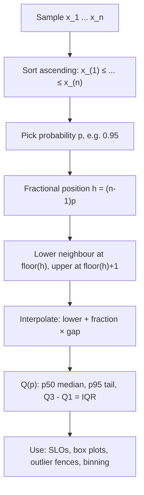

# Percentiles and Quantiles

$$
Q(p) = F^{-1}(p) = \inf\{x : F(x) \ge p\}, \qquad \hat{Q}(p) = x_{(\lfloor h \rfloor + 1)} + (h - \lfloor h \rfloor)\left(x_{(\lfloor h \rfloor + 2)} - x_{(\lfloor h \rfloor + 1)}\right)
$$

, where $h = (n-1)p$, $p \in [0, 1]$, and $x_{(1)} \le \dots \le x_{(n)}$ are the sorted values

## Deep Breakdown

What it tells me *(Situation Awareness)*:
The quantile function $Q(p)$ answers the inverse of the CDF question: instead of "what fraction of values are below $x$?", it asks "below which value lies a fraction $p$ of the data?". A percentile is the same thing on a 0 to 100 scale ($P_{95} = Q(0.95)$), quartiles split at $p = 0.25, 0.5, 0.75$, deciles at multiples of 0.1, and the median is $Q(0.5)$. Because real samples are discrete, the sample quantile needs an interpolation rule; the default in NumPy, R (type 7) and Excel `PERCENTILE.INC` places the $p$-quantile at fractional position $h = (n-1)p$ (0-based) and interpolates linearly between the two neighbouring sorted values. Quantiles are robust, distribution-free descriptors of spread and tails, which is exactly what matters for SLAs and risk. In DA/DS: p50/p95/p99 latency SLOs for APIs and LLM inference; the interquartile range (IQR) and Tukey fences for outlier detection and box plots; quantile binning of features (`pd.qcut`); Value-at-Risk in finance; quantile regression and prediction intervals; calibrating thresholds ("flag the top 5% riskiest transactions").

## Flowchart



## Real-world use

### Where it is used

API and LLM serving dashboards (p50, p95, p99 latency, time-to-first-token); box plots and Tukey outlier rules; income and price reports (deciles); feature engineering with quantile bins and `QuantileTransformer`; risk metrics (VaR = loss quantile); quantile regression and conformal prediction intervals; threshold setting for fraud or anomaly scores.

### Problem it solves

Means hide tails. An API with mean latency 277 ms can still make one user in ten wait half a second. Business commitments (SLAs, risk limits, capacity planning) are about "how bad does it get for most users", which is a quantile question, not an average question.

### How it solves the problem

By sorting the data and reading off the value at a chosen rank, quantiles describe any part of the distribution directly without assuming a shape (Normal or otherwise). Linear interpolation makes the estimate continuous in $p$ and well defined for any sample size.

### Example in a business

An ML platform team serves an LLM endpoint. Ten request latencies (ms): $[100, 120, 130, 150, 180, 200, 240, 300, 450, 900]$. Mean $= 277$ ms, median $= 190$ ms, but p95 $= 697.5$ ms. The SLO "p95 under 500 ms" is violated even though the mean looks healthy, so the team investigates the long-tail requests (very long prompts) and adds a prompt-length based routing rule.

## The formula, piece by piece

- $F(x) = P(X \le x)$: the cumulative distribution function.
- $Q(p) = F^{-1}(p)$: the quantile function, the generalized inverse of the CDF; $\inf$ handles flat parts and jumps of $F$.
- $p$: target probability (0.95 for p95, 0.25 for Q1).
- $n$: sample size; $x_{(k)}$: the $k$-th smallest value (1-based).
- $h = (n-1)p$: fractional 0-based position of the quantile in the sorted sample.
- $\lfloor h \rfloor$: integer part, selecting the lower neighbour $x_{(\lfloor h \rfloor + 1)}$.
- $h - \lfloor h \rfloor$: fractional part, the weight given to the gap up to the next value.
- $x_{(\lfloor h \rfloor + 2)} - x_{(\lfloor h \rfloor + 1)}$: the gap between the two neighbours.
- IQR $= Q(0.75) - Q(0.25)$: spread of the middle 50%.
- Tukey fences: $Q_1 - 1.5\,\text{IQR}$ and $Q_3 + 1.5\,\text{IQR}$; points outside are flagged as outliers.

## The formula in words

"Sort the data, walk a fraction $p$ of the way from the smallest to the largest position, and if you land between two values, take the proportional point between them." Tiny example: latencies above, $p = 0.9$: $h = 9 \times 0.9 = 8.1$, so the lower neighbour is $x_{(9)} = 450$ and the upper is $x_{(10)} = 900$; $Q(0.9) = 450 + 0.1 \times 450 = 495$ ms.

## Critical Concepts

- **Many definitions exist:** Hyndman and Fan list nine sample-quantile rules. NumPy default `method="linear"` equals R type 7 and Excel `PERCENTILE.INC`; other tools (some SQL `PERCENTILE_DISC`, Excel `PERCENTILE.EXC`) give different answers on small samples. Always state the method when comparing dashboards.
- **Tail quantiles need data:** p99 from 100 requests is essentially the maximum. A rule of thumb: you need well over $1/(1-p)$ observations (thousands for p99) for a stable tail estimate; bootstrap the CI.
- **Not averageable:** the average of hourly p95s is not the daily p95. Aggregate from raw data or from mergeable sketches (t-digest, HDR histograms, KLL).
- **Equivariance:** for any increasing transform $g$, $Q_{g(X)}(p) = g(Q_X(p))$, so the quantile of log-latency is the log of the latency quantile (the mean has no such property).
- **IQR and the Normal:** for Normal data $\text{IQR} \approx 1.349\,\sigma$, giving the robust scale estimate $\hat{\sigma} = \text{IQR}/1.349$.
- **Inverse-transform link:** $Q(U)$ with $U \sim \text{Uniform}(0,1)$ has distribution $F$; this is how random samples are generated from arbitrary distributions.

## Step-by-step calculation (tiny example)

*Data (sorted, ms):* $[100, 120, 130, 150, 180, 200, 240, 300, 450, 900]$, $n = 10$.

*Step 1: Q1 ($p = 0.25$)*
$h = 9 \times 0.25 = 2.25$. Neighbours $x_{(3)} = 130$, $x_{(4)} = 150$. $Q_1 = 130 + 0.25 \times 20 = 135$.

*Step 2: Median ($p = 0.5$)*
$h = 4.5$. Neighbours $180$, $200$. $Q(0.5) = 180 + 0.5 \times 20 = 190$.

*Step 3: Q3 ($p = 0.75$)*
$h = 6.75$. Neighbours $x_{(7)} = 240$, $x_{(8)} = 300$. $Q_3 = 240 + 0.75 \times 60 = 285$.

*Step 4: p95*
$h = 8.55$. Neighbours $450$, $900$. $Q(0.95) = 450 + 0.55 \times 450 = 697.5$.

*Step 5: IQR and fences*
$\text{IQR} = 285 - 135 = 150$. Upper fence $= 285 + 1.5 \times 150 = 510$; lower fence $= 135 - 225 = -90$. Only the 900 ms request is an outlier.

## Code examples

### Beginner example (Python)

```python
import numpy as np

latency_ms = np.array([100, 120, 130, 150, 180, 200, 240, 300, 450, 900])

for p in [25, 50, 75, 90, 95]:
    print(f"p{p}: {np.percentile(latency_ms, p):.1f} ms")
# p25 135.0 | p50 190.0 | p75 285.0 | p90 495.0 | p95 697.5

q1, q3 = np.percentile(latency_ms, [25, 75])
iqr = q3 - q1
upper_fence = q3 + 1.5 * iqr
print(f"Mean: {latency_ms.mean():.1f} ms")          # 277.0
print(f"IQR: {iqr:.1f}, upper fence: {upper_fence:.1f}")   # 150.0, 510.0
print("Outliers:", latency_ms[latency_ms > upper_fence])   # [900]
```

### Beginner example (R)

```r
latency_ms <- c(100, 120, 130, 150, 180, 200, 240, 300, 450, 900)
print(quantile(latency_ms, c(0.25, 0.5, 0.75, 0.9, 0.95), type = 7))
# 135 190 285 495 697.5
iqr <- IQR(latency_ms)                        # 150
upper_fence <- quantile(latency_ms, 0.75) + 1.5 * iqr
print(latency_ms[latency_ms > upper_fence])   # 900
```

### Professional example (Python)

```python
import numpy as np


def manual_quantile(values: np.ndarray, p: float) -> float:
    """Linear-interpolation quantile (NumPy 'linear' / R type 7), written out explicitly."""
    x = np.sort(values)
    h = (x.size - 1) * p
    lo = int(np.floor(h))
    hi = min(lo + 1, x.size - 1)
    return float(x[lo] + (h - lo) * (x[hi] - x[lo]))


def slo_report(latency: np.ndarray, slo_ms: float, p: float = 0.95,
               n_boot: int = 1000, seed: int = 0) -> dict[str, float]:
    """Tail-latency SLO check with a bootstrap CI for the quantile."""
    rng = np.random.default_rng(seed)
    q_hat = manual_quantile(latency, p)
    boots = np.array([
        manual_quantile(rng.choice(latency, latency.size, replace=True), p)
        for _ in range(n_boot)
    ])
    lo, hi = np.percentile(boots, [2.5, 97.5])
    return {"p": p, "q_hat_ms": q_hat, "ci_low_ms": float(lo), "ci_high_ms": float(hi),
            "slo_ms": slo_ms, "violated": float(q_hat > slo_ms)}


rng = np.random.default_rng(7)
# LLM endpoint: mostly fast, plus a heavy tail from long prompts
latency = np.concatenate([rng.lognormal(np.log(180), 0.35, 1900),
                          rng.lognormal(np.log(900), 0.40, 100)])
assert np.isclose(manual_quantile(latency, 0.95), np.percentile(latency, 95))
print(f"mean = {latency.mean():.1f} ms, p50 = {np.median(latency):.1f} ms")
for key, val in slo_report(latency, slo_ms=500).items():
    print(f"{key:>10}: {val:,.2f}")
```

---

*Source: domain knowledge*
