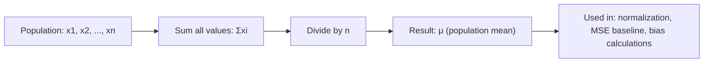

# Population Mean

$$
\mu = \frac{\sum x_i}{n}
$$

## Deep Breakdown

What it tells me *(Situation Awareness)*:
The population mean $\mu$ is the arithmetic average of all values in the population. It is the central tendency measure and the "expected value" for a discrete uniform distribution. In DA/DS it is the baseline measure computed before any modeling, used in feature normalization, loss function baselines, and residual analysis.

## Flowchart



## Real-world use

### Where it is used

Computing average revenue per user, mean session duration, average order value — whenever a single central value summarizes a population of measurements.

### Problem it solves

Condenses a distribution into a single representative value for reporting, comparison, or use in downstream formulas (variance, z-score, regression).

### How it solves the problem

Sums all values and divides by count — a linear, unbiased estimator of the true center of the distribution.

### Example in a business

Average Order Value (AOV): $\mu = \sum_{i=1}^{n} \text{order}_i / n$. Used to track revenue performance, set upsell thresholds, and compute cohort-level LTV.

## The formula, piece by piece

$\mu = \frac{\sum x_i}{n}$
- $\mu$: Greek letter mu — the population mean.
- $\sum x_i$: sum of all values ($x_1 + x_2 + \ldots + x_n$).
- $n$: total number of values in the population.

## The formula in words

"The population mean is the sum of all values divided by the count of values." Example: [2, 4, 6, 8] → $\mu = 20/4 = 5$.

## Critical Concepts

- Sensitive to outliers: a single extreme value shifts $\mu$ significantly.
- Population mean $\mu$ vs. sample mean $\bar{x}$: $\bar{x}$ uses $n$, $\mu$ uses $N$ (population size).
- $\mu$ minimizes Mean Squared Error: $\text{argmin}_c \sum (x_i - c)^2 = \mu$.
- Median is preferred for skewed distributions or when outliers are present.

## Step-by-step calculation (tiny example)

*Step 1: Data*
Order values: [50, 75, 100, 25, 200].

*Step 2: Sum*
$50 + 75 + 100 + 25 + 200 = 450$

*Step 3: Divide*
$\mu = 450/5 = 90$

*Step 4: Interpret*
Average order value is $90. The $200 order is an outlier pulling the mean up.

## Code examples

### Beginner example (Python)

```python
import numpy as np
order_values = np.array([50, 75, 100, 25, 200])
mu = order_values.mean()
print(f"Population mean (AOV): ${mu:.2f}")   # Compare to median (robust to outliers)
median_val = np.median(order_values)
print(f"Median: ${median_val:.2f}")
```

### Beginner example (R)

```r
order_values <- c(50, 75, 100, 25, 200)
mu <- mean(order_values)
cat(sprintf("Population mean (AOV): $%.2f\n", mu))
cat(sprintf("Median: $%.2f\n", median(order_values)))
```

### Professional example (Python)

```python
import numpy as np
import pandas as pd

def cohort_mean_analysis(
    values: np.ndarray, cohort_labels: np.ndarray
) -> pd.DataFrame:
    """
    Compute population mean per cohort with outlier sensitivity check.

    Args:
        values: Numeric array of metric values.
        cohort_labels: Array of cohort identifiers.

    Returns:
        DataFrame with mean, median, and skew per cohort.
    """
    df = pd.DataFrame({"value": values, "cohort": cohort_labels})
    return (
        df.groupby("cohort")["value"]
        .agg(
            mean="mean",
            median="median",
            skew="skew",
            count="count",
        )
        .assign(mean_median_ratio=lambda x: x["mean"] / x["median"])
        .round(4)
    )


rng = np.random.default_rng(seed=42)
n_users = 5_000
cohorts = rng.choice(["A", "B", "C"], n_users)
orders = np.where(
    rng.uniform(0, 1, n_users) < 0.02,
    rng.uniform(500, 2000, n_users),   # 2% high-value outliers
    rng.lognormal(3.5, 0.8, n_users),  # typical orders ~$33
)
result = cohort_mean_analysis(orders, cohorts)
print("Cohort mean analysis:")
print(result.to_string())
```

---

*Source: AIO p. 86*
