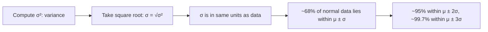

# Standard Deviation

$$
\sigma = \sqrt{\frac{\sum (x_i - \mu)^2}{n}}
$$

## Deep Breakdown

What it tells me *(Situation Awareness)*:
The standard deviation $\sigma$ is the square root of the variance — it returns the spread measure to the same units as the original data. It is the most commonly reported measure of spread in reports, dashboards, and statistical summaries. In ML: used for normalization (StandardScaler), confidence intervals, and assessing model performance variability.

## Flowchart



## Real-world use

### Where it is used

Reporting variability of KPIs ("revenue was $\$100k \pm \$12k$"). Feature normalization. Outlier detection ($|x - \mu| > 3\sigma$). Control charts for process quality.

### Problem it solves

Expresses spread in the same units as the data, making it interpretable unlike variance (which is in squared units).

### How it solves the problem

Takes the square root of variance, restoring the original scale while preserving proportional relationships between spread values.

### Example in a business

Session duration: mean = 4.5 min, $\sigma$ = 1.2 min. Users more than 3σ below mean (< 0.9 min) are flagged as potential bot traffic or bounce events.

## The formula, piece by piece

$\sigma = \sqrt{\frac{\sum (x_i - \mu)^2}{n}}$
- $\sigma$: standard deviation (lowercase sigma).
- Square root of the variance $\sigma^2$.
- Same units as the data.

## The formula in words

"The standard deviation is the square root of the average squared deviation from the mean."

## Critical Concepts

- For normal distributions: 68-95-99.7 rule (empirical rule).
- Sample std: divide by $n-1$ under the square root (Bessel's correction).
- Python: `np.std(x)` population, `np.std(x, ddof=1)` sample.
- R: `sd(x)` is always sample ($n-1$); no built-in for population std.
- StandardScaler: $(x - \mu) / \sigma$ — uses this for feature normalization.

## Step-by-step calculation (tiny example)

*Step 1: Variance computed from [2,4,4,4,5,5,7,9]*
$\sigma^2 = 4$ (from previous example).

*Step 2: Standard deviation*
$\sigma = \sqrt{4} = 2$

*Step 3: Interpret*
Typical values are within $5 \pm 2 = [3, 7]$. The range [2,9] spans $3.5\sigma$ — consistent.

## Code examples

### Beginner example (Python)

```python
import numpy as np
session_durations = np.array([1.2, 3.4, 4.5, 5.1, 6.7, 2.3, 4.8, 3.9])
mu = session_durations.mean()
sigma = session_durations.std()   # population std
print(f"Mean: {mu:.2f} min")
print(f"Std Dev: {sigma:.2f} min")   # Outlier detection: flag > 2 sigma from mean
outliers = session_durations[np.abs(session_durations - mu) > 2 * sigma]
print(f"Outliers (>2σ): {outliers}")
```

### Beginner example (R)

```r
session_durations <- c(1.2, 3.4, 4.5, 5.1, 6.7, 2.3, 4.8, 3.9)
mu <- mean(session_durations)
sigma_pop <- sd(session_durations) * sqrt((length(session_durations)-1)/length(session_durations))
cat(sprintf("Mean: %.2f min\n", mu))
cat(sprintf("Std Dev (population): %.2f min\n", sigma_pop))
```

### Professional example (Python)

```python
import numpy as np
from sklearn.preprocessing import StandardScaler

def standardize_features( data: np.ndarray, feature_names: list[str] | None = None ) -> tuple[np.ndarray, dict[str, float]]:
    """Standardize features to zero mean and unit variance. Applies z-score normalization: (x - μ) / σ. Args: data: 2-D array (n_samples, n_features). feature_names: Optional names for reporting. Returns: Tuple of (scaled_data, stats_dict with mean and std per feature). """
    means = data.mean(axis=0)
    stds = data.std(axis=0)
    if np.any(stds == 0):
        raise ValueError("Zero-variance features found — cannot standardize.")
    scaled = (data - means) / stds
    stats = {}
    for idx, (m, s) in enumerate(zip(means, stds)):
        name = feature_names[idx] if feature_names else f"feature_{idx}"
    stats[name] = {"mean": float(m), "std": float(s)}
    return scaled, stats
rng = np.random.default_rng(seed=42)
raw_features = rng.normal(100, 5, 0.03, 20, 1.5, 0.01, size=(1000, 3))
scaled_features, feature_stats = standardize_features( raw_features, feature_names=["revenue", "sessions", "ctr"] )
print("Feature standardization stats:")
for feat, stats in feature_stats.items():
    print(f" {feat}: μ={stats['mean']:.4f}, σ={stats['std']:.4f}")
print(f"Scaled means: {scaled_features.mean(axis=0).round(4)}")   # ~[0,0,0]
print(f"Scaled stds: {scaled_features.std(axis=0).round(4)}")   # ~[1,1,1]
```

---

*Source: 1300 p. 334*
