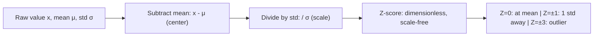

# Standardized Score (Z-Score)

$$
Z = \frac{x - \mu}{\sigma}
$$

## Deep Breakdown

What it tells me *(Situation Awareness)*:
The Z-score measures how many standard deviations a data point is from the mean. It transforms data to have mean 0 and standard deviation 1, enabling comparison across different scales, distributions, and units. In DA/DS: feature normalization (StandardScaler), outlier detection, hypothesis testing (z-test), and comparison of KPIs across different scales.

## Flowchart



## Real-world use

### Where it is used

Outlier detection ($|Z| > 3$), comparing metrics across different scales (e.g., revenue vs. sessions), feature standardization before distance-based ML models (KNN, SVM), and z-test hypothesis testing.

### Problem it solves

Removes units and scale effects, making values from different distributions directly comparable and ensuring features contribute equally in scale-sensitive models.

### How it solves the problem

Centers data at 0 (by subtracting mean) and scales to unit variance (by dividing by std), producing a dimensionless score.

### Example in a business

Anomaly detection: daily sessions = 1,200 vs. historical mean = 1,000, std = 100. Z = (1,200-1,000)/100 = 2.0. Two standard deviations above normal — flag for review.

## The formula, piece by piece

$Z = \frac{x - \mu}{\sigma}$
- $x$: the observation to standardize.
- $\mu$: population (or sample) mean.
- $\sigma$: population (or sample) standard deviation.
- $Z$: dimensionless score.

## The formula in words

"The Z-score is the value minus the mean, divided by the standard deviation — how many standard deviations the value is from average." $Z = 2$ means the value is 2 standard deviations above the mean.

## Critical Concepts

- For normal data: $|Z| > 2$ covers ~5% of data, $|Z| > 3$ covers ~0.3%.
- Z-test statistic uses this: $Z = (\bar{x} - \mu_0) / (\sigma / \sqrt{n})$ where SEM replaces $\sigma$.
- StandardScaler in sklearn: applies Z-score transformation.
- Limitation: not robust to outliers — a few extreme values inflate $\sigma$.

## Step-by-step calculation (tiny example)

*Step 1: Known values*
Daily revenue: $x = \$12{,}000$, historical $\mu = \$10{,}000$, $\sigma = \$1{,}500$.

*Step 2: Z-score*
$Z = (12000 - 10000) / 1500 = 2000 / 1500 = 1.33$

*Step 3: Interpret*
Today's revenue is 1.33 standard deviations above average — elevated but not a 3σ anomaly.

## Code examples

### Beginner example (Python)

```python
import numpy as np   # Anomaly detection via Z-score
historical_mean = 10_000
historical_std = 1_500
today_value = 12_000
z_score = (today_value - historical_mean) / historical_std
print(f"Z-score: {z_score:.2f}")
print(f"Anomaly flag (|Z| > 3): {abs(z_score) > 3}")   # False
```

### Beginner example (R)

```r
historical_mean <- 10000; historical_std <- 1500; today_value <- 12000
z_score <- (today_value - historical_mean) / historical_std
cat(sprintf("Z-score: %.2f\n", z_score))
cat(sprintf("Anomaly (|Z|>3): %s\n", abs(z_score) > 3))
```

### Professional example (Python)

```python
import numpy as np
import pandas as pd

def zscore_anomaly_detection( time_series: np.ndarray, threshold: float = 3.0, window: int | None = None ) -> pd.DataFrame:
    """Detect anomalies in a time series using rolling or global Z-score. Args: time_series: 1-D array of metric values over time. threshold: Z-score threshold for flagging anomalies. window: Rolling window size (None = use global stats). Returns: DataFrame with z-scores and anomaly flags. """
    series = pd.Series(time_series)
    if window is None:
        z_scores = (series - series.mean()) / series.std()
    else:
        rolling_mean = series.rolling(window=window, min_periods=1).mean()
    rolling_std = series.rolling(window=window, min_periods=1).std().fillna(1)
    z_scores = (series - rolling_mean) / rolling_std
    return pd.DataFrame({ "value": time_series, "z_score": z_scores.round(4), "is_anomaly": (z_scores.abs() > threshold).astype(int), })
rng = np.random.default_rng(seed=42)
n_days = 90
daily_sessions = rng.normal(1000, 100, n_days)
daily_sessions[30] = 1800   # Inject anomaly
daily_sessions[60] = 200
result = zscore_anomaly_detection(daily_sessions, threshold=3.0, window=14)
anomalies = result[result["is_anomaly"] == 1]
print(f"Anomalies detected: {len(anomalies)}")
print(anomalies.to_string())
```

---

*Source: AIO p. 86*
