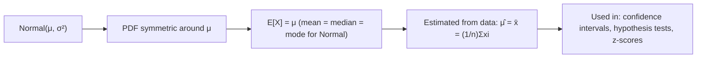

# Expected Value

$$
E[X] = \mu
$$

## Deep Breakdown

What it tells me *(Situation Awareness)*:
For the Normal distribution $N(\mu, \sigma^2)$, the expected value is simply the mean parameter $\mu$ by construction. This is because the Normal PDF is symmetric around $\mu$, making $\mu$ both the mean, median, and mode. In DA/DS: $\mu$ is the location parameter you estimate from data (sample mean $\bar{x}$) when fitting a Normal model.

## Flowchart



## Real-world use

### Where it is used

The parameter $\mu$ is what you estimate and report when fitting a Normal model: mean session duration, mean revenue, mean model prediction error, etc.

### Problem it solves

Identifies the central location of a Normal distribution — the single number that summarizes "where most values are."

### How it solves the problem

The Normal distribution is parameterized by $\mu$ directly. By symmetry and the definition of expected value: $E[X] = \int_{-\infty}^{\infty} x \cdot f(x) dx = \mu$.

### Example in a business

Model calibration: for a well-calibrated Normal regression, $E[\epsilon] = E[y - \hat{y}] = 0$ (zero mean residuals). Non-zero $\mu_{\epsilon}$ indicates systematic bias.

## The formula, piece by piece

$E[X] = \mu$ for $X \sim N(\mu, \sigma^2)$
- $\mu$: location parameter of the Normal distribution.
- Estimated from data: $\hat{\mu} = \bar{x} = \frac{1}{n}\sum x_i$.

## The formula in words

"For a Normal distribution, the expected value equals the mean parameter μ — the center of the bell curve."

## Critical Concepts

- Normal is fully specified by $(\mu, \sigma^2)$: mean controls location, variance controls spread.
- MLE of $\mu$: the sample mean $\bar{x}$ maximizes the Normal likelihood.
- $E[X] = \mu$ holds for all symmetric distributions (Normal, t, Uniform with symmetric support).

## Step-by-step calculation (tiny example)

*Step 1: Fit Normal to data*
Sample: [95, 100, 105, 98, 102]. Sample mean = (95+100+105+98+102)/5 = 100.

*Step 2: E[X] estimate*
$\hat{\mu} = \bar{x} = 100$. So $E[X] \approx 100$.

## Code examples

### Beginner example (Python)

```python
import numpy as np
from scipy.stats import norm
data = np.array([95, 100, 105, 98, 102])
mu_hat = data.mean()
sigma_hat = data.std()
print(f"Fitted Normal: μ={mu_hat:.1f}, σ={sigma_hat:.2f}")
print(f"E[X] = {norm(mu_hat, sigma_hat).mean():.1f}")   # = mu_hat
```

### Beginner example (R)

```r
data <- c(95, 100, 105, 98, 102)
mu_hat <- mean(data)
cat(sprintf("Fitted μ = %.1f\n", mu_hat))
cat(sprintf("E[X] = %.1f\n", mu_hat))
```

### Professional example (Python)

```python
import numpy as np
from scipy.stats import norm
from scipy.optimize import minimize_scalar

def mle_normal_mean(data: np.ndarray) -> dict[str, float]:
    """Compute MLE estimate of Normal mean μ. For Normal distribution, MLE of μ is the sample mean (closed form). Args: data: 1-D array of observations. Returns: Dict with MLE mean, standard error, and confidence interval. """
    n = len(data)
    mu_mle = data.mean()
    sigma_mle = data.std()   # Population std (MLE)
    se_mean = sigma_mle / np.sqrt(n)
    z_95 = norm.ppf(0.975)
    ci_lower = mu_mle - z_95 * se_mean
    ci_upper = mu_mle + z_95 * se_mean
    return { "mu_mle": float(mu_mle), "sigma_mle": float(sigma_mle), "se_mean": float(se_mean), "ci_95_lower": float(ci_lower), "ci_95_upper": float(ci_upper), }
rng = np.random.default_rng(seed=42)
session_data = rng.normal(loc=4.5, scale=1.2, size=500)
result = mle_normal_mean(session_data)
print("MLE Normal mean estimation:")
for key, val in result.items():
    print(f" {key}: {val:.4f}")
```

---

*Source: domain knowledge*
