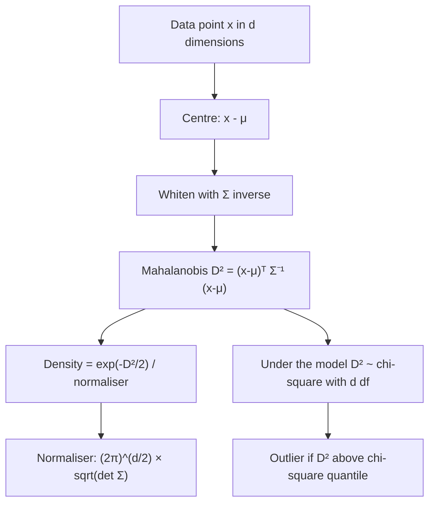

# Multivariate Gaussian Distribution

$$
f(\mathbf{x}) = \frac{1}{(2\pi)^{d/2} \lvert \Sigma \rvert^{1/2}} \exp\left(-\frac{1}{2} (\mathbf{x} - \boldsymbol{\mu})^\top \Sigma^{-1} (\mathbf{x} - \boldsymbol{\mu})\right)
$$

, where $\mathbf{x}, \boldsymbol{\mu} \in \mathbb{R}^d$ and $\Sigma$ is a symmetric positive-definite $d \times d$ covariance matrix

## Deep Breakdown

What it tells me *(Situation Awareness)*:
The multivariate Gaussian $\mathcal{N}(\boldsymbol{\mu}, \Sigma)$ extends the bell curve to $d$ correlated variables at once. The mean vector $\boldsymbol{\mu}$ sets the centre; the covariance matrix $\Sigma$ sets each variable's spread (diagonal) and how pairs move together (off-diagonal). The heart of the formula is the quadratic form $D^2 = (\mathbf{x} - \boldsymbol{\mu})^\top \Sigma^{-1} (\mathbf{x} - \boldsymbol{\mu})$, the squared Mahalanobis distance: a distance measured in standard deviations that also accounts for correlation, so a point that breaks the usual relationship between variables looks far away even if each coordinate looks normal on its own. Contours of equal density are ellipses (ellipsoids) shaped by the eigenvectors of $\Sigma$. Two properties make it uniquely convenient: every marginal is Gaussian (just drop rows and columns of $\boldsymbol{\mu}$ and $\Sigma$) and every conditional is Gaussian with a closed-form mean and variance. In DA/DS: multivariate anomaly and fraud detection via Mahalanobis distance, Gaussian Mixture Models, LDA and QDA classifiers, Gaussian processes, Kalman filters, the latent space of VAEs, portfolio returns in finance, and the sampling distribution of regression coefficients $\hat{\boldsymbol{\beta}}$.

## Flowchart



## Real-world use

### Where it is used

Fraud and anomaly detection on several transaction features, customer segmentation with Gaussian Mixture Models, LDA/QDA classification, Gaussian process regression for demand forecasting and Bayesian optimisation, sensor fusion (Kalman filters), portfolio risk (correlated asset returns), VAE latent spaces, and confidence ellipses for jointly estimated parameters.

### Problem it solves

Models several continuous variables jointly, capturing their correlations, so I can score how typical a whole profile is, predict some variables from others, and simulate realistic correlated scenarios instead of treating features as independent.

### How it solves the problem

The covariance matrix encodes all pairwise linear relationships. Inverting it in the exponent rescales and de-correlates the deviation $\mathbf{x} - \boldsymbol{\mu}$, so the density depends only on the Mahalanobis distance. The determinant $\lvert \Sigma \rvert$ measures the volume of the cloud and keeps the total probability equal to 1. Partitioning $\boldsymbol{\mu}$ and $\Sigma$ gives marginals and conditionals in closed form.

### Example in a business

An e-commerce risk team models (standardised order value, standardised items per order) as $\mathcal{N}(\mathbf{0}, \Sigma)$ with $\Sigma = \begin{pmatrix} 1 & 0.5 \\ 0.5 & 2 \end{pmatrix}$. An order at $\mathbf{x} = (1, 1)$ has $D^2 = 1.1429$ (distance $1.069$), far below the 99% chi-square cut-off of $9.21$ for $d = 2$, so it is normal. Knowing items $= 1$ also updates the expected order value from 0 to $0.25$, with conditional variance $0.875$ instead of $1$.

## The formula, piece by piece

- $\mathbf{x}$: a $d$-dimensional observation (one row of features).
- $\boldsymbol{\mu}$: mean vector, the centre of the cloud; $E[\mathbf{X}] = \boldsymbol{\mu}$.
- $\Sigma$: covariance matrix; $\Sigma_{ii}$ is the variance of feature $i$ and $\Sigma_{ij}$ the covariance of features $i$ and $j$.
- $\Sigma^{-1}$: precision matrix; a zero entry means two variables are conditionally independent given the rest.
- $(\mathbf{x} - \boldsymbol{\mu})^\top \Sigma^{-1} (\mathbf{x} - \boldsymbol{\mu})$: squared Mahalanobis distance $D^2$.
- $\exp(-D^2/2)$: density falls off with distance, equally along each ellipse.
- $\lvert \Sigma \rvert$: determinant, the generalised variance (volume of the ellipsoid).
- $(2\pi)^{d/2}$: normalising constant that grows with dimension.
- With $d = 1$ the formula collapses to the familiar $\frac{1}{\sigma\sqrt{2\pi}} e^{-(x-\mu)^2/(2\sigma^2)}$.
- Marginal: for a block $\mathbf{x}_1$, $\mathbf{X}_1 \sim \mathcal{N}(\boldsymbol{\mu}_1, \Sigma_{11})$.
- Conditional: $\mathbf{X}_1 \mid \mathbf{X}_2 = \mathbf{x}_2 \sim \mathcal{N}\left(\boldsymbol{\mu}_1 + \Sigma_{12}\Sigma_{22}^{-1}(\mathbf{x}_2 - \boldsymbol{\mu}_2),\ \Sigma_{11} - \Sigma_{12}\Sigma_{22}^{-1}\Sigma_{21}\right)$.

## The formula in words

"The density of a point depends on how many correlation-adjusted standard deviations it sits from the centre: square that Mahalanobis distance, halve it, exponentiate its negative, and divide by a constant that depends on the dimension and the volume of the covariance." Tiny example: with $\Sigma = I$ (independent unit-variance features) in $d = 2$, the point $(1, 1)$ has $D^2 = 1 + 1 = 2$ and density $e^{-1}/(2\pi) = 0.0585$.

## Critical Concepts

- **Mahalanobis vs Euclidean:** Euclidean distance ignores scale and correlation; Mahalanobis divides them out. Under the model, $D^2 \sim \chi^2_d$, which gives principled outlier thresholds.
- **Covariance must be positive definite:** with more features than samples, or perfectly collinear features, $\Sigma$ is singular. Use shrinkage (Ledoit-Wolf) or regularisation.
- **Marginals are easy:** pick the sub-vector of $\boldsymbol{\mu}$ and sub-matrix of $\Sigma$.
- **Conditionals are linear regression:** the conditional mean is linear in the observed variables and the conditional variance never exceeds the marginal one. Gaussian processes and Kalman filters are built on this.
- **Uncorrelated implies independent** only for jointly Gaussian variables, not in general.
- **Sampling:** $\mathbf{x} = \boldsymbol{\mu} + L\mathbf{z}$ with $\Sigma = LL^\top$ (Cholesky) and $\mathbf{z} \sim \mathcal{N}(\mathbf{0}, I)$.
- **Work in log space:** $\log f$ avoids underflow in high dimensions and is what GMMs and QDA actually compute.
- **Real data has fat tails:** financial returns and fraud data often violate Gaussian tails; check with QQ-plots of $D^2$ against $\chi^2_d$.

## Step-by-step calculation (tiny example)

*Step 1: Set up*
$d = 2$, $\boldsymbol{\mu} = (0, 0)$, $\Sigma = \begin{pmatrix} 1 & 0.5 \\ 0.5 & 2 \end{pmatrix}$, $\mathbf{x} = (1, 1)$.

*Step 2: Determinant and inverse*
$\lvert \Sigma \rvert = 1 \times 2 - 0.5 \times 0.5 = 1.75$.
$\Sigma^{-1} = \frac{1}{1.75}\begin{pmatrix} 2 & -0.5 \\ -0.5 & 1 \end{pmatrix} = \begin{pmatrix} 1.1429 & -0.2857 \\ -0.2857 & 0.5714 \end{pmatrix}$.

*Step 3: Mahalanobis distance*
$D^2 = (2 - 0.5 - 0.5 + 1)/1.75 = 2/1.75 = 1.1429$.

*Step 4: Density*
$e^{-1.1429/2} = e^{-0.5714} = 0.5647$; normaliser $= 2\pi\sqrt{1.75} = 6.2832 \times 1.3229 = 8.3119$.
$f(\mathbf{x}) = 0.5647 / 8.3119 = 0.0679$.

*Step 5: Marginal and conditional*
Marginal $X_1 \sim \mathcal{N}(0, 1)$. Given $X_2 = 1$: mean $= 0 + (0.5/2)(1 - 0) = 0.25$, variance $= 1 - 0.5^2/2 = 0.875$.

## Code examples

### Beginner example (Python)

```python
import numpy as np
from scipy.stats import multivariate_normal

mu = np.array([0.0, 0.0])
Sigma = np.array([[1.0, 0.5], [0.5, 2.0]])
x = np.array([1.0, 1.0])

diff = x - mu
d2 = diff @ np.linalg.inv(Sigma) @ diff
print(f"det(Sigma) = {np.linalg.det(Sigma):.2f}")        # 1.75
print(f"Mahalanobis D^2 = {d2:.4f}")                     # 1.1429
print(f"Density = {multivariate_normal(mu, Sigma).pdf(x):.4f}")   # 0.0679

# Conditional of X1 given X2 = 1
cond_mean = mu[0] + Sigma[0, 1] / Sigma[1, 1] * (x[1] - mu[1])
cond_var = Sigma[0, 0] - Sigma[0, 1] ** 2 / Sigma[1, 1]
print(f"X1 | X2=1: mean = {cond_mean:.2f}, var = {cond_var:.3f}")   # 0.25, 0.875
```

### Beginner example (R)

```r
mu <- c(0, 0)
Sigma <- matrix(c(1, 0.5, 0.5, 2), nrow = 2)
x <- c(1, 1)
d2 <- mahalanobis(x, center = mu, cov = Sigma)                 # 1.1429
dens <- exp(-d2 / 2) / (2 * pi * sqrt(det(Sigma)))             # 0.0679
cat(sprintf("D^2 = %.4f | density = %.4f\n", d2, dens))
cat(sprintf("99%% cut-off for d=2: %.2f\n", qchisq(0.99, df = 2)))   # 9.21
```

### Professional example (Python)

```python
import numpy as np
from scipy.stats import chi2
from sklearn.covariance import MinCovDet


def mahalanobis_outliers(X: np.ndarray, alpha: float = 0.01) -> tuple[np.ndarray, float]:
    """Flag multivariate outliers using a robust Gaussian fit.

    MinCovDet estimates mu and Sigma while ignoring the most extreme points,
    so the fraud cases do not inflate the covariance they are judged against.

    Args:
        X: (n, d) feature matrix.
        alpha: Tail probability for the chi-square threshold.

    Returns:
        Boolean outlier mask and the D^2 threshold used.
    """
    robust = MinCovDet(random_state=42).fit(X)
    d2 = robust.mahalanobis(X)                     # squared distances
    threshold = chi2.ppf(1 - alpha, df=X.shape[1])
    return d2 > threshold, float(threshold)


rng = np.random.default_rng(42)
mu = np.array([0.0, 0.0])
Sigma = np.array([[1.0, 0.5], [0.5, 2.0]])
normal_orders = rng.multivariate_normal(mu, Sigma, size=2000)

# Fraud: each coordinate looks ordinary, but the combination breaks the correlation
fraud = np.array([[2.0, -2.5], [-2.0, 2.8], [2.2, -2.0]])
X = np.vstack([normal_orders, fraud])

mask, thr = mahalanobis_outliers(X, alpha=0.01)
print(f"Chi-square 99% threshold (d=2): {thr:.2f}")   # 9.21
print(f"Flagged among normal orders: {mask[:-3].mean():.2%} (expected about 1%)")
print(f"Fraud cases flagged: {mask[-3:].sum()} of 3")

# Compare with a naive per-feature z-score rule (|z| above 3 on any feature)
z = (X - X.mean(axis=0)) / X.std(axis=0)
print(f"Fraud flagged by per-feature |z| above 3: {(np.abs(z[-3:]) > 3).any(axis=1).sum()} of 3")
```

---

*Source: domain knowledge*
