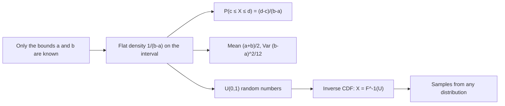

# Continuous Uniform Distribution

$$
f(x) = \frac{1}{b-a} \quad \text{for } a \le x \le b, \qquad f(x) = 0 \text{ otherwise}
$$

, with CDF $F(x) = \frac{x-a}{b-a}$ on $[a, b]$, mean $\frac{a+b}{2}$ and variance $\frac{(b-a)^2}{12}$

## Deep Breakdown

What it tells me *(Situation Awareness)*:
The continuous Uniform distribution $U(a, b)$ says every value in the interval $[a, b]$ is equally likely, so the density is a flat rectangle of height $1/(b-a)$ and the probability of any sub-interval is simply its length divided by the total length. It is the mathematical form of "I only know the bounds". It is also the raw material of simulation: computers generate $U(0, 1)$ numbers, and the inverse-CDF trick turns them into draws from any other distribution. A less obvious but very practical fact: when the null hypothesis is true and the test is valid, p-values follow $U(0, 1)$, which is how I audit an experimentation platform with A/A tests. In DA/DS: random search over hyperparameters, weight initialisation in neural networks, Monte Carlo simulation, random traffic assignment (hash a user ID into $[0, 1)$ and compare to the split), bounded "non-informative" priors, jitter in plots, and p-value calibration checks.

## Flowchart



## Real-world use

### Where it is used

Monte Carlo simulation and inverse-transform sampling, random search and Bayesian optimisation bounds for hyperparameters, Xavier/Glorot uniform weight initialisation, random assignment in A/B testing, scenario analysis when only a min and max are known (lead time, price range), and checking that p-values under a true null are uniform.

### Problem it solves

Provides the simplest valid model when every value in a range is equally plausible, and a neutral source of randomness from which all other random variables can be built.

### How it solves the problem

Spreads total probability 1 evenly over $[a, b]$: height $1/(b-a)$ times width $(b-a)$ gives area 1. Any question about the probability of a range becomes a ratio of lengths, and the linear CDF $F(x) = (x-a)/(b-a)$ is trivially invertible, so $X = a + (b-a)U$ turns a standard uniform into any $U(a, b)$.

### Example in a business

A supplier promises delivery "between 2 and 10 days" with no further information, so I model lead time as $U(2, 10)$. The chance a parcel arrives between day 3 and day 5 is $(5-3)/(10-2) = 0.25$. Expected lead time is $6$ days with variance $64/12 = 5.33$ (standard deviation $2.31$ days). For a promise date that 90% of orders meet, I take the 90th percentile $2 + 0.9 \times 8 = 9.2$ days.

## The formula, piece by piece

- $X$: continuous random variable restricted to $[a, b]$.
- $a$, $b$: lower and upper bounds, with $a \lt b$.
- $b - a$: width of the support.
- $1/(b-a)$: constant density height; it is not a probability, it makes the total area equal 1.
- $F(x) = (x-a)/(b-a)$: share of the interval lying below $x$.
- $E[X] = (a+b)/2$: the midpoint.
- $Var[X] = (b-a)^2/12$: depends only on the width.
- Quantile: $F^{-1}(q) = a + q(b-a)$.

## The formula in words

"Every point between $a$ and $b$ is equally likely, so the probability of landing in a sub-range is that sub-range's length divided by the whole length." Tiny example: a promo code is redeemed uniformly over a 60-minute flash sale. $P(\text{redeemed in the last 15 minutes}) = 15/60 = 0.25$.

## Critical Concepts

- **Density is not probability:** $f(x) = 1/(b-a)$ can exceed 1 when the interval is shorter than 1 (e.g. $U(0, 0.5)$ has height 2). Only areas are probabilities, and $P(X = x) = 0$ for any single point.
- **Inverse transform sampling:** if $U \sim U(0, 1)$ and $F$ is a CDF, then $F^{-1}(U)$ has CDF $F$. For example $-\ln(1-U)/\lambda$ is Exponential with rate $\lambda$.
- **Probability integral transform:** the reverse, $F(X) \sim U(0, 1)$, explains why valid p-values are uniform under the null and underpins PIT calibration checks for forecasts.
- **Max-entropy:** among all distributions on a bounded interval, the Uniform has the highest entropy, which is why it is the default "know only the bounds" choice.
- **Log-uniform for scales:** for hyperparameters such as the learning rate, sample $\log_{10}(\text{lr})$ uniformly (e.g. from $-5$ to $-1$), not the learning rate itself, so each order of magnitude gets equal attention.
- **Discrete cousin:** a fair die is the discrete Uniform on $\{1, \dots, 6\}$, with variance $(K^2 - 1)/12$ instead of $(b-a)^2/12$.

## Step-by-step calculation (tiny example)

*Step 1: Set up*
Lead time $X \sim U(2, 10)$, width $b - a = 8$, density $1/8 = 0.125$.

*Step 2: Interval probability*
$P(3 \le X \le 5) = (5 - 3) \times 0.125 = 0.25$.

*Step 3: Mean*
$E[X] = (2 + 10)/2 = 6$.

*Step 4: Variance and standard deviation*
$Var[X] = 8^2 / 12 = 64/12 = 5.333$, $SD = \sqrt{5.333} = 2.309$.

*Step 5: 90th percentile*
$F^{-1}(0.9) = 2 + 0.9 \times 8 = 9.2$ days.

## Code examples

### Beginner example (Python)

```python
from scipy.stats import uniform

a, b = 2, 10
dist = uniform(loc=a, scale=b - a)   # scipy uses loc=a, scale=b-a
print(f"Density height = {dist.pdf(6):.3f}")                 # 0.125
print(f"P(3 <= X <= 5) = {dist.cdf(5) - dist.cdf(3):.2f}")   # 0.25
print(f"Mean = {dist.mean():.1f} | Var = {dist.var():.3f} | SD = {dist.std():.3f}")   # 6.0 | 5.333 | 2.309
print(f"90th percentile = {dist.ppf(0.9):.1f}")              # 9.2
```

### Beginner example (R)

```r
a <- 2; b <- 10
cat(sprintf("P(3 <= X <= 5) = %.2f\n", punif(5, a, b) - punif(3, a, b)))   # 0.25
cat(sprintf("Mean = %.1f | Var = %.3f\n", (a + b) / 2, (b - a)^2 / 12))       # 6.0 | 5.333
cat(sprintf("90th percentile = %.1f\n", qunif(0.9, a, b)))                    # 9.2
```

### Professional example (Python)

```python
import numpy as np
from scipy.stats import kstest, ttest_ind


def inverse_transform_exponential(u: np.ndarray, rate: float) -> np.ndarray:
    """Turn U(0,1) draws into Exponential(rate) draws via the inverse CDF."""
    return -np.log1p(-u) / rate


def aa_test_pvalue_audit(n_tests: int, n_per_arm: int, rng: np.random.Generator) -> dict[str, float]:
    """Run many A/A tests (no true effect) and check that p-values are U(0,1).

    A broken pipeline (peeking, wrong variance, bad randomisation) shows up as
    p-values that pile up near 0 instead of being flat.
    """
    pvals = np.empty(n_tests)
    for i in range(n_tests):
        a = rng.normal(50, 10, n_per_arm)   # e.g. basket value, same in both arms
        b = rng.normal(50, 10, n_per_arm)
        pvals[i] = ttest_ind(a, b).pvalue
    ks = kstest(pvals, "uniform")
    return {
        "false_positive_rate_at_5pct": float((pvals < 0.05).mean()),
        "ks_pvalue_vs_uniform": float(ks.pvalue),
    }


rng = np.random.default_rng(42)

# 1. Inverse-transform sampling: time between orders, mean 4 minutes
u = rng.uniform(0, 1, 100_000)
gaps = inverse_transform_exponential(u, rate=0.25)
print(f"Mean gap between orders: {gaps.mean():.2f} min (theory 4.00)")

# 2. Log-uniform random search for a learning rate in [1e-5, 1e-1]
lrs = 10 ** rng.uniform(-5, -1, 8)
print("Random-search learning rates:", np.round(lrs, 6))

# 3. Experimentation platform audit: p-values should be uniform
print(aa_test_pvalue_audit(n_tests=2000, n_per_arm=200, rng=rng))
# Expect a false positive rate near 0.05 and a KS p-value that is not small
```

---

*Source: domain knowledge*
