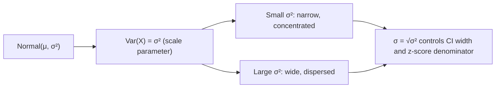

# Variance

$$
Var(X) = \sigma^2
$$

## Deep Breakdown

What it tells me *(Situation Awareness)*:
For the Normal distribution $N(\mu, \sigma^2)$, the variance is the parameter $\sigma^2$ by definition. It controls the width of the bell curve: small $\sigma^2$ = narrow, tall peak; large $\sigma^2$ = wide, flat curve. Estimating $\sigma^2$ from data is essential for confidence intervals, significance tests, and feature normalization.

## Flowchart



## Real-world use

### Where it is used

Confidence interval construction ($\pm z \sigma$), power analysis (effect size = $\Delta\mu/\sigma$), regularization scale selection, and feature normalization (StandardScaler divides by $\hat{\sigma}$).

### Problem it solves

Characterizes the dispersion of a Normal distribution — needed for all probability queries and parameter estimation.

### How it solves the problem

$\sigma^2$ is the second free parameter of the Normal distribution. It enters every probability computation through the standardized z-score $(x - \mu)/\sigma$.

### Example in a business

Sample size calculation: to detect a 5% lift in conversion (from 10% to 10.5%) at 80% power with $\alpha=0.05$, the required $n$ depends on $\sigma^2 = p(1-p)$ of the Bernoulli conversion model.

## The formula, piece by piece

$Var(X) = \sigma^2$ for $X \sim N(\mu, \sigma^2)$
- $\sigma^2$: variance parameter of the Normal.
- Estimated from data: $\hat{\sigma}^2 = \frac{1}{n-1}\sum(x_i - \bar{x})^2$ (sample variance, Bessel's correction).

## The formula in words

"For a Normal distribution, the variance is the parameter σ² — the square of the standard deviation that controls spread."

## Critical Concepts

- MLE of $\sigma^2$: $\hat{\sigma}^2_{\text{MLE}} = \frac{1}{n}\sum(x_i - \bar{x})^2$ (biased).
- Unbiased estimator: divide by $n-1$ (sample variance).
- $\sigma^2$ and $\mu$ are independent for Normal distribution.
- For heteroscedastic models (variance varies with $x$), $\sigma^2$ becomes $\sigma^2(x)$.

## Step-by-step calculation (tiny example)

*Step 1: Data [95, 100, 105, 98, 102], μ=100*

*Step 2: Squared deviations*
$(95-100)^2=25$, $(100-100)^2=0$, $(105-100)^2=25$, $(98-100)^2=4$, $(102-100)^2=4$

*Step 3: Sample variance (n-1=4)*
$\hat{\sigma}^2 = (25+0+25+4+4)/4 = 58/4 = 14.5$

## Code examples

### Beginner example (Python)

```python
import numpy as np
from scipy.stats import norm
data = np.array([95, 100, 105, 98, 102], dtype=float)
sigma2_sample = np.var(data, ddof=1)   # unbiased (n-1)
sigma2_mle = np.var(data)   # MLE (n)
print(f"Sample variance (n-1): {sigma2_sample:.2f}")   # 14.5
print(f"MLE variance (n): {sigma2_mle:.2f}")   # 11.6 # Fitted Normal
fitted = norm(loc=data.mean(), scale=np.sqrt(sigma2_sample))
print(f"Fitted Var(X) = σ² = {fitted.var():.2f}")
```

### Beginner example (R)

```r
data <- c(95, 100, 105, 98, 102)
cat(sprintf("Sample variance: %.2f\n", var(data)))  # 14.5
cat(sprintf("Population var: %.2f\n", var(data) * (length(data)-1)/length(data)))
```

### Professional example (Python)

```python
import numpy as np
from scipy.stats import norm

def normal_sample_size_for_power( effect_size_delta: float, population_std: float, alpha: float = 0.05, power: float = 0.80 ) -> int:
    """Compute required sample size for Normal mean test. Uses variance σ² to compute effect size and required n. Args: effect_size_delta: Minimum detectable difference in means. population_std: σ, standard deviation. alpha: Type I error rate. power: 1 - Type II error rate. Returns: Required sample size per group. """
    z_alpha = norm.ppf(1 - alpha / 2)
    z_beta = norm.ppf(power)
    n = ((z_alpha + z_beta) ** 2 * population_std ** 2) / (effect_size_delta ** 2)
    return int(np.ceil(n))   # Sample size sensitivity to σ
sigma_values = [0.5, 1.0, 1.5, 2.0, 3.0]
delta = 0.5   # detectable difference
print(f"Required n per group (delta={delta}, alpha=0.05, power=0.80):")
for sigma_val in sigma_values:
    n_required = normal_sample_size_for_power(delta, sigma_val)
print(f" σ={sigma_val:.1f} (σ²={sigma_val**2:.2f}): n={n_required:,}")
```

---

*Source: domain knowledge*
