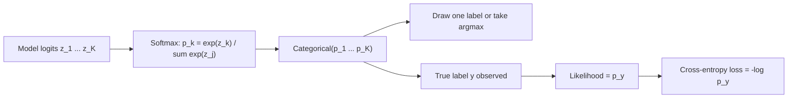

# Categorical Distribution (1 trial, K outcomes)

$$
P(X=k) = p_k = \prod_{j=1}^{K} p_j^{[x=j]}
$$

, where $p_k \ge 0$, $\sum_{k=1}^{K} p_k = 1$, and $[x=j]$ is 1 if $x=j$ and 0 otherwise

## Deep Breakdown

What it tells me *(Situation Awareness)*:
The Categorical distribution models one single draw that lands in exactly one of $K$ classes, with class $k$ having probability $p_k$. It is the multi-class generalisation of the Bernoulli ($K=2$) and the one-trial special case of the Multinomial ($n=1$). The product form $\prod_j p_j^{[x=j]}$ looks odd but simply "switches on" the probability of the observed class, exactly like $p^x(1-p)^{1-x}$ does for Bernoulli. Its negative log-likelihood for one observation is $-\log p_y$, which is precisely the cross-entropy loss. In DA/DS: every softmax output of a multiclass classifier is a Categorical distribution over labels; LLM next-token prediction is a Categorical over the vocabulary (sampling with temperature, top-k and top-p all reshape $p$ before drawing); multinomial logistic regression, Naive Bayes class priors, customer segment assignment, ticket routing, and the "which plan will this user pick" question are all Categorical models.

## Flowchart



## Real-world use

### Where it is used

Multiclass classification (softmax layer, multinomial logistic regression), language-model token sampling, recommendation of one item among $K$, routing a support ticket to one of $K$ teams, modelling which product category a shopper buys, and topic or cluster assignment in mixture models.

### Problem it solves

Gives a valid probability for each of $K$ mutually exclusive outcomes of one event, so a model can express uncertainty across classes instead of just outputting a single label, and so that model can be trained by maximum likelihood.

### How it solves the problem

The model produces $K$ non-negative numbers that sum to 1 (softmax guarantees this). The observed class $y$ receives likelihood $p_y$; maximising $\sum_i \log p_{y_i}$ over the training set is the same as minimising average cross-entropy. At prediction time I either take $\arg\max_k p_k$ (classification) or sample from $p$ (generation).

### Example in a business

A support-ticket router outputs $p = (0.7, 0.2, 0.1)$ for (Billing, Tech, Sales). If the ticket really is Billing, the loss is $-\log 0.7 = 0.3567$; if it is really Sales, the loss is $-\log 0.1 = 2.3026$, more than six times larger. That asymmetry is what pushes the model to put mass on the right class, and calibrated $p_k$ let the operations team auto-route only tickets with $p_{\max} \ge 0.8$ and send the rest to a human.

## The formula, piece by piece

- $X$: the outcome of one trial, taking a value in $\{1, \dots, K\}$.
- $K$: number of possible classes or categories.
- $p_k$: probability of class $k$; the parameter vector $p = (p_1, \dots, p_K)$ lives on the probability simplex.
- $\sum_k p_k = 1$: exactly one class happens.
- $[x=j]$: indicator (one-hot encoding) that the outcome is class $j$.
- $\prod_j p_j^{[x=j]}$: every factor is $p_j^0 = 1$ except the observed class, so the product equals $p_x$.
- $E[[X=k]] = p_k$ and $Var([X=k]) = p_k(1-p_k)$: each one-hot component is a Bernoulli.
- $-\log p_y$: the negative log-likelihood, i.e. the cross-entropy between the one-hot label and $p$.

## The formula in words

"One trial, $K$ possible outcomes: the probability of seeing class $k$ is just $p_k$, and the probabilities over all classes add to one." Tiny example: a shopper buys from Electronics, Fashion, or Home with probabilities $0.5, 0.3, 0.2$. $P(\text{Fashion}) = 0.5^0 \times 0.3^1 \times 0.2^0 = 0.3$.

## Critical Concepts

- **Bernoulli and Multinomial relatives:** $K=2$ gives the Bernoulli; $n$ independent Categorical draws, counted per class, give the Multinomial.
- **Softmax output is a Categorical:** $p_k = e^{z_k}/\sum_j e^{z_j}$. Compute it with the log-sum-exp trick so large logits do not overflow.
- **Cross-entropy = Categorical NLL:** training any softmax classifier with cross-entropy is maximum-likelihood estimation of a Categorical model.
- **MLE from data:** with no features, $\hat{p}_k = n_k / n$, the class frequencies (class priors).
- **Argmax vs sampling:** classification uses $\arg\max_k p_k$; LLMs sample, and temperature $T$ rescales logits as $z/T$ to make $p$ sharper ($T$ less than 1) or flatter ($T$ greater than 1).
- **Calibration:** a model can rank classes well yet output over-confident $p_k$; check reliability diagrams before using $p_k$ as real probabilities in business rules.

## Step-by-step calculation (tiny example)

*Step 1: Model output*
Router probabilities $p = (0.7, 0.2, 0.1)$ for (Billing, Tech, Sales). Check: $0.7 + 0.2 + 0.1 = 1$.

*Step 2: Probability of the true label*
True label is Billing, so the one-hot is $(1, 0, 0)$ and $P(X=\text{Billing}) = 0.7^1 \times 0.2^0 \times 0.1^0 = 0.7$.

*Step 3: Loss for this ticket*
$-\log 0.7 = 0.3567$.

*Step 4: Compare with a wrong-but-possible label*
If the true label were Tech: $-\log 0.2 = 1.6094$. If Sales: $-\log 0.1 = 2.3026$.

*Step 5: Interpretation*
The less probability the model gave to the truth, the larger the loss; averaging these over all tickets gives the training cross-entropy.

## Code examples

### Beginner example (Python)

```python
import numpy as np

labels = ["Billing", "Tech", "Sales"]
p = np.array([0.7, 0.2, 0.1])
print(f"Sum of p = {p.sum():.2f}")   # 1.00
for name, pk in zip(labels, p):
    print(f"P({name}) = {pk:.1f} | loss if true = {-np.log(pk):.4f}")
# Billing 0.3567, Tech 1.6094, Sales 2.3026

rng = np.random.default_rng(42)
draws = rng.choice(len(p), size=100_000, p=p)
print("Empirical frequencies:", np.round(np.bincount(draws) / draws.size, 3))   # about [0.7 0.2 0.1]
```

### Beginner example (R)

```r
p <- c(Billing = 0.7, Tech = 0.2, Sales = 0.1)
print(-log(p))   # 0.3567 1.6094 2.3026
set.seed(42)
draws <- sample(names(p), size = 100000, replace = TRUE, prob = p)
print(round(table(draws) / length(draws), 3))
```

### Professional example (Python)

```python
import numpy as np
from scipy.special import logsumexp
from sklearn.datasets import make_classification
from sklearn.linear_model import LogisticRegression
from sklearn.metrics import log_loss
from sklearn.model_selection import train_test_split


def categorical_nll(logits: np.ndarray, y: np.ndarray) -> float:
    """Mean negative log-likelihood of a Categorical(softmax(logits)) model.

    log p_y = z_y - logsumexp(z), computed stably.
    """
    log_probs = logits - logsumexp(logits, axis=1, keepdims=True)
    return float(-log_probs[np.arange(len(y)), y].mean())


X, y = make_classification(
    n_samples=3000, n_features=8, n_informative=5, n_classes=3, random_state=42
)
X_tr, X_te, y_tr, y_te = train_test_split(X, y, test_size=0.3, random_state=42)
clf = LogisticRegression(max_iter=1000).fit(X_tr, y_tr)

logits = clf.decision_function(X_te)        # z_1..z_K per ticket
probs = clf.predict_proba(X_te)             # softmax(z) = Categorical parameters
print(f"Rows sum to 1: {np.allclose(probs.sum(axis=1), 1.0)}")
print(f"Manual Categorical NLL: {categorical_nll(logits, y_te):.4f}")
print(f"sklearn log_loss:       {log_loss(y_te, probs):.4f}")   # identical

# Business rule: auto-route only confident predictions
confident = probs.max(axis=1) >= 0.8
acc_conf = (probs.argmax(axis=1)[confident] == y_te[confident]).mean()
print(f"Auto-routed share: {confident.mean():.1%} | accuracy there: {acc_conf:.1%}")
```

---

*Source: domain knowledge*
