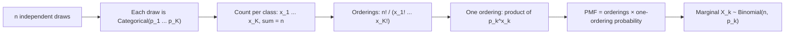

# Multinomial Distribution (n trials, K outcomes)

$$
P(X_1=x_1, \dots, X_K=x_K) = \frac{n!}{x_1!\, x_2! \cdots x_K!} \prod_{k=1}^{K} p_k^{x_k}
$$

, where $x_k \ge 0$, $\sum_k x_k = n$, $p_k \ge 0$ and $\sum_k p_k = 1$

## Deep Breakdown

What it tells me *(Situation Awareness)*:
The Multinomial distribution describes the vector of counts $(X_1, \dots, X_K)$ I get when I repeat $n$ independent Categorical trials with the same class probabilities $p_k$. It generalises the Binomial from two outcomes to $K$ (Binomial is Multinomial with $K=2$) and the Categorical from one trial to $n$ (Categorical is Multinomial with $n=1$). The multinomial coefficient counts the orderings that produce the same counts; the product gives the probability of any one ordering. Each single count is marginally Binomial, $X_k \sim \text{Binomial}(n, p_k)$, with mean $np_k$ and variance $np_k(1-p_k)$, and counts are negatively correlated, $Cov(X_i, X_j) = -np_ip_j$, because they must add up to $n$. In DA/DS: plan or product-mix counts, traffic split across channels, survey answer counts, sample-ratio-mismatch checks in A/B/n tests, chi-square goodness-of-fit tests, bag-of-words document models (Multinomial Naive Bayes), and topic models.

## Flowchart



## Real-world use

### Where it is used

Distribution of sign-ups across pricing tiers, sessions across acquisition channels, users across A/B/n variants, star ratings across 1 to 5, words across a vocabulary (text classification), and categorical survey answers.

### Problem it solves

Gives the joint probability of a whole vector of class counts, so I can test whether an observed mix matches an expected mix (e.g. is the 33/33/33 traffic split actually happening?) and estimate class shares with their uncertainty.

### How it solves the problem

Independence makes any specific sequence with counts $x_1, \dots, x_K$ have probability $\prod_k p_k^{x_k}$. The multinomial coefficient $n!/(x_1! \cdots x_K!)$ counts how many sequences have those counts. Their product is the PMF; the likelihood ratio between observed shares and hypothesised shares leads to the chi-square goodness-of-fit test.

### Example in a business

A SaaS company expects new sign-ups to split Basic/Pro/Enterprise as $(0.5, 0.3, 0.2)$. For a batch of 5 sign-ups, the probability of exactly 3 Basic, 1 Pro and 1 Enterprise is $0.15$. On a larger scale, an A/B/C test meant to split traffic equally recorded 3,420 / 3,300 / 3,280 users; a chi-square test against $(1/3, 1/3, 1/3)$ gives $\chi^2 = 3.44$ and a p-value of about $0.18$, so there is no evidence of a sample-ratio mismatch.

## The formula, piece by piece

- $n$: total number of independent trials (sign-ups, sessions, words).
- $K$: number of categories.
- $x_k$: observed count in category $k$; the counts sum to $n$.
- $p_k$: probability that one trial falls in category $k$.
- $n!/(x_1! \cdots x_K!)$: multinomial coefficient, number of distinct orderings giving these counts.
- $\prod_k p_k^{x_k}$: probability of any single ordering with these counts.
- $E[X_k] = np_k$, $Var[X_k] = np_k(1-p_k)$, $Cov(X_i, X_j) = -np_ip_j$ for $i \ne j$.
- MLE: $\hat{p}_k = x_k / n$.

## The formula in words

"The chance of seeing a particular mix of counts is the number of ways to order the $n$ trials into that mix, times the probability of one such ordering." Tiny example: 2 orders, each from category A or B with probability $0.6$ and $0.4$: $P(1, 1) = \frac{2!}{1!\,1!} \times 0.6 \times 0.4 = 2 \times 0.24 = 0.48$, exactly the Binomial answer.

## Critical Concepts

- **Family tree:** $K=2$ is the Binomial; $n=1$ is the Categorical; $n=1, K=2$ is the Bernoulli.
- **Marginals are Binomial:** to reason about one category alone, use $X_k \sim \text{Binomial}(n, p_k)$.
- **Negative covariance:** more users in one class means fewer elsewhere; do not treat per-class counts as independent.
- **Chi-square test:** $\sum_k (x_k - np_k)^2 / (np_k)$ is approximately $\chi^2_{K-1}$ under the null, valid when every expected count $np_k$ is at least about 5.
- **Poisson connection:** independent Poisson counts, conditioned on their total $n$, are Multinomial. This is why Poisson regression and multinomial models often give the same inference on shares.
- **Overdispersion:** if users cluster (e.g. company accounts signing up together), the real variance exceeds $np_k(1-p_k)$; the Dirichlet-Multinomial handles this.

## Step-by-step calculation (tiny example)

*Step 1: Set up*
$n = 5$ sign-ups, $p = (0.5, 0.3, 0.2)$ for (Basic, Pro, Enterprise), counts $x = (3, 1, 1)$.

*Step 2: Multinomial coefficient*
$\frac{5!}{3!\,1!\,1!} = \frac{120}{6} = 20$.

*Step 3: Probability of one ordering*
$0.5^3 \times 0.3^1 \times 0.2^1 = 0.125 \times 0.3 \times 0.2 = 0.0075$.

*Step 4: Multiply*
$P = 20 \times 0.0075 = 0.15$.

*Step 5: Marginal sanity check*
Basic count alone: $X_1 \sim \text{Binomial}(5, 0.5)$, so $E[X_1] = 2.5$; seeing 3 Basic is close to typical.

## Code examples

### Beginner example (Python)

```python
from scipy.stats import multinomial

n, p = 5, [0.5, 0.3, 0.2]
dist = multinomial(n, p)
print(f"P(3, 1, 1) = {dist.pmf([3, 1, 1]):.4f}")   # 0.1500
print(f"P(1, 1) with n=2, p=(0.6, 0.4) = {multinomial(2, [0.6, 0.4]).pmf([1, 1]):.2f}")   # 0.48
print("E[X] =", dist.mean())   # [2.5 1.5 1. ]
print("Cov matrix:\n", dist.cov())
```

### Beginner example (R)

```r
p <- c(0.5, 0.3, 0.2)
cat(sprintf("P(3, 1, 1) = %.4f\n", dmultinom(c(3, 1, 1), size = 5, prob = p)))   # 0.15
set.seed(42)
print(rmultinom(3, size = 5, prob = p))   # three simulated batches of 5 sign-ups
```

### Professional example (Python)

```python
import numpy as np
from scipy.stats import chisquare, multinomial


def sample_ratio_mismatch(
    observed: np.ndarray, expected_share: np.ndarray, alpha: float = 0.01
) -> dict[str, float]:
    """Check whether traffic in an A/B/n test follows the planned Multinomial split.

    Args:
        observed: Users per variant.
        expected_share: Planned allocation probabilities (sum to 1).
        alpha: Significance threshold for flagging a mismatch.

    Returns:
        Dict with chi-square statistic, p-value and a mismatch flag.
    """
    n = observed.sum()
    expected = n * expected_share
    stat, p_value = chisquare(observed, f_exp=expected)
    return {"n": float(n), "chi2": float(stat), "p_value": float(p_value),
            "mismatch": float(p_value < alpha)}


observed = np.array([3420, 3300, 3280])
planned = np.array([1, 1, 1]) / 3
print(sample_ratio_mismatch(observed, planned))   # chi2 = 3.44, p_value about 0.18, no mismatch

# Monte Carlo check of the same p-value using the Multinomial directly
rng = np.random.default_rng(42)
n = observed.sum()
expected = n * planned
obs_stat = ((observed - expected) ** 2 / expected).sum()
sims = multinomial.rvs(n, planned, size=50_000, random_state=rng)
sim_stats = ((sims - expected) ** 2 / expected).sum(axis=1)
print(f"Simulated p-value: {(sim_stats >= obs_stat).mean():.3f}")
```

---

*Source: domain knowledge*
