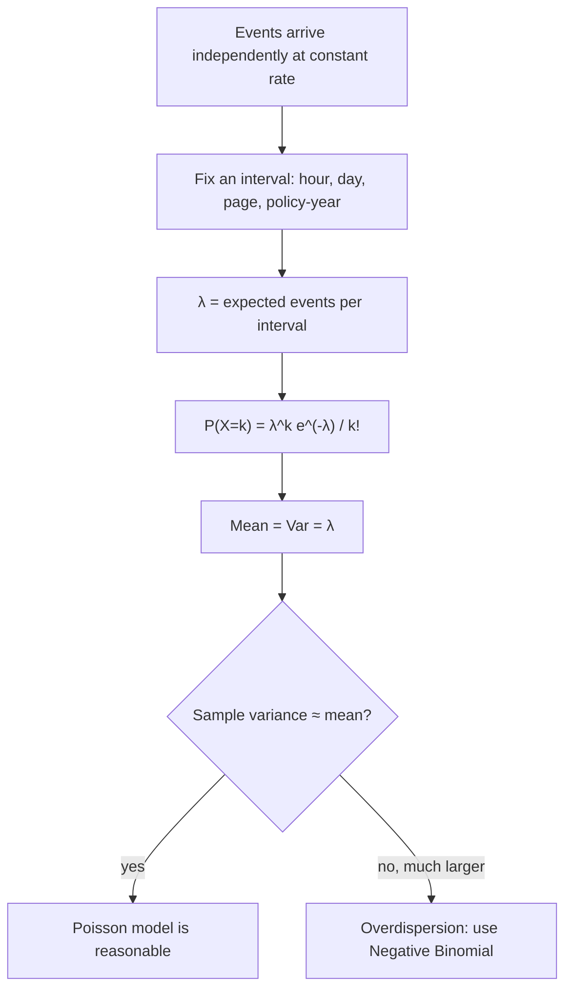

# Poisson Distribution (counts per interval)

$$
P(X=k) = \frac{\lambda^k e^{-\lambda}}{k!}
$$

, where $k \in \{0, 1, 2, \dots\}$ and $\lambda \gt 0$ is the expected count per interval

## Deep Breakdown

What it tells me *(Situation Awareness)*:
The Poisson distribution models how many events happen in a fixed interval of time, space or exposure when events occur independently and at a constant average rate $\lambda$. There is no fixed upper limit on the count, unlike the Binomial. Its signature property is that the mean and variance are both equal to $\lambda$, which gives me an instant diagnostic: if my count data has variance far above its mean, the plain Poisson is the wrong model (overdispersion). It is also the limit of $\text{Binomial}(n, p)$ when $n$ is large, $p$ is small and $np = \lambda$, which is why it fits rare events among many opportunities. In DA/DS: support tickets per hour, orders per minute, website errors per day, insurance claims per policy-year, goals per match, Poisson regression (GLM with log link) for count targets, capacity and staffing planning, anomaly alerts on event counts, and arrival processes in queueing models.

## Flowchart



## Real-world use

### Where it is used

Call-centre and support-ticket staffing, web traffic and order arrivals, incident and error monitoring, insurance claim frequency, rare-defect counts in manufacturing, and as the likelihood in Poisson regression for count targets (visits, purchases per customer, claims).

### Problem it solves

Gives the probability of every possible count in an interval from a single number, the rate $\lambda$, so I can plan capacity ("how many agents cover 95% of hours?"), flag anomalies ("is 12 errors this hour unusual?") and model counts as a function of features.

### How it solves the problem

Split the interval into many tiny slots, each with a tiny chance of one event; the Binomial over those slots converges to $\lambda^k e^{-\lambda}/k!$. Tail probabilities $P(X \ge k)$ quantify how surprising a count is, and quantiles give capacity targets.

### Example in a business

A help desk receives on average $\lambda = 3$ tickets per hour. The chance of a completely quiet hour is $P(X=0) = 0.0498$; the chance of exactly 5 tickets is $0.1008$. One agent can handle 5 tickets per hour, so the probability of overload in a given hour is $P(X \ge 6) = 0.0839$. Planning for 6 tickets covers $96.6\%$ of hours; the 95th percentile of the distribution is 6 and the 99th is 8, which sets the on-call threshold.

## The formula, piece by piece

- $X$: count of events in one interval (0, 1, 2, ... with no upper bound).
- $k$: the specific count I am asking about.
- $\lambda$: rate parameter, the expected number of events per interval; it scales with interval length (3 per hour means 72 per day).
- $\lambda^k$: grows with the number of events requested.
- $k!$: corrects for the order of the $k$ events not mattering.
- $e^{-\lambda}$: normalising constant; it is also $P(X=0)$.
- $E[X] = \lambda$ and $Var[X] = \lambda$.
- MLE: $\hat{\lambda} = \bar{x}$, the sample mean count per interval.

## The formula in words

"If events arrive at an average of $\lambda$ per interval, the probability of exactly $k$ events is $\lambda^k$ times $e^{-\lambda}$, divided by $k!$." Tiny example: a store averages $0.5$ returns per day. $P(\text{no returns today}) = e^{-0.5} = 0.6065$, so at least one return happens on $39.3\%$ of days.

## Critical Concepts

- **Mean equals variance:** the one-parameter model forces $Var = \lambda$. Real data (e.g. purchases per customer) is often overdispersed; use the Negative Binomial or a quasi-Poisson model then.
- **Rate scales with exposure:** if $\lambda$ is per hour, the count over $t$ hours is $\text{Poisson}(\lambda t)$. In Poisson regression this is the log-exposure offset.
- **Sum of Poissons:** independent $\text{Poisson}(\lambda_1) + \text{Poisson}(\lambda_2) = \text{Poisson}(\lambda_1 + \lambda_2)$, so channel-level rates add up to a total rate.
- **Binomial limit:** $\text{Binomial}(n, p) \approx \text{Poisson}(np)$ when $n$ is large and $p$ is small (e.g. fraud cases among many transactions).
- **Exponential waiting times:** in a Poisson process, the time between events follows an Exponential distribution with mean $1/\lambda$.
- **Zero inflation:** many structural zeros (customers who never buy) call for zero-inflated or hurdle models.
- **Normal approximation:** for large $\lambda$ (say above 20), $X \approx \text{Normal}(\lambda, \lambda)$.

## Step-by-step calculation (tiny example)

*Step 1: Set up*
$\lambda = 3$ tickets per hour, want $P(X = 5)$.

*Step 2: Numerator*
$\lambda^5 = 3^5 = 243$, $e^{-3} = 0.049787$, product $= 243 \times 0.049787 = 12.0983$.

*Step 3: Divide by 5!*
$5! = 120$, so $P(X=5) = 12.0983 / 120 = 0.1008$.

*Step 4: Overload probability*
$P(X \le 5) = 0.04979 + 0.14936 + 0.22404 + 0.22404 + 0.16803 + 0.10082 = 0.91608$, so $P(X \ge 6) = 1 - 0.91608 = 0.0839$.

## Code examples

### Beginner example (Python)

```python
from scipy.stats import poisson

lam = 3
dist = poisson(lam)
print(f"P(X=0) = {dist.pmf(0):.4f}")    # 0.0498
print(f"P(X=5) = {dist.pmf(5):.4f}")    # 0.1008
print(f"P(X>=6) = {dist.sf(5):.4f}")    # 0.0839
print(f"95th / 99th percentile: {dist.ppf(0.95):.0f} / {dist.ppf(0.99):.0f}")   # 6 / 8
print(f"Mean = {dist.mean():.1f} | Var = {dist.var():.1f}")   # 3.0 | 3.0
```

### Beginner example (R)

```r
lam <- 3
cat(sprintf("P(X=5) = %.4f\n", dpois(5, lambda = lam)))           # 0.1008
cat(sprintf("P(X>=6) = %.4f\n", 1 - ppois(5, lambda = lam)))      # 0.0839
cat(sprintf("95th percentile = %d\n", qpois(0.95, lambda = lam))) # 6
```

### Professional example (Python)

```python
import numpy as np
from scipy.stats import nbinom, poisson


def count_model_report(counts: np.ndarray, coverage: float = 0.95) -> dict[str, float]:
    """Fit a Poisson rate, test for overdispersion, and give a staffing threshold.

    Args:
        counts: Event counts per interval (e.g. tickets per hour).
        coverage: Share of intervals the capacity should cover.

    Returns:
        Dict with lambda_hat, dispersion ratio and capacity quantiles.
    """
    lam_hat = counts.mean()
    dispersion = counts.var(ddof=1) / lam_hat   # about 1 for Poisson data
    return {
        "lambda_hat": float(lam_hat),
        "dispersion_ratio": float(dispersion),
        "poisson_capacity": float(poisson.ppf(coverage, lam_hat)),
        "empirical_capacity": float(np.quantile(counts, coverage)),
    }


rng = np.random.default_rng(42)
hours = 24 * 90   # one quarter of hourly data

# Case 1: genuinely Poisson ticket arrivals
tickets = rng.poisson(lam=3.0, size=hours)
print("Poisson data:", {k: round(v, 3) for k, v in count_model_report(tickets).items()})

# Case 2: overdispersed counts (busy and quiet hours mixed), same mean of 3
r = 2.0
bursty = nbinom.rvs(r, r / (r + 3.0), size=hours, random_state=rng)
print("Bursty data: ", {k: round(v, 3) for k, v in count_model_report(bursty).items()})
# Dispersion ratio well above 1 -> Poisson under-estimates the capacity needed
```

---

*Source: domain knowledge*
