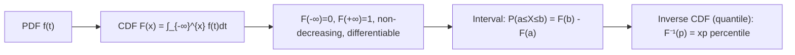

# Cumulative Distribution Function (CDF)

$$
F(x) = P(X \le x) = \int_{-\infty}^x f(t) dt
$$

## Deep Breakdown

What it tells me *(Situation Awareness)*:
The CDF for a continuous RV is the integral of the PDF from $-\infty$ to $x$. It gives the probability that $X$ takes a value at or below $x$. It is a smooth, non-decreasing function from 0 to 1. Used for percentile computation, the inverse CDF (quantile function), probability of intervals, and the probability integral transform.

## Flowchart



## Real-world use

### Where it is used

Percentile/quantile computations (median, IQR). P-value computation in hypothesis tests. Generating random samples via inverse CDF transform. Probability integral transform (PIT) for residual diagnostics.

### Problem it solves

Converts from density (PDF) to probability (area under curve), enabling interval and tail probability queries.

### How it solves the problem

Integrates the PDF from $-\infty$ to $x$, accumulating probability mass up to $x$.

### Example in a business

$P(\text{session duration} > 5 \text{ min}) = 1 - F(5)$ where $F$ is the CDF of the fitted lognormal distribution. Used to set SLA thresholds or product performance benchmarks.

## The formula, piece by piece

$F(x) = \int_{-\infty}^{x} f(t) \, dt$
- $F(x)$: cumulative probability up to $x$.
- $f(t)$: the PDF.
- Derivative: $F'(x) = f(x)$ (the PDF is the derivative of the CDF).

## The formula in words

"The CDF at $x$ is the total area under the PDF curve from negative infinity to $x$."

## Critical Concepts

- $F'(x) = f(x)$: PDF = derivative of CDF. CDF = integral of PDF.
- $P(a \leq X \leq b) = F(b) - F(a)$.
- Quantile function: $Q(p) = F^{-1}(p)$ — inverse of CDF.
- Python: `scipy.stats.<dist>.cdf(x)`, inverse: `ppf(p)`.
- PIT: if $X \sim F$, then $F(X) \sim \text{Uniform}(0,1)$ — used for residual diagnostics.

## Step-by-step calculation (tiny example)

*Step 1: Exponential distribution, rate λ=1*
PDF: $f(x) = e^{-x}$ for $x \geq 0$.

*Step 2: CDF integral*
$F(x) = \int_0^x e^{-t} dt = [-e^{-t}]_0^x = 1 - e^{-x}$

*Step 3: Query*
$P(X \leq 2) = 1 - e^{-2} \approx 0.865$

## Code examples

### Beginner example (Python)

```python
from scipy.stats import expon, norm
import numpy as np   # Exponential: P(X <= 2) where lambda=1 (scale=1/lambda=1)
p_under_2 = expon.cdf(2, scale=1)
print(f"P(Exp(1) ≤ 2) = {p_under_2:.4f}")   # ~0.865 # Normal: 95th percentile (inverse CDF)
p95 = norm.ppf(0.95, loc=0, scale=1)
print(f"95th percentile of N(0,1) = {p95:.4f}")   # ~1.645
```

### Beginner example (R)

```r
cat(sprintf("P(Exp(1) <= 2) = %.4f\n", pexp(2, rate=1)))
cat(sprintf("95th percentile N(0,1) = %.4f\n", qnorm(0.95)))
```

### Professional example (Python)

```python
import numpy as np
from scipy.stats import lognorm, kstest
from scipy.special import erfc

def fit_and_evaluate_cdf( data: np.ndarray, distribution_name: str = "lognorm" ) -> dict[str, float | bool]:
    """Fit a distribution and evaluate CDF for SLA analysis. Uses probability integral transform (PIT) check: if model is correct, F(data) ~ Uniform(0,1). Args: data: Positive continuous data. distribution_name: scipy.stats distribution name. Returns: Dict with fit params, SLA probabilities, and PIT KS test result. """
    import scipy.stats as ss
    dist = getattr(ss, distribution_name)
    params = dist.fit(data, floc=0)
    shape_args = params[:-2]
    loc, scale = params[-2], params[-1]
    fitted = dist(*shape_args, loc=loc, scale=scale)
    pit_values = fitted.cdf(data)
    ks_stat, ks_p = kstest(pit_values, "uniform")
    return { "p_under_p50": float(fitted.cdf(np.percentile(data, 50))), "p95_quantile": float(fitted.ppf(0.95)), "ks_pit_statistic": ks_stat, "ks_pit_pvalue": ks_p, "distribution_adequate": ks_p > 0.05, }
rng = np.random.default_rng(seed=42)
session_durations = rng.lognormal(mean=1.5, sigma=0.8, size=2_000)
result = fit_and_evaluate_cdf(session_durations)
print("Lognormal CDF fit:")
for key, val in result.items():
    print(f" {key}: {val}")
```

---

*Source: domain knowledge*
