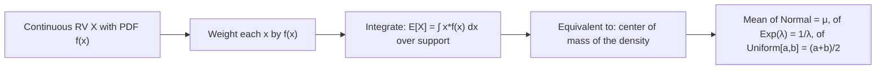

# Expected Value

$$
E[X] = \int_{-\infty}^\infty x f(x) dx
$$

## Deep Breakdown

What it tells me *(Situation Awareness)*:
The expected value of a continuous RV is the probability-weighted average, with integration replacing the discrete sum. It is the "center of mass" of the PDF. Same conceptual role as the discrete case — long-run average, decision theory baseline, loss function component — but computed via integration.

## Flowchart



## Real-world use

### Where it is used

Computing expected revenue from a continuous revenue model, mean prediction in regression (E[Y|X] = hat{y}), expected time between events (exponential model), or expected feature value in a Gaussian-distributed population.

### Problem it solves

Computes the long-run average value of a continuous random variable — the continuous analog of $E[X] = \sum x P(X=x)$.

### How it solves the problem

Integrates $x \cdot f(x)$ — weighting each value $x$ by its infinitesimal probability $f(x)dx$ and summing via integration.

### Example in a business

Customer LTV modeled as Exponential($\lambda = 1/24$) months: $E[\text{LTV}] = 1/\lambda = 24$ months average lifetime. Used to set marketing budget ceiling $\text{CAC} < \text{LTV}$.

## The formula, piece by piece

$E[X] = \int_{-\infty}^{\infty} x \, f(x) \, dx$
- $x$: the value weighted.
- $f(x)$: the PDF (acts as the weight/density).
- Integral: sums infinitesimally many weighted contributions.

## The formula in words

"The expected value is the integral of each value $x$ multiplied by its density $f(x)$."

## Critical Concepts

- $E[X] = \mu$ for a Normal distribution.
- $E[X] = 1/\lambda$ for Exponential($\lambda$).
- $E[X] = (a+b)/2$ for Uniform($a$, $b$).
- Linearity still holds: $E[aX + b] = aE[X] + b$.
- For functions: $E[g(X)] = \int g(x) f(x) dx$ (LOTUS).

## Step-by-step calculation (tiny example)

*Step 1: Uniform on [0, 4]: f(x) = 1/4*

*Step 2: Integrate*
$E[X] = \int_0^4 x \cdot \frac{1}{4} dx = \frac{1}{4} \cdot \frac{x^2}{2} \Big|_0^4 = \frac{1}{4} \cdot 8 = 2$

*Step 3: Verify*
Midpoint of [0,4] is 2. Correct by symmetry.

## Code examples

### Beginner example (Python)

```python
from scipy.stats import expon, norm, uniform
from scipy.integrate import quad
import numpy as np   # Expected values from scipy
print(f"Exp(lambda=1/24): E[X] = {expon(scale=24).mean():.1f}")   # 24
print(f"Normal(10, 2): E[X] = {norm(10, 2).mean():.1f}")   # 10
print(f"Uniform(0, 4): E[X] = {uniform(0, 4).mean():.1f}")   # 2 # Manual integration
exp_val, _ = quad(lambda x: x * expon.pdf(x, scale=24), 0, 1000)
print(f"Manual integral E[Exp(24)] = {exp_val:.2f}")
```

### Beginner example (R)

```r
# Theoretical means
cat("Exp(1/24): E[X] =", 1 / (1/24), "\n")  # 24
cat("Normal(10,2): E[X] = 10\n")
cat("Uniform(0,4): E[X] =", (0+4)/2, "\n")  # 2
```

### Professional example (Python)

```python
import numpy as np
from scipy.stats import lognorm, norm
from scipy.integrate import quad

def continuous_expected_value( pdf_func: callable, support_lower: float = -np.inf, support_upper: float = np.inf ) -> float:
    """Compute E[X] = ∫ x * f(x) dx numerically. Args: pdf_func: The PDF function f(x). support_lower: Integration lower bound. support_upper: Integration upper bound. Returns: E[X] as a float. """
    integrand = lambda x: x * pdf_func(x)
    result, _ = quad(integrand, support_lower, support_upper, limit=500)
    return result   # Compare lognormal E[X] computed analytically vs numerically
from scipy.stats import lognorm
mu_log, sigma_log = 3.0, 0.5
lognorm_dist = lognorm(s=sigma_log, scale=np.exp(mu_log))
analytical = lognorm_dist.mean()   # exp(mu + sigma^2/2)
numerical = continuous_expected_value(lognorm_dist.pdf, support_lower=0)
print(f"Lognormal E[X]:")
print(f" Analytical: {analytical:.6f}")
print(f" Numerical: {numerical:.6f}")
print(f" Match: {abs(analytical - numerical) < 1e-4}")
```

---

*Source: AIO p. 85*
