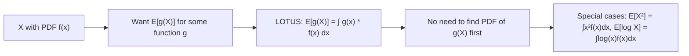

# Function Expectation

$$
E[g(X)] = \int_{-\infty}^\infty g(x) f(x) dx
$$

## Deep Breakdown

What it tells me *(Situation Awareness)*:
The Law of the Unconscious Statistician (LOTUS): the expected value of a function of a random variable $g(X)$ can be computed using the original distribution of $X$ — without finding the distribution of $g(X)$ first. This is immensely practical: you don't need to derive the PDF of the transformed variable.

## Flowchart



## Real-world use

### Where it is used

Computing $E[X^2]$ for variance, $E[\log X]$ for entropy or lognormal fitting, $E[e^{tX}]$ (moment generating function), $E[(X - \mu)^k]$ (central moments), or $E[\text{profit}(X)]$ for expected utility/payoff functions.

### Problem it solves

Enables computing expected values of non-linear transformations without the often-difficult step of deriving the distribution of the transformed variable.

### How it solves the problem

Directly integrates $g(x) f(x)$ using the known PDF of $X$. The integral yields $E[g(X)]$ by LOTUS.

### Example in a business

Expected log-revenue: $E[\log(\text{revenue})]$ for lognormal-distributed revenue, used to estimate the geometric mean performance and for log-space variance calculations in revenue modeling.

## The formula, piece by piece

$E[g(X)] = \int_{-\infty}^{\infty} g(x) \, f(x) \, dx$
- $g(X)$: any measurable function of $X$.
- $f(x)$: PDF of $X$ (not the PDF of $g(X)$).
- LOTUS: "Law of the Unconscious Statistician."

## The formula in words

"The expected value of $g(X)$ is the integral of $g(x)$ weighted by the density of $X$."

## Critical Concepts

- Variance as special case: $Var(X) = E[(X-\mu)^2]$ uses $g(x) = (x-\mu)^2$.
- Second moment: $E[X^2]$ uses $g(x) = x^2$.
- Jensen's Inequality: if $g$ is convex, $E[g(X)] \geq g(E[X])$.
- MGF: $M_X(t) = E[e^{tX}] = \int e^{tx} f(x) dx$.

## Step-by-step calculation (tiny example)

*Step 1: Uniform on [1, e]: E[log(X)]*
$f(x) = 1/(e-1)$ for $x \in [1, e]$.

*Step 2: LOTUS*
$E[\log X] = \int_1^e \log(x) \cdot \frac{1}{e-1} dx$

*Step 3: Integrate by parts*
$= \frac{1}{e-1} [x\log x - x]_1^e = \frac{1}{e-1}[(e \cdot 1 - e) - (1 \cdot 0 - 1)] = \frac{1}{e-1} \cdot 1 \approx 0.582$

## Code examples

### Beginner example (Python)

```python
from scipy.stats import lognorm
from scipy.integrate import quad
import numpy as np
mu_log, sigma_log = 3.0, 0.5
dist = lognorm(s=sigma_log, scale=np.exp(mu_log))   # E[log(X)] via LOTUS — should equal mu_log for lognormal
e_log_x, _ = quad(lambda x: np.log(x) * dist.pdf(x), 1e-10, 1e6)
print(f"E[log(X)] = {e_log_x:.4f}")   # ~3.0 = mu_log
print(f"mu_log = {mu_log:.4f}")
```

### Beginner example (R)

```r
mu_log <- 3.0; sigma_log <- 0.5
e_log_x <- integrate( function(x) log(x) * dlnorm(x, meanlog=mu_log, sdlog=sigma_log), lower=1e-10, upper=1e6
)$value
cat(sprintf("E[log(X)] = %.4f (should be mu_log = %.4f)\n", e_log_x, mu_log))
```

### Professional example (Python)

```python
import numpy as np
from scipy.stats import lognorm
from scipy.integrate import quad

def compute_expected_function( g: callable, pdf_func: callable, support_lower: float = -np.inf, support_upper: float = np.inf, g_name: str = "g(X)" ) -> float:
    """Compute E[g(X)] = ∫ g(x) f(x) dx using LOTUS. Args: g: Function applied to X. pdf_func: PDF of X. support_lower: Integration lower bound. support_upper: Integration upper bound. g_name: Name for reporting. Returns: E[g(X)]. """
    integrand = lambda x: g(x) * pdf_func(x)
    result, _ = quad(integrand, support_lower, support_upper, limit=500)
    return result   # Revenue distribution analysis
mu_log, sigma_log = 4.0, 0.7
dist = lognorm(s=sigma_log, scale=np.exp(mu_log))
functions = { "E[X] (mean)": lambda x: x, "E[X²] (2nd moment)": lambda x: x**2, "E[log X] (log-mean)": lambda x: np.log(x), "E[√X] (sqrt mean)": lambda x: np.sqrt(x),
}
print("LOTUS expected value computations for Lognormal distribution:")
for g_name, g_func in functions.items():
    ev = compute_expected_function(g_func, dist.pdf, support_lower=1e-6)
print(f" {g_name:<25}: {ev:.4f}")
```

---

*Source: domain knowledge*
