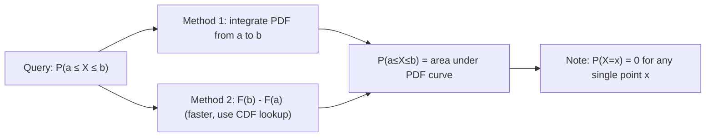

# Interval Probability

$$
P(a \le X \le b) = F(b) - F(a) = \int_a^b f(x) dx
$$

## Deep Breakdown

What it tells me *(Situation Awareness)*:
For a continuous RV, the probability of falling in an interval $[a, b]$ is the area under the PDF between $a$ and $b$, equivalently $F(b) - F(a)$ using the CDF. This is how all continuous probability queries are answered — individual points have zero probability, so intervals are the meaningful unit.

## Flowchart



## Real-world use

### Where it is used

Computing probability that a metric falls in a target range: $P(\text{CTR} \in [0.03, 0.08])$, $P(\text{delivery time} \leq 5 \text{ days})$, $P(\text{revenue per user} > \$50)$, or confidence interval calculations.

### Problem it solves

Continuous RVs assign zero probability to single points. Intervals are the only way to compute non-trivial probabilities for continuous variables.

### How it solves the problem

Uses the Fundamental Theorem of Calculus: $\int_a^b f(x)dx = F(b) - F(a)$, converting an integration problem to a CDF subtraction.

### Example in a business

Session duration target range: $P(3 \leq \text{duration} \leq 10 \text{ min})$ from a fitted lognormal. Measures what fraction of users achieve "engaged" session length.

## The formula, piece by piece

$P(a \leq X \leq b) = F(b) - F(a) = \int_a^b f(x) \, dx$
- $a$, $b$: lower and upper bounds of the interval.
- $F(b) - F(a)$: CDF subtraction (faster computation).
- Equivalent to: area under PDF from $a$ to $b$.

## The formula in words

"The probability of X falling in [a, b] is the area under the PDF between a and b, or equivalently, CDF(b) minus CDF(a)."

## Critical Concepts

- $P(X = c) = 0$ for any single value $c$ in a continuous distribution.
- Inclusion doesn't matter: $P(a \leq X \leq b) = P(a < X < b) = P(a < X \leq b)$.
- Tail probabilities: $P(X > a) = 1 - F(a)$, $P(X < b) = F(b)$.

## Step-by-step calculation (tiny example)

*Step 1: Standard normal, query P(-1 ≤ Z ≤ 1)*

*Step 2: CDF subtraction*
$P(-1 \leq Z \leq 1) = \Phi(1) - \Phi(-1) = 0.8413 - 0.1587 = 0.6827$

*Step 3: Interpret*
~68.3% of standard normal mass lies within 1 standard deviation of the mean (the "68-95-99.7" rule).

## Code examples

### Beginner example (Python)

```python
from scipy.stats import norm, lognorm
import numpy as np

# P(-1 ≤ Z ≤ 1) for standard normal
p_1sigma = norm.cdf(1) - norm.cdf(-1)
print(f"P(-1 ≤ Z ≤ 1) = {p_1sigma:.4f}")  # 0.6827

# P(3 ≤ session ≤ 10) for lognormal(s=0.8, scale=exp(1.5))
lognorm_dist = lognorm(s=0.8, scale=np.exp(1.5))
p_engaged = lognorm_dist.cdf(10) - lognorm_dist.cdf(3)
print(f"P(3 ≤ session ≤ 10 min) = {p_engaged:.4f}")
```

### Beginner example (R)

```r
p_1sigma <- pnorm(1) - pnorm(-1)
cat(sprintf("P(-1 ≤ Z ≤ 1) = %.4f\n", p_1sigma))  # 0.6827

# Lognormal session duration
p_engaged <- plnorm(10, meanlog=1.5, sdlog=0.8) - plnorm(3, meanlog=1.5, sdlog=0.8)
cat(sprintf("P(3 ≤ session ≤ 10 min) = %.4f\n", p_engaged))
```

### Professional example (Python)

```python
import numpy as np
from scipy.stats import lognorm
from dataclasses import dataclass


@dataclass
class EngagementThresholds:
    """Business-defined engagement tiers for session duration."""
    bounce_max: float = 1.0
    low_max: float = 3.0
    engaged_max: float = 10.0
    power_max: float = float("inf")


def session_engagement_distribution(
    meanlog: float, sdlog: float, thresholds: EngagementThresholds | None = None
) -> dict[str, float]:
    """Compute session tier probabilities from a lognormal model.

    Args:
        meanlog: Lognormal mean parameter (log-scale).
        sdlog: Lognormal std parameter (log-scale).
        thresholds: Business-defined tier boundaries in minutes.

    Returns:
        Dict with probability for each engagement tier.
    """
    if thresholds is None:
        thresholds = EngagementThresholds()
    dist = lognorm(s=sdlog, scale=np.exp(meanlog))
    boundaries = [0, thresholds.bounce_max, thresholds.low_max, thresholds.engaged_max, np.inf]
    tier_names = ["bounce", "low", "engaged", "power_user"]
    return {
        name: float(dist.cdf(upper) - dist.cdf(lower))
        for name, lower, upper in zip(tier_names, boundaries[:-1], boundaries[1:])
    }


# Session analytics
result = session_engagement_distribution(meanlog=1.5, sdlog=0.8)
print("Session engagement tier distribution:")
for tier, prob in result.items():
    bar = "#" * int(prob * 40)
    print(f" {tier:<15}: {prob:.4f} ({prob*100:.1f}%) {bar}")
```

---

*Source: domain knowledge*
