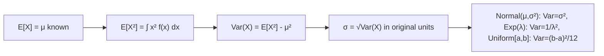

# Variance

$$
Var(X) = E[(X - \mu)^2] = \int_{-\infty}^\infty (x-\mu)^2 f(x) dx = E[X^2] - (E[X])^2
$$

## Deep Breakdown

What it tells me *(Situation Awareness)*:
The variance of a continuous RV is the expected squared deviation from the mean, computed via integration instead of summation. Conceptually identical to the discrete case but operationally requires integration. Fundamental to all distribution parameterization (e.g., Normal: parameter $\sigma^2$), risk quantification, and the bias-variance decomposition.

## Flowchart



## Real-world use

### Where it is used

Parameterizing distributions (Normal, Gamma), computing confidence intervals ($\pm z \sigma$), risk modeling (VaR uses variance of returns), feature normalization (StandardScaler divides by $\sigma$).

### Problem it solves

Quantifies the spread of a continuous distribution around its mean, enabling comparison of variability between distributions and calibration of uncertainty estimates.

### How it solves the problem

Integrates $(x - \mu)^2 f(x)$ — squaring the deviation from the mean to ensure positive contributions and penalize large deviations.

### Example in a business

Normal distribution of click probabilities: $\mu = 0.05$, $\sigma^2 = 0.0001$ (tight) vs. $\sigma^2 = 0.01$ (diffuse). The tighter variance means more predictable performance across ad sets.

## The formula, piece by piece

$Var(X) = \int_{-\infty}^{\infty} (x - \mu)^2 f(x) \, dx = E[X^2] - (E[X])^2$
- Definition form: expected squared deviation.
- Shortcut: second moment minus squared first moment.

## The formula in words

"The variance is the integral of (x minus the mean) squared, weighted by the density."

## Critical Concepts

- Normal$(\mu, \sigma^2)$: $Var(X) = \sigma^2$.
- Exponential($\lambda$): $Var(X) = 1/\lambda^2$.
- Uniform($a$, $b$): $Var(X) = (b-a)^2/12$.
- $Var(X) \geq 0$ always.
- $Var(aX + b) = a^2 Var(X)$ (same as discrete case).

## Step-by-step calculation (tiny example)

*Step 1: Uniform on [0, 4]: E[X] = 2*

*Step 2: Compute E[X²]*
$E[X^2] = \int_0^4 x^2 \cdot \frac{1}{4} dx = \frac{1}{4} \cdot \frac{x^3}{3}\Big|_0^4 = \frac{1}{4} \cdot \frac{64}{3} = \frac{16}{3} \approx 5.333$

*Step 3: Variance*
$Var(X) = E[X^2] - (E[X])^2 = \frac{16}{3} - 4 = \frac{4}{3} \approx 1.333$

*Step 4: Verify*
$Var(\text{Uniform}[0,4]) = (4-0)^2/12 = 16/12 = 4/3$. Correct.

## Code examples

### Beginner example (Python)

```python
from scipy.stats import norm, expon, uniform   # Variance of common continuous distributions
dists = { "Normal(5, 2)": norm(5, 2), "Exp(lambda=2)": expon(scale=0.5), "Uniform(0, 4)": uniform(0, 4),
}
for name, dist in dists.items():
    print(f"{name}: Var={dist.var():.4f}, Std={dist.std():.4f}")
```

### Beginner example (R)

```r
# Normal(5, 2):
variance = 4
cat("Normal(5,2): Var =", 2^2, "\n")
# Exp(rate=2):
variance = 1/2^2
cat("Exp(rate=2): Var =", 1/2^2, "\n")
# Uniform(0,4):
variance = (4-0)^2/12
cat("Uniform(0,4): Var =", (4-0)^2/12, "\n")
```

### Professional example (Python)

```python
import numpy as np
from scipy.stats import norm, lognorm
from scipy.integrate import quad

def compute_variance_numerically( pdf_func: callable, mean: float, support_lower: float = -np.inf, support_upper: float = np.inf ) -> float:
    """Compute Var(X) = ∫ (x-μ)² f(x) dx numerically. Args: pdf_func: PDF function f(x). mean: E[X] = μ. support_lower: Integration lower bound. support_upper: Integration upper bound. Returns: Var(X) as float. """
    integrand = lambda x: (x - mean) ** 2 * pdf_func(x)
    result, _ = quad(integrand, support_lower, support_upper, limit=500)
    return result   # Lognormal variance: analytical vs numerical
mu_log, sigma_log = 2.0, 0.6
dist = lognorm(s=sigma_log, scale=np.exp(mu_log))
analytical_var = dist.var()
analytical_mean = dist.mean()
numerical_var = compute_variance_numerically( dist.pdf, mean=analytical_mean, support_lower=0 )
print(f"Lognormal Var(X):")
print(f" Analytical: {analytical_var:.4f}")
print(f" Numerical: {numerical_var:.4f}")
print(f" Match: {abs(analytical_var - numerical_var) < 0.01}")
```

---

*Source: domain knowledge*
