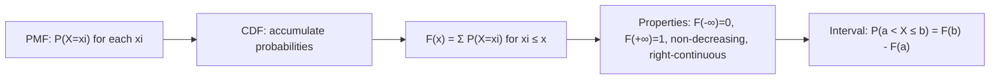

# Cumulative Distribution Function (CDF)

$$
F(x) = P(X \le x) = \sum_{x_i \le x} P(X = x_i)
$$

## Deep Breakdown

What it tells me *(Situation Awareness)*:
The CDF gives the probability that a random variable takes a value less than or equal to $x$. It is a non-decreasing step function for discrete RVs. Used for: computing interval probabilities, percentile calculations, comparison tests (KS test), and converting between CDFs and survival functions (1 - CDF).

## Flowchart



## Real-world use

### Where it is used

Percentile/quantile computation (median = $F^{-1}(0.5)$). KS test for distribution comparison. Computing interval probabilities from lookup tables. Survival analysis (1 - CDF = survival function).

### Problem it solves

Converts from "probability of exactly $x$" (PMF) to "probability of at most $x$" (CDF) — enabling interval and tail probability queries.

### How it solves the problem

Accumulates PMF values from $-\infty$ up to $x$, giving the total probability mass up to and including $x$.

### Example in a business

Delivery time SLA: $P(\text{delivery} \leq 3 \text{ days}) = F(3)$ for a Poisson($\lambda=2$) model. If $F(3) = 0.857$, then 85.7% of deliveries meet the 3-day SLA.

## The formula, piece by piece

$F(x) = P(X \leq x) = \sum_{x_i \leq x} P(X = x_i)$
- $F(x)$: CDF evaluated at $x$.
- $P(X \leq x)$: cumulative probability up to $x$.
- Sum over all $x_i$ in support that are $\leq x$.

## The formula in words

"The CDF at $x$ equals the sum of all PMF values at or below $x$."

## Critical Concepts

- $F(\infty) = 1$, $F(-\infty) = 0$.
- Non-decreasing (can only stay flat or increase).
- Right-continuous: $F(x) = \lim_{t \to x^+} F(t)$.
- Interval: $P(a < X \leq b) = F(b) - F(a)$.
- Python: `scipy.stats.<dist>.cdf(x, ...)`.

## Step-by-step calculation (tiny example)

*Step 1: Binomial(3, 0.5)*
$P(X=0) = 0.125$, $P(X=1) = 0.375$, $P(X=2) = 0.375$, $P(X=3) = 0.125$.

*Step 2: Build CDF*
$F(0) = 0.125$, $F(1) = 0.500$, $F(2) = 0.875$, $F(3) = 1.000$.

*Step 3: Query interval*
$P(1 \leq X \leq 2) = F(2) - F(0) = 0.875 - 0.125 = 0.75$.

## Code examples

### Beginner example (Python)

```python
from scipy.stats import poisson
lam = 2.0
x_values = range(8)
print(f"Poisson(λ={lam}) CDF:")
for x in x_values:
    cdf_val = poisson.cdf(x, lam)
print(f" F({x}) = {cdf_val:.4f}")   # SLA check: P(delivery ≤ 3 days)
sla_prob = poisson.cdf(3, lam)
print(f"\nSLA (≤3 days): {sla_prob:.4f} ({sla_prob*100:.1f}%)")
```

### Beginner example (R)

```r
lam <- 2.0
for (x in 0:7)
cat(sprintf("F(%d) = %.4f\n", x, ppois(x, lam)))
cat(sprintf("SLA (<=3 days): %.4f (%.1f%%)\n", ppois(3, lam), ppois(3, lam)*100))
```

### Professional example (Python)

```python
import numpy as np
from scipy.stats import poisson, binom
from scipy.stats import ks_2samp

def sla_analysis( delivery_counts: np.ndarray, poisson_lambda: float, sla_threshold: int ) -> dict[str, float]:
    """Analyze SLA compliance using Poisson CDF model. Args: delivery_counts: Observed delivery time counts (integers). poisson_lambda: Fitted Poisson mean parameter. sla_threshold: Max allowable delivery time for SLA. Returns: Dict with theoretical and empirical SLA compliance rates. """
    theoretical_compliance = poisson.cdf(sla_threshold, poisson_lambda)
    empirical_compliance = (delivery_counts <= sla_threshold).mean()
    ks_stat, ks_p_value = ks_2samp( delivery_counts, poisson(poisson_lambda).rvs(size=len(delivery_counts), random_state=42) )
    return { "theoretical_sla": theoretical_compliance, "empirical_sla": empirical_compliance, "ks_statistic": ks_stat, "ks_p_value": ks_p_value, "model_adequate": ks_p_value > 0.05, }
rng = np.random.default_rng(seed=42)
delivery_times = rng.poisson(lam=2.5, size=1_000)
result = sla_analysis(delivery_times, poisson_lambda=2.5, sla_threshold=3)
print(f"Theoretical SLA compliance: {result['theoretical_sla']:.4f}")
print(f"Empirical SLA compliance: {result['empirical_sla']:.4f}")
print(f"KS test p-value: {result['ks_p_value']:.4f} | Model adequate: {result['model_adequate']}")
```

---

*Source: AIO p. 85*
