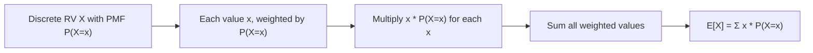

# Expected Value (Mean)

$$
E[X] = \sum_{x} x P(X = x)
$$

## Deep Breakdown

What it tells me *(Situation Awareness)*:
The expected value $E[X]$ is the probability-weighted average of all values a discrete random variable can take. It is the "center of mass" of a distribution. In DA/DS: it is the theoretical counterpart of the sample mean, used in loss functions (MSE = $E[(y - \hat{y})^2]$), reinforcement learning (expected reward), and decision theory.

## Flowchart



## Real-world use

### Where it is used

Reinforcement learning (expected cumulative reward). Decision trees (expected value of each branch). A/B test effect size. Pricing: expected revenue per customer = $\sum_x x \cdot P(\text{revenue} = x)$.

### Problem it solves

Computes the long-run average value of a random variable over many trials, without needing to observe all outcomes.

### How it solves the problem

Weights each outcome by its probability and sums — produces the probability-weighted mean of the distribution.

### Example in a business

Click-value model: clicks yield $\$0$ (60%), $\$5$ (30%), $\$20$ (10%). $E[\text{revenue}] = 0 \times 0.6 + 5 \times 0.3 + 20 \times 0.1 = 0 + 1.5 + 2.0 = \$3.50$ expected revenue per click.

## The formula, piece by piece

$E[X] = \sum_x x \cdot P(X = x)$
- $x$: each possible value of $X$.
- $P(X = x)$: the PMF evaluated at $x$.
- $\sum_x$: sum over all values $x$ in the support of $X$.

## The formula in words

"The expected value is the sum of each outcome times the probability of that outcome."

## Critical Concepts

- $E[X]$ may not be a value that $X$ can actually take (e.g., $E[\text{die}] = 3.5$).
- Linearity: $E[aX + b] = aE[X] + b$.
- For the Bernoulli distribution: $E[X] = p$.
- For Binomial$(n, p)$: $E[X] = np$.
- For Poisson($\lambda$): $E[X] = \lambda$.

## Step-by-step calculation (tiny example)

*Step 1: Revenue outcomes*
Revenue: {$0, $5, $20}, P = {0.6, 0.3, 0.1}.

*Step 2: Weighted sum*
$E = 0 \times 0.6 + 5 \times 0.3 + 20 \times 0.1 = 0 + 1.5 + 2.0 = 3.5$

*Step 3: Interpret*
Expected revenue per click is $3.50.

## Code examples

### Beginner example (Python)

```python
import numpy as np   # Expected revenue per click
outcomes = np.array([0, 5, 20])
probabilities = np.array([0.6, 0.3, 0.1])
expected_revenue = np.dot(outcomes, probabilities)
print(f"E[revenue] = ${expected_revenue:.2f}")   # $3.50
```

### Beginner example (R)

```r
outcomes <- c(0, 5, 20)
probabilities <- c(0.6, 0.3, 0.1)
expected_revenue <- sum(outcomes * probabilities)
cat(sprintf("E[revenue] = $%.2f\n", expected_revenue))  # $3.50
```

### Professional example (Python)

```python
import numpy as np
from scipy.stats import rv_discrete

def expected_value_discrete( outcomes: np.ndarray, probabilities: np.ndarray ) -> float:
    """Compute E[X] for a discrete distribution. Args: outcomes: Array of possible values. probabilities: Corresponding probabilities (must sum to 1). Returns: E[X] = sum(x * P(X=x)). """
    if abs(probabilities.sum() - 1.0) > 1e-8:
        raise ValueError(f"Probabilities sum to {probabilities.sum():.6f}, not 1.0")
    return float(np.dot(outcomes, probabilities))   # Multi-tier revenue model
tiers = { "free": {"revenue": 0, "prob": 0.60}, "basic": {"revenue": 10, "prob": 0.25}, "premium": {"revenue": 50, "prob": 0.12}, "enterprise":{"revenue": 500, "prob": 0.03},
}
rev_outcomes = np.array([t["revenue"] for t in tiers.values()])
rev_probs = np.array([t["prob"] for t in tiers.values()])
ev = expected_value_discrete(rev_outcomes, rev_probs)
variance = expected_value_discrete(rev_outcomes**2, rev_probs) - ev**2
std_dev = np.sqrt(variance)
print(f"E[revenue] = ${ev:.2f}")
print(f"Var[revenue] = ${variance:.2f}")
print(f"Std[revenue] = ${std_dev:.2f}")
for tier_name, tier_data in tiers.items():
    contribution = tier_data["revenue"] * tier_data["prob"]
print(f" {tier_name:<12}: contributes ${contribution:.2f} ({contribution/ev*100:.1f}%)")
```

---

*Source: 1300 p. 333*
