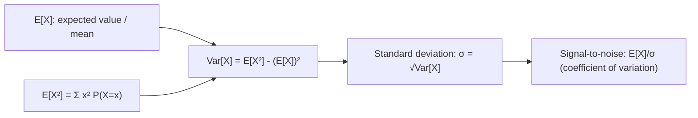

# Variance

$$
Var[X] = E[(X - E[X])^2] = E[X^2] - (E[X])^2
$$

## Deep Breakdown

What it tells me *(Situation Awareness)*:
The variance of a discrete random variable measures the expected squared deviation from the mean. The shortcut formula $E[X^2] - (E[X])^2$ is computationally convenient. Used in risk analysis, feature importance (variance-based sensitivity), regularization design, and A/B test power calculations.

## Flowchart



## Real-world use

### Where it is used

Risk quantification (variance of revenue streams), feature selection (high-variance features carry more information), ensemble diversity (variance of model predictions), and A/B test minimum detectable effect (MDE depends on pooled variance).

### Problem it solves

Quantifies the spread and uncertainty around the expected value, complementing the mean with dispersion information.

### How it solves the problem

Computes the expected squared deviation from the mean, with the shortcut $E[X^2] - (E[X])^2$ avoiding direct computation of $(X - \mu)^2$ for each outcome.

### Example in a business

Revenue model: Bernoulli conversion with $p = 0.05$, value $= \$100$. $E[\text{rev}] = 0.05 \times 100 = \$5$. $Var[\text{rev}] = 100^2 \times 0.05 \times 0.95 = \$475$ — high relative variance signals uncertainty in revenue projections.

## The formula, piece by piece

$Var[X] = E[(X - E[X])^2] = E[X^2] - (E[X])^2$
- $E[(X - E[X])^2]$: expected squared deviation (definition).
- $E[X^2]$: second moment — $\sum_x x^2 P(X=x)$.
- $(E[X])^2$: square of the first moment.
- Shortcut: faster to compute, algebraically equivalent.

## The formula in words

"Variance equals the expected value of $X^2$ minus the square of the expected value of $X$."

## Critical Concepts

- $Var[X] \geq 0$ always.
- $Var[aX + b] = a^2 Var[X]$ (linearity of variance, shift doesn't matter).
- For independent $X, Y$: $Var[X + Y] = Var[X] + Var[Y]$.
- Binomial$(n,p)$: $Var[X] = np(1-p)$.
- Poisson($\lambda$): $Var[X] = \lambda$ (mean = variance).

## Step-by-step calculation (tiny example)

*Step 1: PMF*
$X \in \{0, 1\}$, $P(0) = 0.7$, $P(1) = 0.3$. Bernoulli($p=0.3$).

*Step 2: E[X] and E[X²]*
$E[X] = 0 \times 0.7 + 1 \times 0.3 = 0.3$
$E[X^2] = 0^2 \times 0.7 + 1^2 \times 0.3 = 0.3$

*Step 3: Variance*
$Var[X] = 0.3 - 0.3^2 = 0.3 - 0.09 = 0.21$

*Step 4: Verify*
For Bernoulli: $p(1-p) = 0.3 \times 0.7 = 0.21$. Correct.

## Code examples

### Beginner example (Python)

```python
import numpy as np
from scipy.stats import bernoulli
p_conv = 0.3
dist = bernoulli(p_conv)
print(f"E[X] = {dist.mean():.4f}")   # 0.3
print(f"Var[X] = {dist.var():.4f}")   # 0.21
print(f"Std[X] = {dist.std():.4f}")   # ~0.458
```

### Beginner example (R)

```r
p_conv <- 0.3
outcomes <- c(0, 1); probs <- c(1 - p_conv, p_conv)
ex <- sum(outcomes * probs)
ex2 <- sum(outcomes^2 * probs)
var_x <- ex2 - ex^2
cat(sprintf("E[X] = %.4f | Var[X] = %.4f\n", ex, var_x))
```

### Professional example (Python)

```python
import numpy as np
from scipy.stats import binom

def revenue_model_risk( conversion_rate: float, revenue_per_conversion: float, n_exposures: int ) -> dict[str, float]:
    """Compute expected revenue and risk metrics for a conversion model. Revenue = sum of Bernoulli conversions * value. Under Binomial(n, p): E[R] = n*p*v, Var[R] = n*p*(1-p)*v^2. Args: conversion_rate: p, probability of conversion. revenue_per_conversion: v, value per conversion. n_exposures: n, total users/impressions. Returns: Dict with E[revenue], Var[revenue], std, and coefficient of variation. """
    expected_conversions = n_exposures * conversion_rate
    var_conversions = n_exposures * conversion_rate * (1 - conversion_rate)
    expected_revenue = expected_conversions * revenue_per_conversion
    var_revenue = var_conversions * revenue_per_conversion**2
    std_revenue = np.sqrt(var_revenue)
    cv = std_revenue / expected_revenue if expected_revenue > 0 else float("inf")
    return { "expected_revenue": expected_revenue, "variance_revenue": var_revenue, "std_revenue": std_revenue, "coefficient_of_variation": cv, }
for p_conv in [0.01, 0.05, 0.10, 0.20]:
    metrics = revenue_model_risk(p_conv, 100.0, 10_000)
print(f"p={p_conv:.2f}: E=$ {metrics['expected_revenue']:>8,.0f} | " f"Std=${metrics['std_revenue']:>7,.0f} | CV={metrics['coefficient_of_variation']:.3f}")
```

---

*Source: AIO p. 85*
