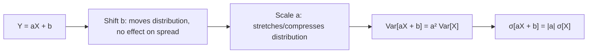

# Variance (Linearity)

$$
Var[aX + b] = a^2 Var[X]
$$

## Deep Breakdown

What it tells me *(Situation Awareness)*:
Unlike expectation, a shift $b$ does NOT affect variance (shifts just move the distribution, don't spread it). Only the scaling factor $a$ matters, and it enters as $a^2$ because variance is in squared units. This is fundamental to understanding how transformations affect risk/spread — and why standardization divides by $\sigma$ to get unit variance.

## Flowchart



## Real-world use

### Where it is used

Revenue scaling ($\text{revenue} = \text{price} \times \text{units}$), risk quantification under leverage, confidence interval width computations, and understanding how normalization affects variance.

### Problem it solves

Computes the variance of a linearly transformed random variable without recomputing the full distribution.

### How it solves the problem

From the definition: $Var[aX+b] = E[(aX+b - (aE[X]+b))^2] = E[a^2(X-E[X])^2] = a^2 Var[X]$. The $b$ cancels out.

### Example in a business

Campaign ROI: individual ROAS $X$ has $Var[X] = 1.5$. If we scale to dollar terms ($Y = 10000 X$), $Var[Y] = 10000^2 \times 1.5 = 1.5 \times 10^8$. The coefficient of variation stays the same since $\sigma[Y]/E[Y] = \sigma[X]/E[X]$.

## The formula, piece by piece

$Var[aX + b] = a^2 Var[X]$
- $a^2$: scale factor squared (since variance is in squared units).
- $b$: disappears — shifts don't change spread.
- Standard deviation: $\text{SD}[aX + b] = |a| \cdot \text{SD}[X]$.

## The formula in words

"The variance of $aX + b$ equals $a$ squared times the variance of $X$. Adding a constant doesn't change the spread."

## Critical Concepts

- Extension to sums (independent): $Var[X + Y] = Var[X] + Var[Y]$.
- Extension (dependent): $Var[X + Y] = Var[X] + Var[Y] + 2 Cov(X,Y)$.
- Standardization: $Var[(X-\mu)/\sigma] = (1/\sigma)^2 \times \sigma^2 = 1$. Confirms unit variance after z-scoring.
- $Var[X - Y] = Var[X] + Var[Y]$ (not minus!) when independent.

## Step-by-step calculation (tiny example)

*Step 1: Known Var[X]*
$Var[X] = 4$.

*Step 2: Transform Y = 3X + 10*
$Var[Y] = 3^2 \times Var[X] = 9 \times 4 = 36$

*Step 3: Standard deviation*
$\text{SD}[Y] = |3| \times \text{SD}[X] = 3 \times 2 = 6$

## Code examples

### Beginner example (Python)

```python
import numpy as np
rng = np.random.default_rng(seed=42)
X = rng.normal(10, 2, 100_000)   # mean=10, std=2,
Var=4
Y = 3 * X + 10   # transform
print(f"Var[X] = {np.var(X):.4f}")   # ~4.0
print(f"Var[Y] = {np.var(Y):.4f}")   # ~36.0 = 9 * 4
print(f"Formula: 3² * Var[X] = {9 * np.var(X):.4f}")
```

### Beginner example (R)

```r
set.seed(42)
X <- rnorm(100000, mean=10, sd=2)
Y <- 3 * X + 10
cat(sprintf("Var[X] = %.4f\n", var(X) * (length(X)-1)/length(X)))  # ~4.0
cat(sprintf("Var[Y] = %.4f\n", var(Y) * (length(Y)-1)/length(Y)))  # ~36.0
```

### Professional example (Python)

```python
import numpy as np
from scipy.stats import rv_continuous

def propagate_variance_linear( base_variance: float, scale: float, shift: float = 0.0 ) -> dict[str, float]:
    """Propagate variance through a linear transformation Y = aX + b. Args: base_variance: Var[X]. scale: Linear scale factor a. shift: Additive shift b (has no effect on variance). Returns: Dict with Var[Y], Std[Y], and confirmation that shift is irrelevant. """
    variance_y = (scale ** 2) * base_variance
    return { "var_y": variance_y, "std_y": float(np.sqrt(variance_y)), "shift_irrelevant": True, "formula": f"{scale}² × {base_variance} = {variance_y}", }   # Portfolio risk analysis: leverage effect on variance
BASE_VARIANCE = 0.04   # 20% annual
vol = Var=0.04
for leverage in [0.5, 1.0, 1.5, 2.0, 3.0]:
    result = propagate_variance_linear(BASE_VARIANCE, scale=leverage)
print(f"Leverage {leverage:.1f}x: Var[Y]={result['var_y']:.4f} | " f"Std[Y]={result['std_y']*100:.1f}% annual vol")
```

---

*Source: domain knowledge*
