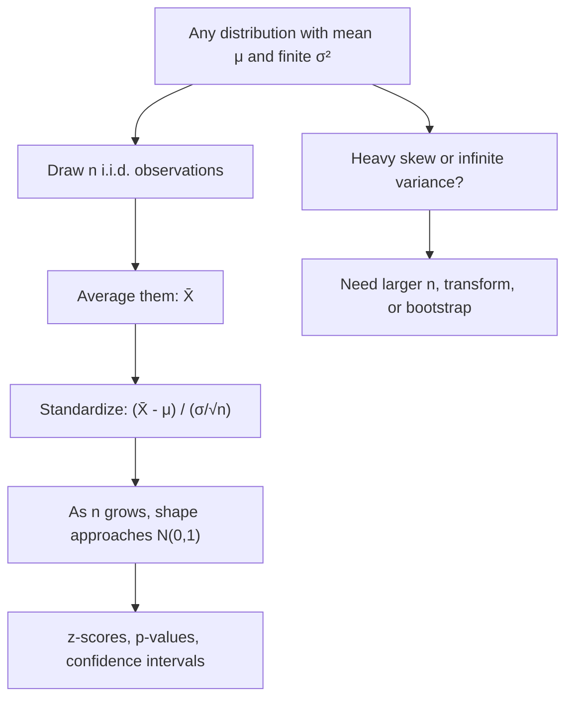

# Central Limit Theorem

$$
\frac{\bar{X}_n - \mu}{\sigma / \sqrt{n}} \xrightarrow{d} \mathcal{N}(0, 1) \quad \text{as } n \to \infty
$$

, where $X_1, \dots, X_n$ are i.i.d. with mean $\mu$ and finite variance $\sigma^2 > 0$; equivalently $\bar{X}_n \approx \mathcal{N}(\mu, \sigma^2/n)$ for large $n$

## Deep Breakdown

What it tells me *(Situation Awareness)*:
The Central Limit Theorem (CLT) says that the standardized average of many independent, identically distributed random variables converges in distribution to a standard Normal, *no matter what the original distribution looks like*, as long as its variance is finite. Skewed order values, 0/1 conversions, Poisson ticket counts: average enough of them and the average is bell-shaped, centred at $\mu$ with standard error $\sigma/\sqrt{n}$. The same holds for sums: $\sum X_i \approx \mathcal{N}(n\mu, n\sigma^2)$. This is why the Normal distribution is everywhere in applied statistics: it is the distribution of *estimates*, not necessarily of the raw data. The theorem is asymptotic, so the practical question is always "is $n$ large enough for this level of skew?"; the Berry-Esseen bound says the approximation error shrinks like $\rho/(\sigma^3\sqrt{n})$ where $\rho = E|X - \mu|^3$, so heavy skew needs much more data. In DA/DS: z-tests and confidence intervals for means and proportions in A/B tests, normal approximation to the Binomial for conversion rates, margin of error in surveys, aggregated forecasts (total weekly revenue), control charts, and justifying Gaussian noise assumptions in regression when errors are sums of many small effects.

## Flowchart



## Real-world use

### Where it is used

A/B testing (two-sample z-test on conversion rates and revenue per user); confidence intervals $\bar{x} \pm 1.96\,s/\sqrt{n}$; survey margins of error; normal approximation to Binomial and Poisson counts; demand and revenue aggregation in forecasting; statistical process control; asymptotic normality of MLEs and regression coefficients (which are weighted averages); Monte Carlo error bars.

### Problem it solves

Raw business data are rarely Normal (revenue is right-skewed, conversions are binary), so exact sampling distributions of averages are usually intractable. Without a shared approximate distribution, every test and interval would need custom maths.

### How it solves the problem

It guarantees one universal limit: whatever the input distribution, the average is approximately $\mathcal{N}(\mu, \sigma^2/n)$. You only need $\mu$ and $\sigma$ (or estimates), and then the standard Normal table gives probabilities, p-values and intervals.

### Example in a business

Order values at an online shop are right-skewed with mean $\mu = 50$ USD and standard deviation $\sigma = 40$ USD. A daily batch has $n = 100$ orders. By the CLT, the daily average is approximately $\mathcal{N}(50, 4^2)$ since $\operatorname{SE} = 40/\sqrt{100} = 4$. The probability that a day's average exceeds 58 USD by chance is $P(Z > (58 - 50)/4) = P(Z > 2) = 0.0228$. A finance analyst uses this to flag days with average order above 58 USD as unusual and worth investigating (promo glitch, bot traffic) rather than noise.

## The formula, piece by piece

- $X_1, \dots, X_n$: i.i.d. observations (orders, clicks, ratings).
- $\mu = E[X_i]$: true mean of a single observation.
- $\sigma^2 = \operatorname{Var}(X_i)$: true variance, must be finite and positive.
- $\bar{X}_n = \frac{1}{n}\sum X_i$: the sample mean.
- $\sigma/\sqrt{n}$: standard error of the mean.
- $(\bar{X}_n - \mu)/(\sigma/\sqrt{n})$: the standardized mean, a z-score of the average.
- $\xrightarrow{d}$: convergence in distribution; CDFs converge to the Normal CDF at every point.
- $\mathcal{N}(0, 1)$: the standard Normal limit.
- Sum form: $(\sum X_i - n\mu)/(\sigma\sqrt{n}) \xrightarrow{d} \mathcal{N}(0,1)$.

## The formula in words

"Average enough independent draws from almost any distribution and the average will be approximately Normal, centred on the true mean, with spread equal to the original spread divided by the square root of the sample size." Tiny example: conversion is Bernoulli with $p = 0.1$, so $\sigma = \sqrt{0.1 \times 0.9} = 0.3$. With $n = 900$ visitors, $\hat{p} \approx \mathcal{N}(0.1, 0.01^2)$, so 95% of samples give a rate within $0.1 \pm 0.0196$.

## Critical Concepts

- **CLT vs LLN:** the Law of Large Numbers says $\bar{X}_n \to \mu$ (where it goes); the CLT says how the error is distributed around $\mu$ at scale $1/\sqrt{n}$ (how it gets there).
- **Raw data do not become Normal:** only the average (or sum) does. Do not use the CLT to justify a Normal model for individual order values.
- **How large is large?** "$n \ge 30$" is a rough folk rule valid for mild skew. For conversion rates, a common check is $np \ge 10$ and $n(1-p) \ge 10$. Heavily skewed revenue data (a few whales) may need thousands of observations; check by simulation or use a log transform or bootstrap.
- **Finite variance is required:** for Cauchy or very heavy-tailed Pareto data (tail index 2 or less) the CLT fails; averages do not stabilize. Trim, winsorize or use medians and quantiles.
- **Independence matters:** correlated data (time series, clustered users) still often satisfy a CLT but with a larger variance than $\sigma^2/n$; using the i.i.d. formula underestimates uncertainty.
- **Plug-in $s$:** replacing $\sigma$ by the sample standard deviation $s$ still gives an asymptotically Normal statistic (Slutsky's theorem); for small $n$ and Normal data the exact distribution is Student's $t$.
- **Multivariate and Lindeberg versions:** the CLT extends to vectors (mean vector with covariance $\Sigma/n$) and to independent but non-identical variables under the Lindeberg condition, which underpins asymptotic normality of regression coefficients and MLEs.

## Step-by-step calculation (tiny example)

*Order values: $\mu = 50$, $\sigma = 40$, daily batch $n = 100$. What is $P(\bar{X} > 58)$?*

*Step 1: Standard error*
$\operatorname{SE} = 40/\sqrt{100} = 40/10 = 4$.

*Step 2: Apply the CLT*
$\bar{X} \approx \mathcal{N}(50, 4^2)$.

*Step 3: Standardize*
$z = (58 - 50)/4 = 2$.

*Step 4: Normal tail probability*
$P(Z > 2) = 1 - \Phi(2) = 1 - 0.9772 = 0.0228$.

*Step 5: Interpret*
Only about 2.3% of days should average above 58 USD by chance; for a sum of the same 100 orders, $P(\sum X_i > 5800) = 0.0228$ as well, because $\sum X_i \approx \mathcal{N}(5000, 400^2)$.

## Code examples

### Beginner example (Python)

```python
import math
from scipy.stats import norm

mu, sigma, n = 50.0, 40.0, 100
se = sigma / math.sqrt(n)
z = (58 - mu) / se
print("SE =", se)                                        # 4.0
print("z =", z)                                          # 2.0
print("P(X_bar > 58) =", round(norm.sf(z), 4))           # 0.0228

p, n_vis = 0.1, 900
se_p = math.sqrt(p * (1 - p) / n_vis)
print("SE of conversion rate =", round(se_p, 4))         # 0.01
print("95% range:", round(p - 1.96 * se_p, 4), "to", round(p + 1.96 * se_p, 4))  # 0.0804 to 0.1196
```

### Beginner example (R)

```r
mu <- 50; sigma <- 40; n <- 100
se <- sigma / sqrt(n)                        # 4
cat("P(X_bar > 58) =", 1 - pnorm(58, mean = mu, sd = se), "\n")   # 0.0228
set.seed(7)
means <- replicate(10000, mean(rexp(n, rate = 1 / 50)))
hist(means, breaks = 50, main = "Means of skewed data look Normal")
```

### Professional example (Python)

```python
import numpy as np
from scipy import stats

rng = np.random.default_rng(42)
n_reps = 20_000

# Strongly right-skewed "revenue per user": lognormal
dist = stats.lognorm(s=1.0, scale=np.exp(3.0))
mu, sigma = dist.mean(), dist.std()
print(f"Population: mean = {mu:.2f}, sd = {sigma:.2f}, skew = {float(dist.stats(moments='s')):.2f}")

print(f"\n{'n':>6} {'skew of X_bar':>14} {'P(z > 1.96) sim':>16} {'Normal':>8}")
for n in [5, 30, 200, 1000]:
    x_bar = dist.rvs(size=(n_reps, n), random_state=rng).mean(axis=1)
    z = (x_bar - mu) / (sigma / np.sqrt(n))
    tail = np.mean(z > 1.96)
    print(f"{n:>6} {stats.skew(x_bar):>14.3f} {tail:>16.4f} {stats.norm.sf(1.96):>8.4f}")

# A/B test on conversion using the CLT (two-proportion z-test)
n_a = n_b = 20_000
conv_a = rng.binomial(1, 0.050, n_a)
conv_b = rng.binomial(1, 0.055, n_b)
p_a, p_b = conv_a.mean(), conv_b.mean()
se_diff = np.sqrt(p_a * (1 - p_a) / n_a + p_b * (1 - p_b) / n_b)
z_ab = (p_b - p_a) / se_diff
print(f"\nA/B: p_A = {p_a:.4f}, p_B = {p_b:.4f}, z = {z_ab:.2f}, "
      f"two-sided p = {2 * stats.norm.sf(abs(z_ab)):.4f}")
```

---

*Source: domain knowledge*
