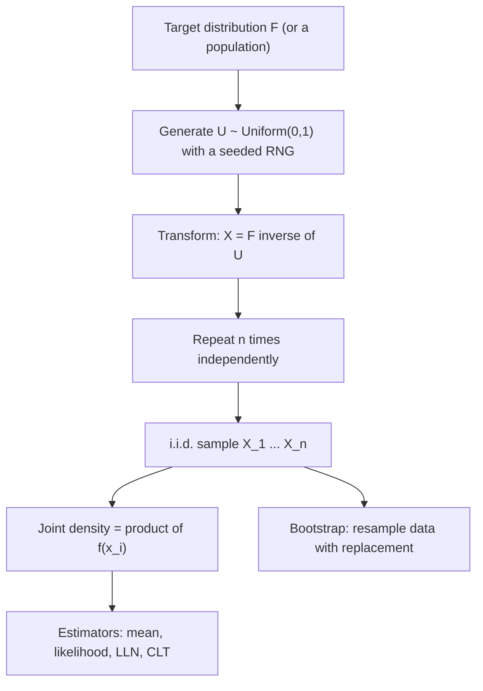

# Random Sampling (i.i.d. samples)

$$
X_1, \dots, X_n \overset{\text{iid}}{\sim} F \quad \Longleftrightarrow \quad f(x_1, \dots, x_n) = \prod_{i=1}^{n} f(x_i)
$$

, and any distribution can be sampled by inverse transform: $X = F^{-1}(U)$ with $U \sim \text{Uniform}(0, 1)$

## Deep Breakdown

What it tells me *(Situation Awareness)*:
A random sample is a collection of random variables $X_1, \dots, X_n$ that are **independent** (knowing one tells you nothing about the others) and **identically distributed** (all drawn from the same distribution $F$). Under i.i.d., the joint density or mass factorizes into a product of identical marginals, which is the single assumption that makes likelihoods simple ($\log L = \sum_i \log f(x_i)$), makes the sample mean an unbiased estimator with variance $\sigma^2/n$, and powers the Law of Large Numbers and the Central Limit Theorem. On a computer, sampling from a distribution starts from uniform pseudo-random numbers and transforms them; the most general recipe is inverse-transform sampling, $X = F^{-1}(U)$, which works because $P(F^{-1}(U) \le x) = P(U \le F(x)) = F(x)$. Resampling the observed data with replacement (the bootstrap) treats the empirical distribution as $F$ and gives standard errors and confidence intervals for almost any statistic. In DA/DS: random assignment in A/B tests, train/test splits, survey and audit samples, Monte Carlo simulation of revenue or risk, mini-batch SGD, bootstrap CIs, and checking whether i.i.d. is violated (time series, clustered users, repeated sessions) before trusting a p-value.

## Flowchart



## Real-world use

### Where it is used

Randomized experiments (each user independently assigned to A or B); train/validation/test splits and K-fold CV; Monte Carlo forecasting of demand, revenue or portfolio losses; synthetic data generation; SGD mini-batches; bootstrap confidence intervals; random audit sampling of transactions; LLM decoding (sampling the next token from a softmax distribution).

### Problem it solves

You almost never see the whole population or know the true distribution. Random i.i.d. samples let you learn about the population with quantifiable uncertainty, and sampling from a known model lets you simulate outcomes that are too complex to compute analytically.

### How it solves the problem

Randomness removes selection bias (every unit has the same chance of being chosen), and independence makes the uncertainty mathematically tractable: probabilities multiply, variances add, and averages concentrate around the true mean at rate $1/\sqrt{n}$.

### Example in a business

A support team models time between incoming tickets as Exponential with rate $\lambda = 2$ per minute (mean 0.5 min). To stress-test staffing, an analyst simulates inter-arrival times by inverse transform, $X = -\ln(1 - U)/\lambda$. With uniforms $U = 0.5, 0.9, 0.2$ the simulated gaps are $0.347$, $1.151$ and $0.112$ minutes. Repeating this 100,000 times per shift gives the distribution of queue lengths and the probability of breaching the 2-minute response SLA.

## The formula, piece by piece

- $X_1, \dots, X_n$: the sample, viewed as random variables before the data are observed.
- $\overset{\text{iid}}{\sim} F$: independent and identically distributed with common CDF $F$.
- $f(x_1, \dots, x_n)$: joint density (or PMF) of the whole sample.
- $\prod_{i=1}^{n} f(x_i)$: independence lets the joint factorize; identical distribution means the same $f$ in every factor.
- $U \sim \text{Uniform}(0,1)$: the raw output of a pseudo-random number generator.
- $F^{-1}$: the quantile function; maps a uniform probability to a value of $X$.
- Exponential case: $F(x) = 1 - e^{-\lambda x}$, so $F^{-1}(u) = -\ln(1-u)/\lambda$.

## The formula in words

"Draw each observation the same way and without any draw influencing another; then the probability of the whole sample is just the product of the individual probabilities." Tiny example: three independent visitors, each converting with $p = 0.05$. $P(\text{all three convert}) = 0.05^3 = 0.000125$ and $P(\text{at least one converts}) = 1 - 0.95^3 = 0.1426$.

## Critical Concepts

- **Independence is the fragile part:** repeated sessions from the same user, users within the same company, or consecutive days in a time series are correlated. Treating them as i.i.d. understates standard errors and inflates false positives in A/B tests. Fix with cluster-robust SEs, randomizing at the user level, or block bootstrap.
- **Identical distribution can drift:** data collected across seasons, product versions or marketing campaigns are not identically distributed; a model trained on summer traffic may fail in December (dataset shift).
- **Sampling with vs without replacement:** from a finite population of size $N$, sampling without replacement is not exactly independent; the variance of the mean shrinks by the finite population correction $(N - n)/(N - 1)$, negligible when $n \ll N$.
- **Seeds and reproducibility:** pseudo-random generators are deterministic given a seed. Always seed (`np.random.default_rng(42)`) so analyses and experiments can be reproduced and audited.
- **Inverse transform vs other samplers:** inverse transform needs a computable $F^{-1}$. Otherwise use rejection sampling, Box-Muller for Normals, or MCMC when the density is only known up to a constant (Bayesian posteriors).
- **Bootstrap:** resampling $n$ points with replacement from the observed data and recomputing a statistic $B$ times approximates its sampling distribution, giving percentile CIs for medians, ratios, AUC and other statistics without closed-form SEs.

## Step-by-step calculation (tiny example)

*Simulate 3 inter-arrival times from Exponential($\lambda = 2$) by inverse transform.*

*Step 1: Invert the CDF*
$F(x) = 1 - e^{-2x} \Rightarrow F^{-1}(u) = -\ln(1 - u)/2$.

*Step 2: Draw uniforms*
$U = 0.5, 0.9, 0.2$.

*Step 3: Transform*
$-\ln(0.5)/2 = 0.3466$; $-\ln(0.1)/2 = 1.1513$; $-\ln(0.8)/2 = 0.1116$.

*Step 4: Summarize*
Sum $= 1.6094$, sample mean $= 0.5365$ min, close to the true mean $1/\lambda = 0.5$. With more draws the sample mean converges to 0.5 (Law of Large Numbers).

## Code examples

### Beginner example (Python)

```python
import numpy as np

lam = 2.0
u = np.array([0.5, 0.9, 0.2])
x = -np.log(1 - u) / lam
print("Inverse-transform draws:", np.round(x, 4))   # [0.3466 1.1513 0.1116]
print("Sample mean:", round(x.mean(), 4))           # 0.5365

rng = np.random.default_rng(42)
big = -np.log(1 - rng.uniform(size=100_000)) / lam
print("Mean of 100k draws:", round(big.mean(), 3))  # close to 0.5
print("P(all 3 convert):", round(0.05**3, 6))        # 0.000125
print("P(at least one):", round(1 - 0.95**3, 4))     # 0.1426
```

### Beginner example (R)

```r
set.seed(42)
lam <- 2
u <- c(0.5, 0.9, 0.2)
x <- -log(1 - u) / lam
print(round(x, 4))                       # 0.3466 1.1513 0.1116
big <- -log(1 - runif(100000)) / lam
print(mean(big))                         # close to 0.5
boot_means <- replicate(2000, mean(sample(x, replace = TRUE)))
print(quantile(boot_means, c(0.025, 0.975)))
```

### Professional example (Python)

```python
import numpy as np
from scipy import stats


def inverse_transform_sample(ppf, n: int, rng: np.random.Generator) -> np.ndarray:
    """Draw n i.i.d. values from any distribution given its quantile function (ppf)."""
    return ppf(rng.uniform(size=n))


def bootstrap_ci(data: np.ndarray, stat, n_boot: int, rng: np.random.Generator,
                 level: float = 0.95) -> tuple[float, float]:
    """Percentile bootstrap CI: resample i.i.d. with replacement, recompute stat."""
    idx = rng.integers(0, data.size, size=(n_boot, data.size))
    boots = np.apply_along_axis(stat, 1, data[idx])
    alpha = (1 - level) / 2
    return tuple(np.quantile(boots, [alpha, 1 - alpha]))


rng = np.random.default_rng(2026)

# 1) Inverse transform from a heavy-tailed revenue model (lognormal)
revenue_dist = stats.lognorm(s=0.9, scale=np.exp(3.0))
sample = inverse_transform_sample(revenue_dist.ppf, n=5_000, rng=rng)
ks = stats.kstest(sample, revenue_dist.cdf)
print(f"KS test vs true lognormal: stat = {ks.statistic:.4f}, p = {ks.pvalue:.3f}")

# 2) Bootstrap CIs for the mean and the median of an observed sample
observed = sample[:400]
for name, fn in [("mean", np.mean), ("median", np.median)]:
    lo, hi = bootstrap_ci(observed, fn, n_boot=2_000, rng=rng)
    print(f"{name:>6}: point = {fn(observed):7.2f}, 95% CI = [{lo:7.2f}, {hi:7.2f}]")
print(f"true mean = {revenue_dist.mean():.2f}, true median = {revenue_dist.median():.2f}")
```

---

*Source: domain knowledge*
