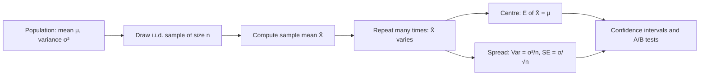

# Sampling Distribution of the Mean

$$
\bar{X} = \frac{1}{n}\sum_{i=1}^{n} X_i, \qquad E[\bar{X}] = \mu, \qquad \operatorname{Var}(\bar{X}) = \frac{\sigma^2}{n}, \qquad \operatorname{SE}(\bar{X}) = \frac{\sigma}{\sqrt{n}}
$$

, where $X_1, \dots, X_n$ are i.i.d. with mean $\mu$ and variance $\sigma^2$

## Deep Breakdown

What it tells me *(Situation Awareness)*:
The sample mean $\bar{X}$ is itself a random variable: draw a different sample and you get a different average. Its distribution across all possible samples is the sampling distribution of the mean. Two facts hold for any i.i.d. data, whatever its shape: it is centred on the true mean ($E[\bar{X}] = \mu$, so $\bar{X}$ is unbiased), and its spread shrinks with sample size as $\sigma^2/n$. The standard deviation of this distribution, $\sigma/\sqrt{n}$, is the **standard error**, the yardstick for how far a single sample average typically lands from the truth. The square root is the crucial (and expensive) part: to halve the error you need four times the data. If the data are Normal, $\bar{X}$ is exactly Normal; otherwise the Central Limit Theorem makes it approximately Normal for large $n$. In DA/DS: standard errors and confidence intervals for averages (AOV, revenue per user, session length); A/B test power and sample-size calculations; deciding how many survey responses or labelled examples are enough; understanding why mini-batch gradient noise falls with batch size; reading error bars on dashboards.

## Flowchart



## Real-world use

### Where it is used

Confidence intervals for any average KPI; A/B test z-tests and t-tests (difference of two sample means); sample-size and power planning; polling and survey margins of error; quality control charts ($\bar{X}$ charts with limits $\mu \pm 3\sigma/\sqrt{n}$); mini-batch SGD (gradient estimate variance scales as $1/\text{batch size}$); Monte Carlo error estimates.

### Problem it solves

A single sample average is an estimate, not the truth. Without knowing how much it would vary from sample to sample, you cannot tell a real lift from noise or decide how much data to collect.

### How it solves the problem

Linearity of expectation gives $E[\bar{X}] = \frac{1}{n}\sum E[X_i] = \mu$. Independence makes variances add: $\operatorname{Var}(\sum X_i) = n\sigma^2$, and scaling by $1/n$ divides the variance by $n^2$, giving $\sigma^2/n$. This turns "how reliable is my average?" into a closed-form number.

### Example in a business

An e-commerce analyst measures average order value with known historical $\sigma = 60$ USD. With $n = 36$ orders, $\operatorname{SE} = 60/\sqrt{36} = 10$ USD, so a 95% interval is roughly $\pm 19.6$ USD, too wide to detect a 5 USD change from a checkout redesign. To get $\operatorname{SE} = 2.5$ USD (a fourfold reduction) the team needs $16 \times 36 = 576$ orders per arm.

## The formula, piece by piece

- $X_i$: the $i$-th observation (e.g. one order's value), a random variable.
- $n$: sample size.
- $\bar{X} = \frac{1}{n}\sum X_i$: the sample mean, the statistic whose distribution we study.
- $\mu$: the population (true) mean.
- $\sigma^2$: the population variance of a single observation.
- $E[\bar{X}] = \mu$: unbiasedness; on average across samples, $\bar{X}$ hits the target.
- $\operatorname{Var}(\bar{X}) = \sigma^2/n$: variance falls in proportion to $1/n$.
- $\operatorname{SE} = \sigma/\sqrt{n}$: standard deviation of $\bar{X}$, in the same units as the data; in practice estimated by $s/\sqrt{n}$ with the sample standard deviation $s$.

## The formula in words

"The average of $n$ independent draws is right on target on average, and its typical error is the spread of one draw divided by the square root of $n$." Tiny example: $\sigma = 60$, $n = 36$ gives $\operatorname{SE} = 60/6 = 10$; quadrupling to $n = 144$ gives $60/12 = 5$, half the error.

## Critical Concepts

- **Standard deviation vs standard error:** $\sigma$ (or $s$) describes variability of individual customers; $\sigma/\sqrt{n}$ describes uncertainty in the average. Error bars on a KPI chart should use the SE (or a CI), not the SD.
- **Square-root law:** precision grows as $\sqrt{n}$, so diminishing returns are severe. Going from 1,000 to 100,000 users only cuts the SE by a factor of 10.
- **Requires independence:** with correlated data (multiple orders per customer, clustered users), the true variance is larger than $\sigma^2/n$; the design effect $1 + (m - 1)\rho$ for clusters of size $m$ with intra-cluster correlation $\rho$ quantifies the inflation.
- **Shape of the distribution:** exactly Normal if the data are Normal; approximately Normal for large $n$ by the CLT; for small $n$ with unknown $\sigma$ use the $t$-distribution with $n-1$ degrees of freedom.
- **Finite population:** sampling without replacement from $N$ units multiplies the variance by $(N-n)/(N-1)$.
- **Difference of means (A/B tests):** $\operatorname{Var}(\bar{X}_A - \bar{X}_B) = \sigma_A^2/n_A + \sigma_B^2/n_B$, the basis of the two-sample z-test.
- **Variance reduction:** CUPED and stratification reduce $\sigma^2$ itself (by using pre-experiment covariates), which is often cheaper than increasing $n$.

## Step-by-step calculation (tiny example)

*Average order value: $\mu = 80$ USD, $\sigma = 60$ USD, sample of $n = 36$ orders.*

*Step 1: Expected value of the sample mean*
$E[\bar{X}] = \mu = 80$ USD.

*Step 2: Variance of the sample mean*
$\operatorname{Var}(\bar{X}) = 60^2/36 = 3600/36 = 100$.

*Step 3: Standard error*
$\operatorname{SE} = \sqrt{100} = 10$ USD.

*Step 4: Approximate 95% range of sample means*
$80 \pm 1.96 \times 10 = [60.4, 99.6]$ USD.

*Step 5: Sample size for SE of 2.5 USD*
$n = (\sigma/\operatorname{SE})^2 = (60/2.5)^2 = 24^2 = 576$ orders.

## Code examples

### Beginner example (Python)

```python
import math

mu, sigma, n = 80.0, 60.0, 36
var_mean = sigma**2 / n
se = math.sqrt(var_mean)
print("E[X_bar] =", mu)                                  # 80.0
print("Var(X_bar) =", var_mean)                          # 100.0
print("SE =", se)                                        # 10.0
print("95% range:", round(mu - 1.96 * se, 1), "to", round(mu + 1.96 * se, 1))  # 60.4 to 99.6
print("n for SE = 2.5:", round((sigma / 2.5) ** 2))      # 576
```

### Beginner example (R)

```r
mu <- 80; sigma <- 60; n <- 36
se <- sigma / sqrt(n)
cat("SE =", se, "\n")                               # 10
cat("95% range:", mu - 1.96 * se, mu + 1.96 * se, "\n")   # 60.4 99.6
set.seed(1)
means <- replicate(10000, mean(rexp(n, rate = 1 / 80)))
cat("Simulated mean:", mean(means), " simulated SE:", sd(means), "\n")
```

### Professional example (Python)

```python
import numpy as np

rng = np.random.default_rng(42)

# Skewed "population" of order values: exponential with mean 80 (so sigma = 80)
mu_true, sigma_true = 80.0, 80.0
n_reps = 20_000

print(f"{'n':>5} {'mean of X_bar':>14} {'empirical SE':>13} {'theory sigma/sqrt(n)':>21}")
for n in [4, 16, 64, 256]:
    samples = rng.exponential(scale=mu_true, size=(n_reps, n))
    x_bar = samples.mean(axis=1)
    print(f"{n:>5} {x_bar.mean():>14.2f} {x_bar.std(ddof=1):>13.2f} "
          f"{sigma_true / np.sqrt(n):>21.2f}")

# In practice sigma is unknown: estimate SE from ONE sample with s / sqrt(n)
one_sample = rng.exponential(scale=mu_true, size=400)
se_hat = one_sample.std(ddof=1) / np.sqrt(one_sample.size)
print(f"\nOne sample of 400: mean = {one_sample.mean():.2f}, "
      f"estimated SE = {se_hat:.2f} (theory {sigma_true / 20:.2f})")
```

---

*Source: domain knowledge*
