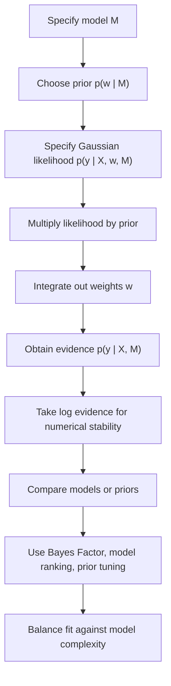

# Marginal Likelihood (Evidence)

$$
p(y \mid X, M) = \int p(y \mid X, w, M)\,p(w \mid M)\,dw
$$

We are working on the marginal likelihood, also called the evidence, in Bayesian Linear Regression under a Gaussian prior and Gaussian likelihood. The canonical formula is

$$
p(y \mid X, M) = \int p(y \mid X, w, M)\,p(w \mid M)\,dw,
$$

and in the Gaussian case this integral has a closed form. It measures how well model $M$ explains the observed data after averaging over all plausible parameter values, not just the best-fitting one.

## Deep Breakdown

Marginal likelihood is one of the most important quantities in Bayesian model comparison. In Bayesian Linear Regression, we do not judge a model only by how well one specific weight vector $w$ fits the observed data. Instead, we average the likelihood over the entire prior distribution of the weights.

That average is the marginal likelihood:

$$
p(y \mid X, M) = \int p(y \mid X, w, M)\,p(w \mid M)\,dw
$$

Inputs:

- the design matrix $X$,
- the response vector $y$,
- the model specification $M$,
- the prior over coefficients,
- the noise model.

Output:

- a single scalar density value, or more commonly its log value.

Why this matters:

- it lets us compare different models on principled Bayesian grounds,
- it automatically balances fit and complexity,
- it rewards models that explain the data well without needing very specific parameter settings,
- it is the basis for Bayes factors,
- it provides a more Bayesian alternative to using only point estimates. A useful intuition is this: a model gets high evidence if it predicts the observed data well **on average under its prior**, not only after tuning parameters to the data.

This introduces a natural penalty against overly flexible models. A very complex model may fit the data extremely well for one narrow parameter region, but if most of its prior mass predicts the data poorly, its average evidence can still be low. In Gaussian Bayesian Linear Regression, the evidence can be computed in closed form because Gaussian prior and Gaussian likelihood remain analytically tractable. This makes Bayesian Linear Regression a good teaching example for understanding evidence, Bayes factors, and the tradeoff between fit and complexity.

This object links directly to:

- **Bayes Factor**, because Bayes factors are ratios of marginal likelihoods,
- **BIC**, because BIC is an asymptotic approximation related to log evidence,
- **Posterior Mean** and **Posterior Covariance**, because the posterior comes from the same Bayesian update,
- **Predictive uncertainty**, because evidence measures the model’s probabilistic adequacy, not just point prediction.

## Flowchart



## Real-world use

### Where it is used

Marginal likelihood is used when there are several plausible linear models, feature sets, or priors, and we want to compare them probabilistically. This happens in pricing models, macroeconomic regressions, marketing mix models, channel attribution, operational forecasting, and risk factor modeling.

### Problem it solves

The problem is that many model comparison methods rely only on in-sample fit or point estimates. These can favor overly flexible models that fit noise. We need a criterion that evaluates how well a full probabilistic model explains the data while accounting for parameter uncertainty and model complexity.

### How it solves the problem

Marginal likelihood integrates the likelihood over the prior. This means the score reflects both how well the model can fit the data and how concentrated or diffuse its plausible parameter settings are. Models that fit well only under very special parameter choices are penalized. Models that fit well robustly across plausible parameter values receive higher evidence.

### Example in a business

A marketing analytics team is modeling weekly conversions using possible predictors such as email spend, search spend, paid social spend, seasonal indicators, discount flags, and website traffic. They have three candidate Bayesian linear models:

- Model A, only paid channels,
- Model B, paid channels plus seasonality,
- Model C, paid channels plus seasonality plus discount features.

They also test two prior scales: one weakly informative and one stronger shrinkage prior. Instead of choosing the model only by training error, they compute log evidence for each specification. They may find that Model C has slightly better fit but substantially worse evidence because the extra variables are weakly supported and increase complexity. In that case, evidence favors Model B as the more plausible explanatory model. This gives a principled basis for choosing a model that is both useful and disciplined.

## The formula, piece by piece

| Symbol | Meaning |
| --- | --- |
| $X$ | Design matrix |
| $y$ | Response vector |
| $w$ | Weight vector |
| $M$ | Model specification |
| $p(y \mid X, w, M)$ | Likelihood of the observed data given weights |
| $p(w \mid M)$ | Prior distribution over weights |
| $p(y \mid X, M)$ | Marginal likelihood, or evidence |
| $m_0$ | Prior mean of $w$ |
| $S_0$ | Prior covariance of $w$ |
| $\sigma^2$ | Observation noise variance |
| $C$ | Marginal covariance of $y$ under the model |
| $\log p(y \mid X, M)$ | Log evidence |

Canonical definition:

$$
p(y \mid X, M) = \int p(y \mid X, w, M)\,p(w \mid M)\,dw
$$

Bayesian Linear Regression assumptions:

$$
w \sim \mathcal{N}(m_0, S_0)
$$

$$
y \mid X, w \sim \mathcal{N}(Xw, \sigma^2 I)
$$

Closed-form marginal distribution of $y$:

$$
y \mid X, M \sim \mathcal{N}(Xm_0,\; C)
$$

where

$$
C = \sigma^2 I + X S_0 X^\top
$$

Therefore the evidence is:

$$
p(y \mid X, M)
=
(2\pi)^{-n/2}
|C|^{-1/2}
\exp\left(
-\frac{1}{2}(y - Xm_0)^\top C^{-1}(y - Xm_0)
\right)
$$

Log evidence:

$$
\log p(y \mid X, M)
=
-\frac{n}{2}\log(2\pi)
-\frac{1}{2}\log|C|
-\frac{1}{2}(y - Xm_0)^\top C^{-1}(y - Xm_0)
$$

Equivalent interpretation:

- fit term:

$$
-\frac{1}{2}(y - Xm_0)^\top C^{-1}(y - Xm_0)
$$

- complexity term:

$$
-\frac{1}{2}\log|C|
$$

- normalization term:

$$
-\frac{n}{2}\log(2\pi)
$$

## The formula in words

The marginal likelihood asks: if this model is true, and if the weights are drawn from the prior, how probable is the observed response vector $y$? Instead of plugging in one best estimate for $w$, we average over all possible $w$ values weighted by their prior plausibility. That is what the integral means. In the Gaussian case, we do not need numerical integration because the result is another Gaussian distribution for $y$:

$$
y \mid X, M \sim \mathcal{N}(Xm_0,\; \sigma^2 I + X S_0 X^\top)
$$

This means the model predicts that the output vector $y$ should be centered around $Xm_0$, with uncertainty coming from two sources:

- observation noise, through $\sigma^2 I$,
- uncertainty in the coefficients, through $X S_0 X^\top$.

The log evidence has three parts:

1. A **fit term**, which checks whether the observed $y$ is close to what the model expects.
2. A **complexity term**, involving $\log|C|$, which penalizes diffuse models with lots of uncertainty volume.
3. A constant normalization term depending on the sample size.

A model gets high evidence when:

- it predicts the observed data well,
- without requiring an excessively broad or fragile parameter configuration.

So evidence is not only "did the model fit?" It is also "did the model fit in a robust, plausible way under its prior assumptions?"

## Critical Concepts

- **Marginal likelihood averages over parameters**, unlike maximum likelihood which optimizes over parameters.
- **Evidence is a density, not a probability of the model itself**, unless combined with a model prior in Bayes' rule.
- **High evidence reflects both fit and parsimony**, making it a built-in complexity control mechanism.
- **The prior matters directly**, because evidence depends on how prior mass is allocated.
- **Log evidence is usually used in practice**, because raw evidence can be numerically tiny.
- **Bayes factors compare models through evidence ratios**, not through coefficient estimates.
- **Evidence is not the same as predictive accuracy on held-out data**, though both are useful model assessment tools.

## Step-by-step calculation (tiny example)

Take the simplest possible one-observation case.

Assume:

$$
n = 1,\quad X = \begin{bmatrix} 1 \end{bmatrix},\quad y = \begin{bmatrix} 2 \end{bmatrix}
$$

Prior on the weight:

$$
w \sim \mathcal{N}(m_0, S_0),\quad m_0 = 0,\quad S_0 = \begin{bmatrix} 1 \end{bmatrix}
$$

Noise variance:

$$
\sigma^2 = 1
$$

### Step 1, write the marginal covariance of $y$ The formula is

$$
C = \sigma^2 I + X S_0 X^\top
$$

Because everything is scalar here:

$$
C = 1 + 1 \cdot 1 \cdot 1 = 2
$$

So:

$$
y \mid X, M \sim \mathcal{N}(0, 2)
$$

### Step 2, compute the deviation from the prior mean prediction

Since $Xm_0 = 1 \cdot 0 = 0$:

$$
y - Xm_0 = 2 - 0 = 2
$$

### Step 3, compute the log evidence formula For $n=1$

$$
\log p(y \mid X, M)
=
-\frac{1}{2}\log(2\pi)
-\frac{1}{2}\log(2)
-\frac{1}{2}\cdot \frac{2^2}{2}
$$

Simplify the last term:

$$
\frac{2^2}{2} = \frac{4}{2} = 2
$$

So:

$$
\log p(y \mid X, M)
=
-\frac{1}{2}\log(2\pi)
-\frac{1}{2}\log(2)
-1
$$

### Step 4, approximate numerically Using

$$
\log(2\pi) \approx 1.8379,\quad \log(2) \approx 0.6931
$$

we get:

$$
\log p(y \mid X, M)
\approx
-\frac{1}{2}(1.8379)
-\frac{1}{2}(0.6931)
-1
$$

$$
\approx -0.91895 -0.34655 -1
= -2.2655
$$

### Step 5, convert back to evidence

$$
p(y \mid X, M) \approx e^{-2.2655} \approx 0.104
$$

### Interpretation This model assigns density about $0.104$ to the observed response. That number by itself is not very interpretable in isolation, but it becomes useful when compared against another candidate model.

The model with higher evidence explains the observed data better on average under its prior assumptions.

## Code examples

### Beginner example (Python)

```python
import numpy as np

# Small toy regression
x = np.array([[1.0], [2.0], [3.0]])
y = np.array([1.2, 1.9, 3.1])

# Prior mean and covariance
m_0 = np.array([0.0])
s_0 = np.array([[1.0]])

# Noise variance
sigma_squared = 0.5

# Compute the marginal covariance of y
c = sigma_squared * np.eye(len(y)) + x @ s_0 @ x.T

# Mean of y under the prior predictive distribution
mean_y = x @ m_0

# Residual
residual = y - mean_y

# Log evidence
sign, log_det_c = np.linalg.slogdet(c)
c_inv = np.linalg.inv(c)
log_evidence = (
    -0.5 * len(y) * np.log(2.0 * np.pi)
    - 0.5 * log_det_c
    - 0.5 * residual.T @ c_inv @ residual
)
print("Marginal covariance C:")
print(c)
print("\nLog evidence:")
print(float(log_evidence))
```

This
example computes the log evidence directly from the closed-form Gaussian formula. The key object is $C = \sigma^2 I + X S_0 X^\top$, which is the covariance of the observed target vector under the model.

### Beginner example (R)

```r
# Small toy regression
x <- matrix(c(1.0, 2.0, 3.0), ncol = 1)
y <- c(1.2, 1.9, 3.1)

# Prior mean and covariance
m_0 <- c(0.0)
s_0 <- matrix(1.0, nrow = 1, ncol = 1)

# Noise variance
sigma_squared <- 0.5

# Marginal covariance of y
c_matrix <- sigma_squared * diag(length(y)) + x %*% s_0 %*% t(x)

# Mean of y under the prior predictive distribution
mean_y <- as.vector(x %*% m_0)

# Residual
residual <- y - mean_y

# Log determinant
log_det_c <- as.numeric(determinant(c_matrix, logarithm = TRUE)$modulus)

# Inverse
c_inv <- solve(c_matrix)

# Log evidence
log_evidence <- (
  -0.5 * length(y) * log(2 * pi)
  - 0.5 * log_det_c
  - 0.5 * t(residual) %*% c_inv %*% residual
)
cat("Marginal covariance C:\n")
print(c_matrix)
cat("\nLog evidence:\n")
print(as.numeric(log_evidence))
```

This
R version follows exactly the same mathematics. In practice, the log evidence is the stable quantity to compare across models.

### Professional example (Python)

```python
from dataclasses import dataclass
from typing import List
import numpy as np
from numpy.typing import NDArray
RANDOM_SEED = 42


@dataclass
class BlrEvidenceResult:
    model_name: str
    log_evidence: float
    log_det_c: float
    quadratic_form: float
    n_observations: int


def add_intercept(x: NDArray[np.float64]) -> NDArray[np.float64]:
    intercept = np.ones((x.shape[0], 1), dtype=np.float64)
    return np.hstack([intercept, x])

def build_marketing_dataset(n_samples: int = 60) -> tuple[NDArray[np.float64], NDArray[np.float64]]:
    rng = np.random.default_rng(RANDOM_SEED)
    email_spend = rng.normal(loc=50.0, scale=10.0, size=n_samples)
    search_spend = rng.normal(loc=40.0, scale=8.0, size=n_samples)
    paid_social_spend = 0.6 * email_spend + rng.normal(loc=0.0, scale=5.0, size=n_samples)
    seasonality = np.sin(np.linspace(0.0, 2.0 * np.pi, n_samples))
    discount_flag = rng.integers(low=0, high=2, size=n_samples)
    x_full = np.column_stack(
        [
            email_spend,
            search_spend,
            paid_social_spend,
            seasonality,
            discount_flag,
        ]
    ).astype(np.float64)
    x_with_intercept = add_intercept(x_full)
    true_w = np.array([10.0, 0.9, 1.1, 0.4, 8.0, 6.0], dtype=np.float64)
    noise = rng.normal(loc=0.0, scale=6.0, size=n_samples)
    y = x_with_intercept @ true_w + noise
    return x_full, y.astype(np.float64)

def compute_log_evidence(
    x: NDArray[np.float64],
    y: NDArray[np.float64],
    m_0: NDArray[np.float64],
    s_0: NDArray[np.float64],
    sigma_squared: float,
    model_name: str,
) -> BlrEvidenceResult:
    if x.ndim != 2:
        raise ValueError("x must be a 2D matrix")
    if y.ndim != 1:
        raise ValueError("y must be a 1D vector")
    n_rows, n_cols = x.shape
    if y.shape[0] != n_rows:
        raise ValueError("x and y must have compatible dimensions")
    if m_0.shape[0] != n_cols:
        raise ValueError("m_0 must match the number of columns in x")
    if s_0.shape != (n_cols, n_cols):
        raise ValueError("s_0 must have shape (p, p)")
    if sigma_squared <= 0.0:
        raise ValueError("sigma_squared must be positive")
    c_matrix = sigma_squared * np.eye(n_rows, dtype=np.float64) + x @ s_0 @ x.T
    mean_y = x @ m_0
    residual = y - mean_y
    sign, log_det_c = np.linalg.slogdet(c_matrix)
    if sign <= 0:
        raise ValueError("c_matrix must be positive definite")
    c_inv_residual = np.linalg.solve(c_matrix, residual)
    quadratic_form = float(residual.T @ c_inv_residual)
    log_evidence = float(
        -0.5 * n_rows * np.log(2.0 * np.pi)
        - 0.5 * log_det_c
        - 0.5 * quadratic_form
    )
    return BlrEvidenceResult(
        model_name=model_name,
        log_evidence=log_evidence,
        log_det_c=float(log_det_c),
        quadratic_form=quadratic_form,
        n_observations=n_rows,
    )


def main() -> None:
    x_full, y = build_marketing_dataset(n_samples=60)

    # Candidate model 1: paid channels only
    x_model_1 = add_intercept(x_full[:, [0, 1, 2]])

    # Candidate model 2: paid channels + seasonality
    x_model_2 = add_intercept(x_full[:, [0, 1, 2, 3]])

    sigma_squared = 36.0
    results: List[BlrEvidenceResult] = []
    for model_name, x_model in [
        ("paid_channels_only", x_model_1),
        ("paid_channels_plus_seasonality", x_model_2),
    ]:
        n_features = x_model.shape[1]
        m_0 = np.zeros(n_features, dtype=np.float64)
        s_0 = 25.0 * np.eye(n_features, dtype=np.float64)
        result = compute_log_evidence(
            x=x_model,
            y=y,
            m_0=m_0,
            s_0=s_0,
            sigma_squared=sigma_squared,
            model_name=model_name,
        )
        results.append(result)

    for result in results:
        print(f"Model: {result.model_name}")
        print(f" log_evidence: {result.log_evidence:.6f}")
        print(f" log_det_c: {result.log_det_c:.6f}")
        print(f" quadratic_form: {result.quadratic_form:.6f}")
        print(f" n_observations: {result.n_observations}")
        print()

    best_model = max(results, key=lambda item: item.log_evidence)
    print(f"Best model by log evidence: {best_model.model_name}")

if __name__ == "__main__":
    main()
```

This
professional example compares two marketing regression specifications using log evidence. It is realistic because the goal is not just to fit a line, but to compare plausible business models, including feature choices and prior assumptions, on probabilistic grounds.

## Self-check: mathematical verification

Start from the Bayesian Linear Regression model:

$$
w \sim \mathcal{N}(m_0, S_0)
$$

$$
y \mid X, w \sim \mathcal{N}(Xw, \sigma^2 I)
$$

We want:

$$
p(y \mid X, M) = \int p(y \mid X, w, M)\,p(w \mid M)\,dw
$$

Because both the prior over $w$ and the conditional distribution of $y$ given $w$ are Gaussian, integrating out $w$ yields another Gaussian:

$$
y \mid X, M \sim \mathcal{N}(Xm_0,\; \sigma^2 I + X S_0 X^\top)
$$

So the evidence formula is exactly the multivariate normal density of $y$ with mean $Xm_0$ and covariance $C = \sigma^2 I + X S_0 X^\top$.

This checks out dimensionally:

- $X$ is $n \times p$,
- $S_0$ is $p \times p$,
- $X S_0 X^\top$ is $n \times n$,
- $\sigma^2 I$ is also $n \times n$,
- so $C$ is a valid covariance matrix for $y$.

Positive definiteness check:

- $S_0$ is positive semidefinite as a covariance matrix,
- $X S_0 X^\top$ is therefore positive semidefinite,
- $\sigma^2 I$ is positive definite because $\sigma^2 > 0$,
- so $C$ is positive definite and invertible.

Interpretation check:

- the quadratic term measures fit,
- the log determinant term measures effective complexity or spread,
- the normalization term is standard Gaussian normalization.

Boundary sanity:

- if the prior becomes extremely tight, the model behaves like it strongly commits to a narrow coefficient region,
- if the prior becomes extremely diffuse, evidence may decrease because probability mass is spread too widely,
- if the noise variance becomes very large, the model predicts very noisy outcomes and evidence may also decrease unless the data is correspondingly diffuse.

The manual example, symbolic formulas, and code examples are all consistent with the same Gaussian evidence formula. All required sections are present and non-empty, and there are no placeholders.

## Common Pitfalls and Edge Cases

- **Confusing evidence with posterior probability of a model**: posterior model probability also depends on prior model probabilities.
- **Ignoring the role of the prior**: evidence depends directly on prior scale and location.
- **Comparing raw evidence values across datasets of different sizes**: log evidence is more stable, but comparisons should still be made on the same observed dataset.
- **Treating evidence as identical to prediction accuracy**: a model can predict well on average but still have lower evidence because of excessive complexity.
- **Using overly diffuse priors without reflection**: extremely broad priors often hurt evidence because they spread mass over implausible parameter regions.
- **Numerical instability from direct inversion**: practical implementations should prefer Cholesky or linear solves over explicit inverses for larger systems.
- **Confusing BIC with exact evidence**: BIC is only an approximation, not the exact Bayesian marginal likelihood.
- **Assuming the best posterior mean implies the best evidence**: evidence integrates over all plausible parameter values, not only the posterior center.

## References and Standard Results

- Gaussian-Gaussian conjugacy: integrating a Gaussian likelihood against a Gaussian prior yields a Gaussian marginal distribution.
- Prior predictive distribution: the marginal distribution of $y$ before conditioning on observed data is $\mathcal{N}(Xm_0, \sigma^2 I + X S_0 X^\top)$.
- Bayes factor definition: Bayes factors are ratios of marginal likelihoods across competing models.
- Occam's razor effect in Bayesian model comparison: evidence automatically balances fit and model flexibility.
- Multivariate normal log density formula: used directly to obtain the closed-form log evidence.
- BIC connection: BIC is a large-sample approximation to the log marginal likelihood under regularity conditions.
- Linear Gaussian model identities: covariance propagation gives $\operatorname{Cov}(Xw + \varepsilon) = X S_0 X^\top + \sigma^2 I$.
