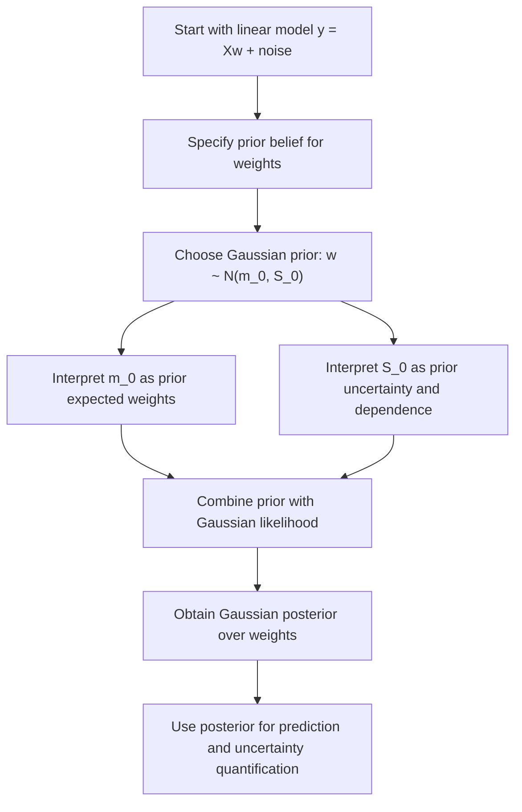

# Parameter Prior

$$
w \sim \mathcal{N}(m_0, S_0)
$$

We are working on the parameter prior in Bayesian Linear Regression, with canonical formula $w \sim \mathcal{N}(m_0, S_0)$, where $w$ is the regression weight vector, $m_0$ is the prior mean, and $S_0$ is the prior covariance matrix. A common special case is $m_0 = 0$ and $S_0 = \lambda^{-1} I$, which gives an isotropic Gaussian prior. The domain is Gaussian Bayesian linear regression with finite-dimensional feature vectors, where this prior is conjugate to a Gaussian likelihood.

## Deep Breakdown

In Bayesian Linear Regression, the regression coefficients are treated as random variables rather than fixed unknown constants. Instead of asking only, “What single coefficient vector best fits the data?”, Bayesian analysis asks, “What is our probability distribution over plausible coefficient vectors before and after seeing the data?” The **parameter prior** is the probability distribution we place on the weight vector $w$ before observing the training data.

In the Gaussian case, the prior is:

$$
w \sim \mathcal{N}(m_0, S_0)
$$

This means:

- our prior best guess for the weights is encoded in $m_0$,
- our uncertainty about that guess is encoded in $S_0$,
- and the Gaussian form makes the model analytically tractable when paired with Gaussian observation noise.

In standard Bayesian linear regression, the data model is typically:

$$
y = X w + \varepsilon, \qquad \varepsilon \sim \mathcal{N}(0, \sigma^2 I)
$$

Here, the prior does not yet use the observed outcomes $y$. It only expresses beliefs or assumptions before the sample is seen.

Why this matters in DA/DS:

- **Regularization:** the Gaussian prior shrinks coefficients toward the prior mean, often toward zero.
- **Uncertainty quantification:** instead of one estimate, the model produces a posterior distribution over weights.
- **Stable inference:** priors reduce overfitting, especially when data is small, noisy, or collinear.
- **Domain knowledge injection:** if a business already expects a variable to have small effect or near-zero effect, that belief can be encoded in the prior.
- **Conjugacy:** Gaussian prior plus Gaussian likelihood leads to a Gaussian posterior, which makes closed-form analysis possible.

A common special case is:

$$
m_0 = 0, \qquad S_0 = \frac{1}{\lambda} I
$$

This says that before seeing the data, all coefficients are centered at zero with equal variance $1/\lambda$, and are a priori independent. Larger $\lambda$ implies a tighter prior, stronger shrinkage, and more conservative coefficient values.

## Flowchart

