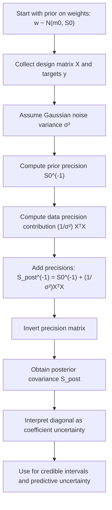

# Posterior Covariance

$$
S_{\text{post}} = \left(S_0^{-1} + \frac{1}{\sigma^2} X^\top X\right)^{-1}
$$

We are working on the posterior covariance of the regression weights in Bayesian Linear Regression under a Gaussian prior and Gaussian noise model. The canonical precision-form formula is

$$
S_{\text{post}}^{-1} = S_0^{-1} + \frac{1}{\sigma^2} X^\top X,
$$

equivalently

$$
S_{\text{post}} = \left(S_0^{-1} + \frac{1}{\sigma^2} X^\top X\right)^{-1},
$$

where $w \sim \mathcal{N}(m_0, S_0)$, the likelihood noise variance is $\sigma^2 > 0$, and $X$ is the design matrix.

## Deep Breakdown

Posterior covariance in Bayesian Linear Regression tells us how uncertain we remain about the regression coefficients **after** seeing the data. In ordinary least squares, we often estimate one single coefficient vector and stop there. In Bayesian Linear Regression, we treat the coefficient vector $w$ as a random variable. Before seeing data, we express belief about it through a prior distribution. After seeing data, we update that belief into a posterior distribution. The posterior distribution of the weights is Gaussian:

$$
w \mid y, X \sim \mathcal{N}(m_{\text{post}}, S_{\text{post}})
$$

The matrix $S_{\text{post}}$ is the posterior covariance.

It summarizes:

- how uncertain each coefficient still is,
- how coefficients co-vary with each other,
- how prior information and observed data combine,
- how this parameter uncertainty propagates into predictive uncertainty.

Inputs:

- prior covariance matrix $S_0$,
- design matrix $X$,
- observation noise variance $\sigma^2$.

Output:

- posterior covariance matrix $S_{\text{post}}$.

Why it matters in DA/DS:

- it gives **credible intervals** for coefficients,
- it helps quantify whether a coefficient is tightly estimated or still uncertain,
- it supports **uncertainty bands** on predictions,
- it makes regularization interpretable as prior information,
- it handles situations where data is limited, noisy, or collinear. A useful way to think about it is in terms of **precision**, where precision means inverse covariance.

The posterior precision is:

$$
S_{\text{post}}^{-1} = S_0^{-1} + \frac{1}{\sigma^2} X^\top X
$$

This says:

- the prior contributes information through $S_0^{-1}$,
- the data contributes information through $\frac{1}{\sigma^2} X^\top X$,
- the posterior combines both.

So the posterior covariance is smaller when:

- the prior is very informative,
- the sample size is large,
- the design matrix contains strong information,
- the observation noise is low.

This object is directly linked to:

- **Posterior Mean**, because both are derived from the same posterior Gaussian,
- **Predictive Uncertainty**, because uncertainty in $w$ affects uncertainty in predictions,
- **Ridge Regression**, because the algebra is closely related when the prior is Gaussian.

## Flowchart

