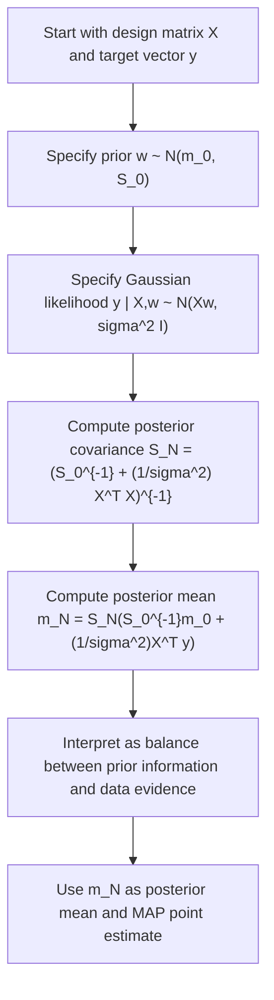

# Posterior Mean (MAP)

$$
m_N = S_N \left(S_0^{-1} m_0 + \frac{1}{\sigma^2} X^\top y\right)
$$

We are working on the posterior mean in Bayesian Linear Regression, with canonical formula $m_N = S_N \left(S_0^{-1} m_0 + \frac{1}{\sigma^2} X^\top y\right)$, where $w \mid X, y \sim \mathcal{N}(m_N, S_N)$ under a Gaussian prior and Gaussian likelihood. The domain is finite-dimensional Bayesian linear regression with known observation noise variance $\sigma^2$, prior $w \sim \mathcal{N}(m_0, S_0)$, and design matrix $X$. In this Gaussian case, the posterior is Gaussian, its mean equals its mode, and it acts as a Bayesian regularized regression estimate.

## Deep Breakdown

In Bayesian Linear Regression, we do not treat the regression coefficients $w$ as fixed unknown numbers. Instead, we model them probabilistically. Before seeing data, we express belief through a prior:

$$
w \sim \mathcal{N}(m_0, S_0)
$$

Then we observe training data $(X, y)$ under a Gaussian likelihood:

$$
y \mid X, w \sim \mathcal{N}(Xw, \sigma^2 I)
$$

After combining prior and likelihood, we obtain the posterior distribution:

$$
w \mid X, y \sim \mathcal{N}(m_N, S_N)
$$

The **posterior mean** is:

$$
m_N = S_N \left(S_0^{-1} m_0 + \frac{1}{\sigma^2} X^\top y\right)
$$

and the posterior covariance is:

$$
S_N = \left(S_0^{-1} + \frac{1}{\sigma^2} X^\top X\right)^{-1}
$$

This posterior mean is central because it is the main point summary of the posterior distribution. In the Gaussian case, the posterior is symmetric and unimodal, so:

- posterior mean = posterior mode = MAP estimate,
- posterior mean is a shrinkage estimate,
- the estimate balances prior belief and sample evidence.

Why this matters in DA/DS:

- **Regularized estimation:** it behaves like ridge regression when the prior is zero-mean isotropic.
- **Bayesian point estimate:** it gives a single coefficient vector when you need one practical model.
- **Uncertainty-aware learning:** unlike ordinary least squares, it arises from a full posterior distribution.
- **Stability with collinearity or low sample size:** prior precision stabilizes estimates.
- **Interpretability of influence:** the term $S_0^{-1} m_0$ represents prior pull, while $\frac{1}{\sigma^2} X^\top y$ represents evidence from data.

A useful operational interpretation:

- If the prior is strong and data is weak, $m_N$ stays close to $m_0$.
- If the data is strong and the prior is weak, $m_N$ moves closer to the classical regression solution.
- If predictors are highly correlated, the prior helps prevent unstable coefficient values.

## Flowchart

