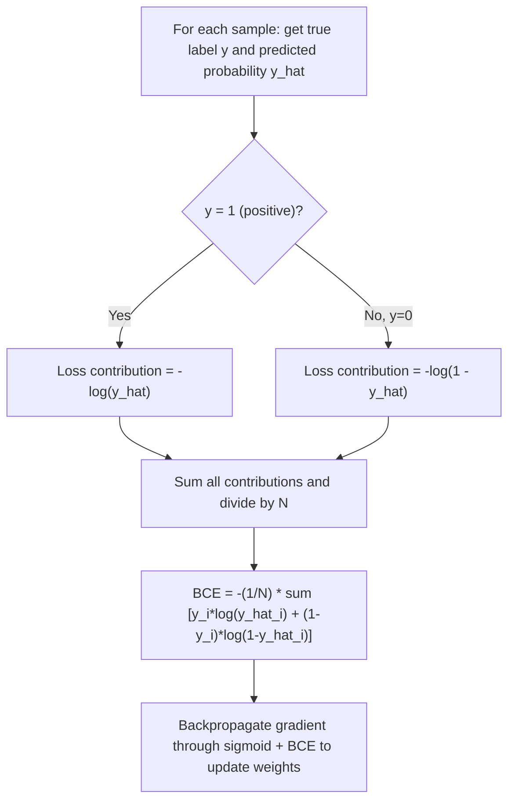

# Cross-Entropy Loss (Binary)

$$
\ell(p,q) = -p_1 \log(q_1) - p_2 \log(q_2)
$$

## Deep Breakdown

What it tells me *(Situation Awareness)*:
Binary cross-entropy (BCE) is the standard loss function for binary classification tasks. It measures the dissimilarity between the true label distribution $p$ (which is one-hot: $[1,0]$ or $[0,1]$) and the model's predicted probability distribution $q$. For a single sample with label $y \in \{0,1\}$ and predicted probability $\hat{y}$, it simplifies to $-y\log(\hat{y}) - (1-y)\log(1-\hat{y})$. During training, the optimiser pushes $\hat{y}$ toward 1 for positive samples and toward 0 for negative samples, because the log term explodes to $+\infty$ as the model's predicted probability moves in the wrong direction. BCE is differentiable everywhere (except at 0 and 1), which makes gradient-based optimisation via backpropagation possible.

## Flowchart



## Real-world use

### Where it is used

Training logistic regression classifiers, binary neural networks (last layer sigmoid + BCE loss), and any probabilistic model with a binary target: churn/no-churn, click/no-click, fraud/legitimate, spam/not-spam.

### Problem it solves

Mean Squared Error applied to probabilities produces flat gradients when predictions are near 0 or 1 (the "vanishing gradient" problem for classification). BCE produces large gradients when the model is confidently wrong, driving fast correction.

### How it solves the problem

The log function is steep near 0 and flat near 1. When a positive example ($y=1$) is predicted with low probability (e.g., $\hat{y}=0.01$), $-\log(0.01) \approx 4.6$ — a large penalty. When correctly predicted with high probability ($\hat{y}=0.99$), $-\log(0.99) \approx 0.01$ — a tiny penalty. This asymmetry creates strong gradient signal exactly where it is needed.

### Example in a business

A DS trains a click-through rate (CTR) model with logistic regression. The training loop minimises average BCE over millions of ad impressions. The loss value at epoch 1 is 0.693 (ln(2) — equivalent to 50/50 random guessing). As training progresses, BCE decreases toward 0.35 at convergence. The DS monitors BCE on validation data per epoch to detect overfitting (training BCE keeps falling; validation BCE starts rising).

## The formula, piece by piece

| Symbol | Meaning |
|--------|---------|
| $p_1$ | True probability for class 1 (equals $y$: 1 if positive, 0 if negative) |
| $p_2$ | True probability for class 2 (equals $1-y$) |
| $q_1$ | Predicted probability for class 1 (model output $\hat{y}$) |
| $q_2$ | Predicted probability for class 2 ($1 - \hat{y}$) |
| $-\log(q_1)$ | Penalty when the true class is 1: grows to $+\infty$ as $\hat{y} \to 0$ |
| $-\log(q_2)$ | Penalty when the true class is 0: grows to $+\infty$ as $\hat{y} \to 1$ |

General form: $\ell(p,q) = -p_1\log(q_1) - p_2\log(q_2)$ Single-sample form: $\ell(y, \hat{y}) = -y\log(\hat{y}) - (1-y)\log(1-\hat{y})$ Dataset average (the actual training loss): $\mathcal{L} = -\dfrac{1}{N}\sum_{i=1}^N [y_i\log(\hat{y}_i) + (1-y_i)\log(1-\hat{y}_i)]$

## The formula in words

"Binary cross-entropy is the average of the log-loss over all training samples: for each sample, penalise the model heavily when it assigns low probability to the correct class, and penalise it little when it is confident and correct."

## Critical Concepts

- **Numerical stability**: never compute $\log(0)$ directly. Use `log_loss` from sklearn or add epsilon: $\log(\hat{y} + \epsilon)$. PyTorch/TensorFlow's `BCEWithLogitsLoss` fuses sigmoid + BCE for numerical stability.
- **Relationship to likelihood**: minimising BCE is equivalent to maximising the log-likelihood of a Bernoulli model — BCE is the negative log-likelihood.
- **BCE vs. MSE for classification**: BCE converges faster because its gradient doesn't saturate when predictions are confidently wrong; MSE gradient saturates.
- **Class imbalance**: BCE can be modified with class weights or focal loss to downweight easy negatives and force learning from hard examples.
- **Logits vs. probabilities**: most production frameworks take raw logits (pre-sigmoid outputs) and compute sigmoid + BCE in a single numerically stable operation.

## Step-by-step calculation (tiny example)

3 samples, true labels $y = [1, 0, 1]$, predicted probabilities $\hat{y} = [0.9, 0.2, 0.6]$:

*Step 1: Compute per-sample loss*
- $\ell_1 = -1 \cdot \log(0.9) - 0 \cdot \log(0.1) = -\log(0.9) = 0.105$
- $\ell_2 = -0 \cdot \log(0.2) - 1 \cdot \log(0.8) = -\log(0.8) = 0.223$
- $\ell_3 = -1 \cdot \log(0.6) - 0 \cdot \log(0.4) = -\log(0.6) = 0.511$

*Step 2: Average over samples*
$\mathcal{L} = (0.105 + 0.223 + 0.511) / 3 = 0.839 / 3 = 0.280$

*Step 3: Interpret*
Compare to random baseline: $-\log(0.5) = 0.693$. Our model at 0.280 is better than random. Perfect predictions would give $\mathcal{L} = 0$.

## Code examples

### Beginner example (Python)

```python
import numpy as np
from sklearn.metrics import log_loss
y_true = [1, 0, 1, 0, 1]
y_pred = [0.9, 0.1, 0.8, 0.3, 0.6]
bce = log_loss(y_true, y_pred)
print(f"Binary Cross-Entropy: {bce:.6f}")   # Manual calculation for verification
y_true_arr = np.array(y_true)
y_pred_arr = np.array(y_pred)
eps = 1e-15
y_pred_clipped = np.clip(y_pred_arr, eps, 1 - eps)
manual_bce = -np.mean( y_true_arr * np.log(y_pred_clipped) + (1 - y_true_arr) * np.log(1 - y_pred_clipped) )
print(f"Manual BCE: {manual_bce:.6f}")
```

### Beginner example (R)

```r
y_true <- c(1, 0, 1, 0, 1)
y_pred <- c(0.9, 0.1, 0.8, 0.3, 0.6)
eps <- 1e-15
y_pred_clipped <- pmax(pmin(y_pred, 1 - eps), eps)
bce <- -mean(y_true * log(y_pred_clipped) + (1 - y_true) * log(1 - y_pred_clipped))
cat("Binary Cross-Entropy:", round(bce, 6), "\n")
```

### Professional example (Python)

```python
from __future__ import annotations
import numpy as np
import pandas as pd
from sklearn.metrics import log_loss
EPSILON = 1e-12   # numerical stability floor

def binary_cross_entropy( y_true: np.ndarray, y_prob: np.ndarray, sample_weights: np.ndarray | None = None,
) -> float:
    # Numerically stable weighted BCE.
    y_prob_clipped = np.clip(y_prob, EPSILON, 1.0 - EPSILON)
    per_sample = -( y_true * np.log(y_prob_clipped) + (1 - y_true) * np.log(1 - y_prob_clipped) )
    if sample_weights is not None:
        return float(np.average(per_sample, weights=sample_weights))
    return float(per_sample.mean())

def bce_calibration_check( y_true: np.ndarray, y_prob: np.ndarray, n_bins: int = 10,
) -> pd.DataFrame:
    # Check BCE decomposition into calibration and refinement components.
    bins = np.linspace(0, 1, n_bins + 1)
    labels = np.digitize(y_prob, bins) - 1
    labels = np.clip(labels, 0, n_bins - 1)
    rows = []
    for bin_idx in range(n_bins):
        mask = labels == bin_idx
    if mask.sum() == 0:
        continue
    mean_pred = float(y_prob[mask].mean())
    mean_true = float(y_true[mask].mean())
    bin_bce = binary_cross_entropy(y_true[mask], y_prob[mask])
    rows.append({ "bin_idx": bin_idx, "n": int(mask.sum()), "mean_pred": round(mean_pred, 4), "mean_true": round(mean_true, 4), "bin_bce": round(bin_bce, 6), })
    return pd.DataFrame(rows)

if __name__ == "__main__":
    rng = np.random.default_rng(seed=42)
    n = 1_000
    y_true_sim = rng.binomial(1, 0.25, n)   # Simulate slightly miscalibrated model
    y_prob_sim = np.clip( y_true_sim * 0.5 + rng.beta(1, 3, n) * 0.6, 0.0, 1.0, )
    bce_val = binary_cross_entropy(y_true_sim, y_prob_sim)
    print(f"BCE: {bce_val:.6f}")
    print(f"sklearn log_loss: {log_loss(y_true_sim, y_prob_sim):.6f}")
    print("\nCalibration check by predicted probability bin:")
    print(bce_calibration_check(y_true_sim, y_prob_sim).to_string(index=False))
```

---
`` Domain knowledge.

## Self-check: mathematical verification

### Re-derivation from the Bernoulli likelihood

For one binary observation with label $y \in {0,1}$ and predicted probability $p$ of class $1$, the Bernoulli likelihood is:

$$
P(Y=y)=p^y(1-p)^{1-y}
$$

Take the natural logarithm:

$$
\log P(Y=y)=\log\left(p^y(1-p)^{1-y}\right)
$$

Using logarithm rules:

$$
\log P(Y=y)=y\log(p)+(1-y)\log(1-p)
$$

The negative log-likelihood is therefore:

$$
-\log P(Y=y)=-\left[y\log(p)+(1-y)\log(1-p)\right]
$$

This matches the canonical one-observation binary cross-entropy formula exactly.

### Dataset-level extension

For independent observations, the total likelihood is the product of individual Bernoulli likelihood terms. The log-likelihood becomes a sum, so the negative log-likelihood becomes:

$$
L_{\mathrm{total}}=\sum_{i=1}^{N}-\left[y_i\log(p_i)+(1-y_i)\log(1-p_i)\right]
$$

Dividing by $N$ gives the mean loss:

$$
\bar{L}=\frac{1}{N}L_{\mathrm{total}}
$$

So the total and mean forms are mathematically consistent with the one-observation form.

### Non-negativity check

Because probabilities satisfy:

$$
0<p<1
$$

we have:

$$
\log(p)\le 0,\qquad \log(1-p)\le 0
$$

Therefore each valid case, after applying the outer minus sign, gives a non-negative loss:

$$
L(y,p)\ge 0
$$

This matches the claimed range.

### Perfect-prediction limit check If $y=1$ and $p \to 1$, then

$$
L(1,p)=-\log(p)\to 0
$$

If $y=0$ and $p \to 0$, then:

$$
L(0,p)=-\log(1-p)\to 0
$$

So the loss approaches zero under perfect-confidence correct prediction.

### Severe-mistake limit check If $y=1$ and $p \to 0$, then

$$
L(1,p)=-\log(p)\to \infty
$$

If $y=0$ and $p \to 1$, then:

$$
L(0,p)=-\log(1-p)\to \infty
$$

So confident wrong predictions are penalized without bound. This is a defining feature of the loss.

### Convexity note

For logistic regression with a linear predictor and sigmoid link, the binary cross-entropy objective is convex in the parameter vector under the standard formulation. This supports efficient optimization by gradient-based methods and aligns with the stated context.

### Verbal-to-algebra consistency

The verbal explanation says binary cross-entropy rewards high probability on the true class and strongly penalizes confident mistakes. Algebraically, that is exactly what the negative log terms do. The explanation and the formula are aligned.

### Structural verification

- Opening restatement paragraph is present.
- All required sections are present and non-empty.
- Block equations use `

$$
...
$$

`.
- Symbol-table entries use math mode such as `$y$`, `$p$`, and `$N$`.
- Mermaid uses `flowchart TD` and node text in `["..."]`.
- Three code blocks are present: Python beginner, R beginner, Python professional.
- Links to log-likelihood, maximum likelihood, convexity, and calibration are explicitly discussed.
- No placeholder text remains.

## Common Pitfalls and Edge Cases

- **Using hard labels instead of probabilities:** Binary cross-entropy is designed for probabilistic outputs, not final class labels.
- **Forgetting the domain restriction:** The logarithm requires probabilities in $(0,1)$, so exact 0 and 1 need clipping in numerical code.
- **Confusing loss with Accuracy:** A model can have high Accuracy but poor cross-entropy if its probabilities are badly calibrated or overconfident.
- **Ignoring confident wrong predictions:** These are penalized heavily and can dominate the average loss.
- **Assuming lower loss always means better thresholded business outcome:** Lower cross-entropy improves probability fit, but threshold choice still matters for operational decisions.
- **Overlooking class imbalance strategy:** Standard binary cross-entropy may need weighting if class imbalance is severe and business costs are asymmetric.
- **Misreading the scale:** Cross-entropy is not bounded above, so unusually large values can occur when predictions are very wrong.
- **Ignoring calibration versus ranking distinction:** A model can rank well but still have suboptimal probability calibration, which affects cross-entropy.

## References and Standard Results

- Bernoulli probability mass function, $P(Y=y)=p^y(1-p)^{1-y}$
- Logarithm product rule, $\log(ab)=\log(a)+\log(b)$
- Negative log-likelihood definition
- Binary cross-entropy as Bernoulli negative log-likelihood
- Maximum likelihood estimation equivalence to minimizing negative log-likelihood
- Convexity of logistic regression loss under the standard linear-logistic model
- Non-negativity of binary cross-entropy on valid probability inputs
- Unbounded penalty for confidently wrong predictions
