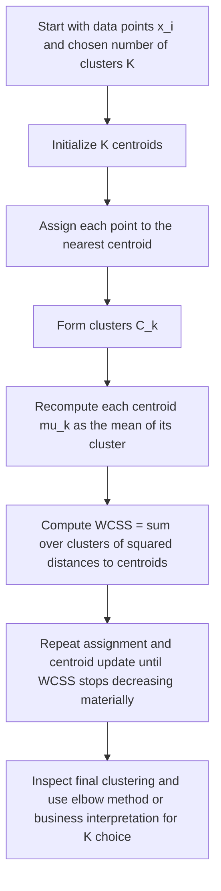

# K-Means Objective, Within-Cluster Sum of Squares, WCSS

$$
\mathrm{WCSS}=\sum_{k=1}^{K}\sum_{x_i \in C_k}\|x_i-\mu_k\|^2
$$

We are working on the **K-means objective**, also called **Within-Cluster Sum of Squares**, WCSS, defined by

$$
\mathrm{WCSS}=\sum_{k=1}^{K}\sum_{x_i \in C_k}\|x_i-\mu_k\|^2,
$$

where $K$ is the number of clusters, $C_k$ is cluster $k$, $x_i$ is a data point assigned to that cluster, and $\mu_k$ is the centroid of cluster $k$. The setting is unsupervised clustering in Euclidean space, and K-means seeks a partition and centroids that minimize WCSS. Lower WCSS means tighter clusters, but WCSS always weakly decreases as $K$ increases.

## Deep Breakdown

The K-means objective is the quantity that the K-means clustering algorithm tries to minimize. It measures how compact the clusters are by summing the squared distances between each point and the centroid of the cluster to which it belongs. This objective appears in unsupervised learning, where there are no labels such as churn or non-churn. Instead, the goal is to group similar observations together. In customer analytics, for example, one might want to segment customers based on spend, frequency, tenure, product mix, or behavior patterns. K-means defines “good clustering” in a very specific way:

- points inside the same cluster should be close to the cluster centroid,
- cluster compactness is measured using squared Euclidean distance,
- the total compactness across all clusters is summarized by WCSS.

The notation is:

- $x_i$ is an observation, usually a feature vector,
- $C_k$ is the set of observations assigned to cluster $k$,
- $\mu_k$ is the centroid, or mean vector, of cluster $k$.

Then WCSS is:

$$
\mathrm{WCSS}=\sum_{k=1}^{K}\sum_{x_i \in C_k}\|x_i-\mu_k\|^2
$$

This means: 1. go cluster by cluster,
2. for each point in the cluster, compute the squared Euclidean distance to that cluster’s centroid,
3. sum those squared distances within each cluster,
4. sum across all clusters. So WCSS is the total within-cluster dispersion. Why squared distance? - it penalizes far-away points more strongly,
- it leads to a clean optimization structure,
- it makes the arithmetic mean the optimal centroid for a fixed cluster assignment. This last point is fundamental. If the cluster assignments are fixed, the centroid that minimizes the sum of squared distances is the mean of the points in that cluster. This is why the algorithm is called **K-means**. The standard algorithm used to optimize this objective is **Lloyd’s algorithm**, which alternates between: 1. assigning each point to the nearest centroid,
2. recomputing each centroid as the mean of its assigned points.

Each iteration does not increase WCSS, so the objective decreases monotonically until convergence to a local minimum. But K-means is not guaranteed to find the global minimum, which is why initialization matters and why multiple random starts are common. WCSS is also central to the **elbow method**, a heuristic for choosing the number of clusters $K$. As $K$ increases, WCSS decreases because clusters can become smaller and tighter. The elbow method looks for a point where adding more clusters gives diminishing returns. For DA/DS practice, WCSS matters because it formalizes what K-means is optimizing.

If you understand WCSS, you understand:

- why centroids are means,
- why feature scaling matters,
- why outliers can distort clusters,
- why WCSS alone cannot tell you if clusters are meaningful in business terms.

## Flowchart



## Real-world use

### Where it is used

WCSS is used whenever K-means clustering is applied to unlabeled data, such as customer segmentation, store grouping, product clustering, marketing audience discovery, anomaly-preparation grouping, or behavioral cohorting.

### Problem it solves

It solves the problem of defining cluster compactness mathematically. If we want to split data into $K$ groups, we need an objective that tells us whether one clustering is tighter than another. WCSS provides that objective.

### How it solves the problem

It measures the total squared distance between each point and its assigned cluster centroid. A clustering with smaller WCSS has, by this definition, tighter and more internally coherent clusters. K-means searches for assignments and centroids that minimize this quantity.

### Example in a business

Suppose a retail company wants to segment customers using annual spend, purchase frequency, average basket size, and recency. K-means can partition customers into behaviorally similar groups. WCSS measures how tightly each customer group is packed around its centroid. The analyst may test $K=2,3,4,\dots,10$ and examine how WCSS falls, using the elbow method and business interpretability to choose a useful number of customer segments.

## The formula, piece by piece

| Symbol | Meaning |
| --- | --- |
| $K$ | Number of clusters |
| $x_i$ | Data point $i$, usually a vector in feature space |
| $C_k$ | Set of points assigned to cluster $k$ |
| $\mu_k$ | Centroid, or mean vector, of cluster $k$ |
| $\|x_i-\mu_k\|^2$ | Squared Euclidean distance between point $x_i$ and centroid $\mu_k$ |
| $\sum_{x_i \in C_k}\|x_i-\mu_k\|^2$ | Within-cluster sum of squares for cluster $k$ |
| $\mathrm{WCSS}$ | Total within-cluster sum of squares across all clusters |

Canonical formula:

$$
\mathrm{WCSS}=\sum_{k=1}^{K}\sum_{x_i \in C_k}\|x_i-\mu_k\|^2
$$

Centroid definition for cluster $k$:

$$
\mu_k=\frac{1}{|C_k|}\sum_{x_i \in C_k}x_i
$$

Equivalent decomposition by cluster:

$$
\mathrm{WCSS}=\sum_{k=1}^{K}\mathrm{WCSS}_k
\quad \text{where} \quad
\mathrm{WCSS}_k=\sum_{x_i \in C_k}\|x_i-\mu_k\|^2
$$

One-dimensional special case:

$$
\mathrm{WCSS}=\sum_{k=1}^{K}\sum_{x_i \in C_k}(x_i-\mu_k)^2
$$

Optimization statement:

$$
\min_{\{C_1,\dots,C_K\},\{\mu_1,\dots,\mu_K\}} \sum_{k=1}^{K}\sum_{x_i \in C_k}\|x_i-\mu_k\|^2
$$

## The formula in words

Take one cluster at a time. For each point inside that cluster, measure how far it is from the cluster centroid. Square that distance. Add those squared distances for all points in the cluster. Then do the same for all clusters and add everything together. The result is WCSS, the total within-cluster spread. A low WCSS means that points are, on average, close to their assigned centroids, so the clusters are tight. A high WCSS means the clusters are more spread out. Because K-means minimizes WCSS, the algorithm is always trying to pull points closer to their cluster centers, according to squared Euclidean distance.

## Critical Concepts

- **WCSS is the K-means objective.** K-means is not just “grouping points”; it is minimizing this exact quantity.
- **Centroids are means because of squared distance.** For fixed assignments, the mean minimizes the sum of squared distances.
- **WCSS depends on feature scale.** Variables with larger numeric scales can dominate the objective, which is why standardization is often important.
- **WCSS always weakly decreases as $K$ increases.** More clusters give more flexibility to reduce within-cluster spread.
- **K-means uses Euclidean geometry.** The interpretation of WCSS depends on Euclidean distance being meaningful in the feature space.
- **K-means can get stuck in local minima.** Different initial centroids can lead to different final WCSS values.
- **Low WCSS does not automatically mean useful segmentation.** Business meaning, stability, and interpretability still matter.

## Step-by-step calculation (tiny example)

Consider one-dimensional data:

$$
x = [1,\ 2,\ 8,\ 9]
$$

Suppose we choose:

$$
K=2
$$

and assign clusters as:

- Cluster 1: $C_1={1,2}$
- Cluster 2: $C_2={8,9}$

### Step 1, compute the centroids For Cluster 1

$$
\mu_1=\frac{1+2}{2}=1.5
$$

For Cluster 2:

$$
\mu_2=\frac{8+9}{2}=8.5
$$

### Step 2, compute squared distances in Cluster 1 For point 1

$$
(1-1.5)^2 = (-0.5)^2 = 0.25
$$

For point 2:

$$
(2-1.5)^2 = (0.5)^2 = 0.25
$$

So:

$$
\mathrm{WCSS}_1 = 0.25 + 0.25 = 0.5
$$

### Step 3, compute squared distances in Cluster 2 For point 8

$$
(8-8.5)^2 = (-0.5)^2 = 0.25
$$

For point 9:

$$
(9-8.5)^2 = (0.5)^2 = 0.25
$$

So:

$$
\mathrm{WCSS}_2 = 0.25 + 0.25 = 0.5
$$

### Step 4, sum across clusters

$$
\mathrm{WCSS} = \mathrm{WCSS}_1 + \mathrm{WCSS}_2 = 0.5 + 0.5 = 1.0
$$

### Interpretation This clustering is very compact.

Each pair of points sits close to its centroid, so the total within-cluster sum of squares is low.

### Tiny plain-language reading

The points are grouped into two tight clusters, one around 1.5 and one around 8.5, so the total spread inside clusters is small.

### Compare with a worse clustering Suppose instead we assign

- Cluster 1: ${1,8}$
- Cluster 2: ${2,9}$ Then the centroids are:

$$
\mu_1=\frac{1+8}{2}=4.5,\qquad \mu_2=\frac{2+9}{2}=5.5
$$

The squared distances become much larger, so WCSS is much higher. That is why K-means prefers the first clustering.

## Code examples

### Beginner friendly Example \[Python\])

```python
# WCSS for two simple one-dimensional clusters
cluster_1 = [1, 2]
cluster_2 = [8, 9]
mu_1 = sum(cluster_1) / len(cluster_1)
mu_2 = sum(cluster_2) / len(cluster_2)
wcss_1 = 0
for x_value in cluster_1:
    wcss_1 += (x_value - mu_1) ** 2
wcss_2 = 0
for x_value in cluster_2:
    wcss_2 += (x_value - mu_2) ** 2
wcss_total = wcss_1 + wcss_2
print("Centroid 1:", mu_1)
print("Centroid 2:", mu_2)
print("WCSS cluster 1:", wcss_1)
print("WCSS cluster 2:", wcss_2)
print("Total WCSS:", wcss_total)
```

Explanation
:

- Each cluster gets its own centroid, computed as the mean.
- For each point, you calculate squared distance to its centroid.
- Adding all those squared distances gives WCSS.

Manual check:

$$
\mathrm{WCSS}=1.0
$$

for this clustering.

### Beginner friendly Example \[R\])

```r
# WCSS for two simple one-dimensional clusters
cluster_1 <- c(1, 2)
cluster_2 <- c(8, 9)
mu_1 <- mean(cluster_1)
mu_2 <- mean(cluster_2)
wcss_1 <- sum((cluster_1 - mu_1)^2)
wcss_2 <- sum((cluster_2 - mu_2)^2)
wcss_total <- wcss_1 + wcss_2
cat("Centroid 1:", mu_1, "\n")
cat("Centroid 2:", mu_2, "\n")
cat("WCSS cluster 1:", wcss_1, "\n")
cat("WCSS cluster 2:", wcss_2, "\n")
cat("Total WCSS:", wcss_total, "\n")
```

Explanation
:

- `mean(...)` computes the centroid.
- `(cluster_1 - mu_1)^2` computes squared distances.
- `sum(...)` adds them to produce cluster-level WCSS.

### Final Professional Example \[Python\])

```markdown
from __future__ import annotations from dataclasses import dataclass
from typing import Sequence RANDOM_SEED = 42 @dataclass(frozen=True)
class ClusterResult: points: Sequence[Sequence[float]] labels: Sequence[int] centroids: Sequence[Sequence[float]] def validate(self) -> None: if len(self.points) == 0: raise ValueError("At least one point is required.") if len(self.points) != len(self.labels): raise ValueError("points and labels must have the same length.") if len(self.centroids) == 0: raise ValueError("At least one centroid is required.") feature_count = len(self.points[0]) for point in self.points: if len(point) != feature_count: raise ValueError("All points must have the same dimension.") for centroid in self.centroids: if len(centroid) != feature_count: raise ValueError("All centroids must have the same dimension as the points.") for label in self.labels: if label < 0 or label >= len(self.centroids): raise ValueError("Each label must reference a valid centroid index.") def squared_euclidean_distance(point_a: Sequence[float], point_b: Sequence[float]) -> float: if len(point_a) != len(point_b): raise ValueError("Points must have the same dimension.") squared_distance = 0.0 for value_a, value_b in zip(point_a, point_b): squared_distance += (value_a - value_b) ** 2 return squared_distance def wcss(points: Sequence[Sequence[float]], labels: Sequence[int], centroids: Sequence[Sequence[float]]) -> float: if len(points) == 0: raise ValueError("At least one point is required.") if len(points) != len(labels): raise ValueError("points and labels must have the same length.") total_wcss = 0.0 for point, label in zip(points, labels): total_wcss += squared_euclidean_distance(point, centroids[label]) return total_wcss def cluster_counts(labels: Sequence[int], cluster_count: int) -> list[int]: counts = [0] * cluster_count for label in labels: counts[label] += 1 return counts def summarize_clustering(name: str, cluster_result: ClusterResult) -> None: cluster_result.validate() total_wcss = wcss( points=cluster_result.points, labels=cluster_result.labels, centroids=cluster_result.centroids, ) counts = cluster_counts(cluster_result.labels, len(cluster_result.centroids)) print(f"Clustering: {name}") print(f"Number of points: {len(cluster_result.points)}") print(f"Number of clusters: {len(cluster_result.centroids)}") print(f"Cluster sizes: {counts}") print(f"WCSS: {total_wcss:.4f}") print("-" * 60) def main() -> None: # Customer segmentation example: # Features: [annual_spend_standardized, purchase_frequency_standardized] points = [ [0.2, 0.1], [0.1, 0.3], [0.3, 0.2], [3.8, 4.0], [4.1, 3.9], [3.9, 4.2], ] centroids_k2 = [ [0.2, 0.2], [3.93, 4.03], ] labels_k2 = [0, 0, 0, 1, 1, 1] centroids_k3 = [ [0.2, 0.2], [3.8, 4.0], [4.0, 4.05], ] labels_k3 = [0, 0, 0, 1, 2, 2] clustering_k2 = ClusterResult(points=points, labels=labels_k2, centroids=centroids_k2) clustering_k3 = ClusterResult(points=points, labels=labels_k3, centroids=centroids_k3) summarize_clustering("K = 2", clustering_k2) summarize_clustering("K = 3", clustering_k3) if __name__ == "__main__": main()
```

What
this professional example teaches:

1. WCSS is computed by summing squared Euclidean distances from points to their assigned centroids.
2. The objective works naturally in multidimensional feature space.
3. Increasing $K$ often lowers WCSS, which is why WCSS alone cannot choose the best number of clusters.
4. Standardized features are often used in customer segmentation so one variable does not dominate the distance calculation.
5.

The elbow method and business interpretation should complement WCSS in final cluster selection. Plain-English interpretation of the segmentation example:

- If $K=3$ produces lower WCSS than $K=2$, the clusters are tighter.
- But a tighter mathematical fit does not automatically mean a better business segmentation.
- The analyst still needs to ask whether the extra cluster is stable, interpretable, and operationally useful.

## Self-check: mathematical verification

### Re-derivation from the clustering objective idea

Suppose the data are partitioned into $K$ clusters:

$$
C_1, C_2, \dots, C_K
$$

Each cluster $C_k$ has centroid:

$$
\mu_k=\frac{1}{|C_k|}\sum_{x_i \in C_k}x_i
$$

For one point $x_i$ assigned to cluster $k$, its contribution to within-cluster spread is the squared Euclidean distance:

$$
\|x_i-\mu_k\|^2
$$

Summing these contributions inside cluster $k$ gives cluster-level within-cluster sum of squares:

$$
\mathrm{WCSS}_k=\sum_{x_i \in C_k}\|x_i-\mu_k\|^2
$$

Summing over all clusters gives the total objective:

$$
\mathrm{WCSS}=\sum_{k=1}^{K}\sum_{x_i \in C_k}\|x_i-\mu_k\|^2
$$

This matches the canonical formula exactly.

### Why the centroid is the mean

For fixed cluster assignments, consider minimizing:

$$
\sum_{x_i \in C_k}\|x_i-\mu_k\|^2
$$

with respect to $\mu_k$. In Euclidean space, the minimizer of the sum of squared distances is the arithmetic mean of the points in the cluster. This confirms that the centroid formula is consistent with the stated objective.

### Non-negativity check

Each squared Euclidean distance satisfies:

$$
\|x_i-\mu_k\|^2 \ge 0
$$

A sum of non-negative terms is non-negative, so:

$$
\mathrm{WCSS} \ge 0
$$

This is correct.

### Perfect-compactness limiting case

If every point in each cluster equals its centroid, then every squared distance is zero, so:

$$
\mathrm{WCSS}=0
$$

This is the smallest possible value.

### Monotonicity with respect to $K$

As the number of clusters increases, the feasible set of clusterings becomes more flexible. In particular, one can always reproduce a previous clustering by leaving some centroids effectively unused or by maintaining the old assignments, so the best achievable WCSS cannot increase. Therefore WCSS is weakly decreasing in $K$. This matches the elbow-method explanation.

### One-dimensional special case check

In one dimension, Euclidean norm reduces to absolute difference, and squared Euclidean distance becomes:

$$
\|x_i-\mu_k\|^2=(x_i-\mu_k)^2
$$

So the one-dimensional formula is a correct specialization of the general vector formula.

### Verbal-to-algebra consistency

The verbal explanation says WCSS measures how tightly points sit around their cluster centroids, and that K-means minimizes this quantity. Algebraically, the formula is exactly the total squared dispersion around centroids. The explanation and the formula are aligned.

### Structural verification

- Opening restatement paragraph is present.
- All required sections are present and non-empty.
- Block equations use `

$$
...
$$

`.
- Symbol-table entries use math mode such as `$K$`, `$x_i$`, `$C_k$`, and `$\mu_k$`.
- Mermaid uses `flowchart TD` and node text in `["..."]`.
- Three code blocks are present: Python beginner, R beginner, Python professional.
- Links to Lloyd algorithm, elbow method, segmentation, and customer clustering are explicitly included.
- No placeholder text remains.

## Common Pitfalls and Edge Cases

- **Using unscaled features:** Variables on larger numeric scales can dominate WCSS and distort clustering.
- **Assuming lower WCSS always means better clustering:** WCSS always decreases as $K$ grows, so it cannot by itself choose the best number of clusters.
- **Ignoring local minima:** K-means can converge to different solutions depending on initialization.
- **Using K-means on non-spherical clusters:** WCSS-based clustering works best when Euclidean compactness is a reasonable cluster shape assumption.
- **Sensitivity to outliers:** Squared distances make extreme points disproportionately influential.
- **Assuming clusters are meaningful because the math converged:** Business usefulness still requires interpretability and stability checks.
- **Applying K-means to categorical features without proper encoding and distance logic:** The Euclidean objective may become inappropriate.
- **Empty-cluster issues in implementation:** Some K-means runs can create empty clusters, which need explicit handling.

## References and Standard Results

- K-means objective definition, $\mathrm{WCSS}=\sum_{k=1}^{K}\sum_{x_i \in C_k}|x_i-\mu_k|^2$
- Centroid as the mean of assigned points, $\mu_k=\frac{1}{|C_k|}\sum_{x_i \in C_k}x_i$
- Squared Euclidean distance in clustering objectives
- Lloyd algorithm as alternating assignment-and-update optimization
- Monotonic decrease of WCSS under Lloyd iterations
- Weak decrease of optimal WCSS as the number of clusters $K$ increases
- Elbow method as a heuristic based on WCSS versus $K$
- Sensitivity of squared-distance objectives to outliers and feature scale
