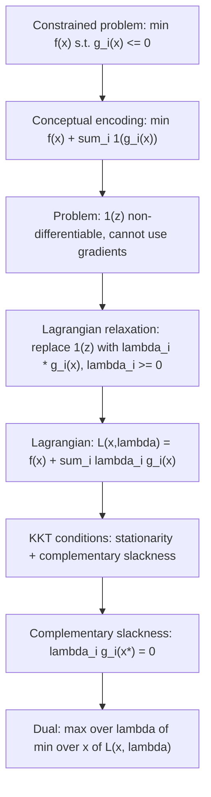

# Infinite Step Function (Constraint Penalty)

$$
\mathbf{1}(z) = \begin{cases} 0 & \text{if } z \le 0 \\ \infty & \text{otherwise} \end{cases}
$$

_(Used to impose infinite penalty if a constraint $g_i(x) \le 0$ is violated; circumvented by Lagrange multipliers)_.

## Deep Breakdown

What it tells me *(Situation Awareness)*:
The infinite step function is a theoretical device in constrained optimisation. When minimising $f(x)$ subject to $g_i(x) \leq 0$, one formal encoding is to add $\sum_i \mathbf{1}(g_i(x))$ to the objective: constraint violation instantly inflates cost to $\infty$. This device is not directly computable (non-differentiable), but it motivates the Lagrangian: Lagrange multipliers $\lambda_i \geq 0$ replace the discontinuous step with a smooth linear penalty $\lambda_i g_i(x)$. The constraint that $\lambda_i \geq 0$ follows directly from the step function's sign — the penalty for violation must be non-negative. Understanding this concept is essential for reading SVM, QP, and constrained Bayesian optimisation derivations.

## Flowchart



## Real-world use

### Where it is used

Understanding derivations of SVMs, QP duals, constrained neural network training (e.g., fairness constraints), and augmented Lagrangian methods. Encountered whenever reading "the indicator constraint is relaxed via Lagrange multipliers" in a textbook or paper.

### Problem it solves

How do you turn a hard constraint into something differentiable that a gradient-based optimiser can handle? The infinite step function shows why the answer (Lagrange multipliers) must be non-negative and yields the KKT conditions.

### How it solves the problem

The Lagrangian $\mathcal{L}(x, \lambda) = f(x) + \sum_i \lambda_i g_i(x)$ is a smooth surrogate for the infinite-penalty problem when $\lambda_i \geq 0$. Maximising the dual $g(\lambda) = \min_x \mathcal{L}(x, \lambda)$ over $\lambda \geq 0$ tightens the lower bound. Under Slater's condition (convex problem with a strictly feasible point), strong duality holds and the dual equals the primal.

### Example in a business

A DS derives the SVM hard-margin classifier. Primal: $\min_{w,b} \frac{1}{2}\|w\|^2$ subject to $y_i(w^T x_i + b) \geq 1$. Rewriting: $g_i = 1 - y_i(w^T x_i + b) \leq 0$. The conceptual step-function form makes clear why dual multipliers $\alpha_i \geq 0$ arise, and complementary slackness ($\alpha_i = 0$ for non-support-vectors) explains sparsity.

## The formula, piece by piece

| Symbol | Meaning |
|--------|---------|
| $z = g_i(x)$ | Constraint function evaluated at $x$ |
| $\mathbf{1}(z) = 0$ if $z \leq 0$ | No penalty when constraint is satisfied |
| $\mathbf{1}(z) = \infty$ if $z > 0$ | Infinite penalty when constraint is violated |
| $\lambda_i \geq 0$ | Lagrange multiplier replacing $\mathbf{1}(\cdot)$ |
| $\lambda_i g_i(x)$ | Smooth linear penalty for constraint $i$ |

Constrained problem via indicator: $\min_x f(x) + \sum_i \mathbf{1}(g_i(x))$ Lagrangian: $\mathcal{L}(x, \lambda) = f(x) + \sum_i \lambda_i g_i(x)$ KKT complementary slackness: $\lambda_i g_i(x^*) = 0$, $\lambda_i \geq 0$, $g_i(x^*) \leq 0$

## The formula in words

"The infinite step function says: if you violate a constraint, cost becomes infinite. Lagrange multipliers replace this with a linear price: the multiplier $\lambda_i$ is the shadow price of constraint $i$. The price must be non-negative because you can only be penalised for violations, not rewarded."

## Critical Concepts

- **Complementary slackness**: $\lambda_i > 0 \Rightarrow g_i(x^*) = 0$ (constraint active); $g_i(x^*) < 0 \Rightarrow \lambda_i = 0$ (constraint inactive). This is why SVMs are sparse.
- **Strong duality under Slater's condition**: for convex $f$ and convex $g_i$, if there exists $x$ with $g_i(x) < 0$ for all $i$, then primal = dual.
- **Barrier methods**: interior-point solvers use $-\mu \log(-g_i(x))$ (log barrier) as a smooth approximation that approaches $\mathbf{1}(\cdot)$ as $\mu \to 0$.
- **Penalty methods**: replace $\mathbf{1}(\cdot)$ with $\rho \max(0, g_i(x))^2$ — differentiable but inexact (constraint not exactly satisfied).
- **Augmented Lagrangian**: combines multiplier update with penalty term for fast, exact constraint satisfaction.

## Step-by-step calculation (tiny example)

$\min_x (x - 3)^2$ subject to $x \leq 2$ ($g(x) = x - 2 \leq 0$).

*Step 1: Indicator form*
$\min_x (x-3)^2 + \mathbf{1}(x-2)$. Unconstrained minimum: $x^* = 3$, which violates $x \leq 2$.

*Step 2: Lagrangian*
$\mathcal{L}(x, \lambda) = (x-3)^2 + \lambda(x-2)$

*Step 3: KKT stationarity*
$\partial \mathcal{L}/\partial x = 2(x-3) + \lambda = 0 \Rightarrow x^* = 3 - \lambda/2$

*Step 4: Complementary slackness*
If $x^* = 2$ (boundary): $3 - \lambda/2 = 2 \Rightarrow \lambda = 2$. Check: $\lambda = 2 \geq 0$ ✓.
Constraint is active: $g(x^*) = 0$. Complementary slackness satisfied. Solution: $x^* = 2$, $f^* = 1$.

## Code examples

### Beginner example (Python)

```python
import numpy as np
from scipy.optimize import minimize

def objective(x):
    # min (x - 3)^2
    return float((x[0] - 3.0) ** 2)

def gradient(x):
    return np.array([2.0 * (x[0] - 3.0)])   # Hard constraint: x <= 2
constraints = [{"type": "ineq", "fun": lambda x: 2.0 - x[0]}]
result = minimize( objective, x0=[0.0], jac=gradient, method="SLSQP", constraints=constraints,
)
print(f"Optimal x: {result.x[0]:.4f} (expected: 2.0)")
print(f"Optimal f: {result.fun:.4f} (expected: 1.0)")   # Without constraint
result_unc = minimize(objective, x0=[0.0], jac=gradient, method="BFGS")
print(f"Unconstrained x: {result_unc.x[0]:.4f} (expected: 3.0)")
```

### Beginner example (R)

```r
# min (x - 3)^2 subject to x <= 2, encoded as -x >= -2
objective <- function(x) (x - 3)^2
gradient <- function(x) 2 * (x - 3)
result <- constrOptim( theta = 0.0, f = objective, grad = gradient, ui = matrix(-1, nrow = 1), ci = -2.0, method = "BFGS"
)
cat("Optimal x:", round(result$par, 4), "(expected 2.0)\n")
cat("Optimal f:", round(result$value, 4), "(expected 1.0)\n")
```

### Professional example (Python)

```python
from __future__ import annotations
import numpy as np
from scipy.optimize import minimize

def penalty_method( f: object, g_constraints: list[object], x0: np.ndarray, rho_sequence: list[float], tol: float = 1e-7,
) -> dict[str, object]:
    # Penalty method approximating indicator 1(g_i(x)) with rho *
    max(0, g_i(x))^2.   # As rho increases, constraint satisfaction improves.
    x = x0.copy()
    history = []
    for rho in rho_sequence:

def penalised_obj(x_inner):
    return float(f(x_inner)) + rho * sum( max(0.0, float(g(x_inner))) ** 2 for g in g_constraints )
result = minimize(penalised_obj, x, method="BFGS", tol=tol)
x = result.x
violations = [max(0.0, float(g(x))) for g in g_constraints]
history.append({ "rho": rho, "f_value": round(float(f(x)), 6), "max_violation": round(max(violations, default=0.0), 8), })
return {"x_opt": x.round(6), "history": history}

if __name__ == "__main__":
    # min (x1-2)^2 + (x2-3)^2 s.t. x1 + x2 <= 4, x1 >= 0, x2 >= 0
    f_obj = lambda x: (x[0] - 2.0) ** 2 + (x[1] - 3.0) ** 2
    g1 = lambda x: x[0] + x[1] - 4.0   # x1+x2 <= 4
    g2 = lambda x: -x[0]   # x1 >= 0
    g3 = lambda x: -x[1]   # x2 >= 0
    result = penalty_method( f=f_obj, g_constraints=[g1, g2, g3], x0=np.array([1.0, 1.0]), rho_sequence=[1, 10, 100, 1000], )
    print("Penalty method result:")
    print(f" Optimal x: {result['x_opt']}")
    print(" Convergence history:")
    for row in result["history"]:
        print(f" {row}")
```

---
`` Domain knowledge.

## Self-check: mathematical verification

- If $x$ is **infeasible** for $g_i(x)\le 0$, then $\phi(g(x))=+\infty$ and $f(x)+\phi(g(x))=+\infty$, so such points cannot minimize the extended objective when any feasible point exists.
- If $x$ is **feasible**, $\phi(g(x))=0$, so the unconstrained problem $\min_x (f+\phi)$ matches $\min_x f$ on the feasible region.
- This is the **indicator** of the feasible set in convex analysis; smooth penalties (quadratic, log-barrier) approximate it for optimization algorithms.

## Common Pitfalls and Edge Cases

- **Empty feasible set:** every point has cost $+\infty$; the reformulation hides feasibility diagnosis.
- **Numerical optimization** cannot literally implement $+\infty$; barrier or penalty methods use finite smooth surrogates.
- **Equality constraints** need two inequalities or a separate indicator on an affine subspace.

## References and Standard Results

- Constrained-to-unconstrained reformulations; connection to **exact penalties** and **interior-point** barrier methods.
- Indicator functions and subdifferential calculus in convex optimization.
