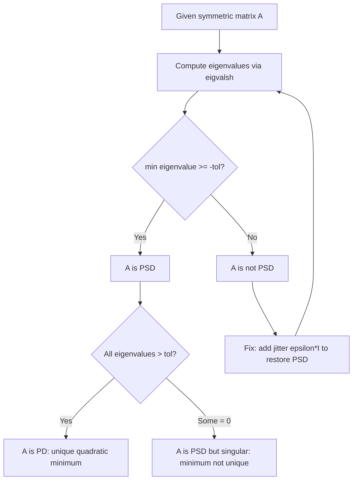

# PSD Verification via Rayleigh Quotient

$$
0 \le \lambda_{min}(A) \le R_A(x)
$$

_(If eigenvalues are non-negative, $A$ is PSD. Furthermore, $A^T A$ is always positive semi-definite)_.

## Deep Breakdown

What it tells me *(Situation Awareness)*:
A matrix $A$ is Positive Semi-Definite (PSD) if and only if $x^T A x \geq 0$ for all $x \neq 0$. The Rayleigh Quotient $R_A(x) = x^T A x / \|x\|^2$ connects this definition to eigenvalues: its minimum over all non-zero $x$ equals the smallest eigenvalue $\lambda_{min}(A)$. So PSD is equivalent to $\lambda_{min}(A) \geq 0$. This is critical in ML because PSD matrices appear everywhere: covariance matrices must be PSD (negative variance is impossible), Hessians of convex loss functions must be PSD, and kernel matrices in SVMs/Gaussian Processes must be PSD for the dual/likelihood to be well-defined. The fact that $A^T A$ is always PSD is why normal equations and Gram matrices never fail this check by construction.

## Flowchart



## Real-world use

### Where it is used

Validating covariance matrices before fitting multivariate Gaussians or GMMs, checking Hessians to confirm convexity, constructing valid kernel matrices for SVMs/Gaussian Processes, and debugging numerical failures where theoretically-PSD matrices have tiny negative eigenvalues from floating-point errors.

### Problem it solves

Convex optimisation solvers, Cholesky-based samplers, and kernel methods all require PSD inputs. A single negative eigenvalue (even $-10^{-12}$ from float accumulation) will cause Cholesky to fail, QP solvers to reject the problem, and multivariate Gaussian log-likelihood to become undefined.

### How it solves the problem

The Rayleigh Quotient's minimum equals $\lambda_{min}$. If $\lambda_{min} \geq 0$, the matrix passes the PSD test. The standard fix for numerical non-PSD is to add a small diagonal perturbation (jitter) $\epsilon I$: this shifts all eigenvalues by $\epsilon$, guaranteeing PSD with minimal distortion to the original matrix.

### Example in a business

A DS fits a GMM to 50 high-dimensional customer feature vectors. After EM, one cluster's covariance matrix has $\lambda_{min} = -4 \times 10^{-11}$ due to floating-point accumulation. The DS adds jitter $\epsilon = 10^{-8} \cdot I$ to all covariance matrices as a hardened regularisation step (standard in sklearn's GMM and GP libraries), restoring PSD and allowing Cholesky to proceed.

## The formula, piece by piece

| Symbol | Meaning |
|--------|---------|
| $A$ | Symmetric $n \times n$ matrix |
| $x$ | Any non-zero vector in $\mathbb{R}^n$ |
| $R_A(x)$ | Rayleigh Quotient: $x^T A x / \|x\|^2$ |
| $\lambda_{min}(A)$ | Smallest eigenvalue of $A$ |
| $0 \leq \lambda_{min}(A) \leq R_A(x)$ | PSD condition: all Rayleigh quotients are non-negative |
| $A^T A$ | Always PSD: eigenvalues are squared singular values of $A$ |

Rayleigh-Ritz theorem: $\lambda_{min} = \min_{x \neq 0} R_A(x)$, $\lambda_{max} = \max_{x \neq 0} R_A(x)$

## The formula in words

"The Rayleigh Quotient measures how matrix $A$ scales any direction $x$. If the minimum scaling over all directions is non-negative, $A$ is PSD — it cannot compress any direction into negative space."

## Critical Concepts

- **Numerical check**: use `np.linalg.eigvalsh` (symmetric eigenvalue decomposition) not `eigvals` — it is faster and numerically superior for symmetric matrices.
- **Cholesky as PSD test**: if `np.linalg.cholesky(A)` succeeds, $A$ is PD. This is the fastest production check but less informative than eigenvalues.
- **$A^T A$ always PSD**: the Gram matrix $X^T X$ in regression and kernel matrix $K_{ij} = k(x_i, x_j)$ are PSD by construction. This is why normal equations always have a solution (at least $\hat{w} = (X^TX)^+ X^T y$).
- **Covariance from data with $p > n$**: the sample covariance is PSD but not PD — it has rank at most $n-1 < p$. Ridge regularisation makes it PD.
- **Condition number**: $\kappa = \lambda_{max}/\lambda_{min}$ for PD matrices.

Large condition numbers signal near-singularity and numerical instability in solvers.

## Step-by-step calculation (tiny example)

Test $A = \begin{bmatrix} 4 & 2 \\ 2 & 1 \end{bmatrix}$.

*Step 1: Compute eigenvalues*
Characteristic equation: $\lambda^2 - 5\lambda + (4 - 4) = 0 \Rightarrow \lambda^2 - 5\lambda = 0 \Rightarrow \lambda(\lambda - 5) = 0$
$\lambda_1 = 5$, $\lambda_2 = 0$

*Step 2: PSD check*
$\lambda_{min} = 0 \geq 0$: matrix is PSD (but singular — not PD).

*Step 3: Rayleigh Quotient check*
For $x = [1, 0]^T$: $R_A = [1,0] A [1,0]^T / 1 = 4 \geq 0$
For $x = [1, -2]^T$ (zero eigenvector): $R_A = [1,-2] A [1,-2]^T / 5 = 0 \geq 0$ All Rayleigh quotients non-negative — PSD confirmed.

## Code examples

### Beginner example (Python)

```python
import numpy as np

def is_psd(matrix: np.ndarray, tolerance: float = 1e-8) -> bool:
    # Check PSD: minimum eigenvalue must be >= -tolerance.
    eigenvalues = np.linalg.eigvalsh(matrix)   # symmetric-specific solver
    return bool(eigenvalues.min() >= -tolerance)
A_psd = np.array([[4.0, 2.0], [2.0, 1.0]])
A_not_psd = np.array([[1.0, 3.0], [3.0, 1.0]])   # off-diagonals too large
print(f"A_psd is PSD: {is_psd(A_psd)}")
print(f"A_not_psd is PSD: {is_psd(A_not_psd)}")
print(f"Eigenvalues of A_not_psd: {np.linalg.eigvalsh(A_not_psd).round(4)}")   # A^T A is always PSD
B = np.random.default_rng(42).standard_normal((5, 3))
print(f"B^T B is PSD: {is_psd(B.T @ B)}")
```

### Beginner example (R)

```r
is_psd <- function(mat, tolerance = 1e-8) {
  eigenvalues <- eigen(mat, symmetric = TRUE)$values
  all(eigenvalues >= -tolerance)
}
A_psd <- matrix(c(4, 2, 2, 1), nrow = 2, byrow = TRUE)
A_not_psd <- matrix(c(1, 3, 3, 1), nrow = 2, byrow = TRUE)
cat("A_psd is PSD:", is_psd(A_psd), "\n")
cat("A_not_psd is PSD:", is_psd(A_not_psd), "\n")

# B^T B is always PSD
B <- matrix(rnorm(15), nrow = 5)
cat("B^T B is PSD:", is_psd(t(B) %*% B), "\n")
```

### Professional example (Python)

```python
import numpy as np

JITTER_INITIAL = 1e-10
JITTER_MAX = 1e-3

def psd_report(matrix: np.ndarray) -> dict[str, object]:
    # Full PSD diagnostic: eigenvalues, condition number, rank.
    eigenvalues = np.linalg.eigvalsh(matrix)
    min_eig = float(eigenvalues.min())
    max_eig = float(eigenvalues.max())
    cond_num = max_eig / max(abs(min_eig), 1e-15) if min_eig != 0 else float("inf")
    return {
        "is_psd": bool(min_eig >= -1e-8),
        "is_pd": bool(min_eig > 1e-8),
        "min_eigenvalue": round(min_eig, 10),
        "max_eigenvalue": round(max_eig, 6),
        "condition_number": round(cond_num, 4),
        "effective_rank": int(np.sum(eigenvalues > 1e-10)),
    }


def make_psd(
    matrix: np.ndarray,
    jitter_initial: float = JITTER_INITIAL,
    jitter_max: float = JITTER_MAX,
) -> tuple[np.ndarray, float]:
    # Add the smallest diagonal jitter that makes a matrix PSD.
    eigenvalues = np.linalg.eigvalsh(matrix)
    min_eig = float(eigenvalues.min())
    if min_eig >= 0:
        return matrix.copy(), 0.0
    jitter = max(-min_eig + jitter_initial, jitter_initial)
    if jitter > jitter_max:
        raise ValueError(f"Required jitter {jitter:.2e} exceeds max {jitter_max:.2e}.")
    return matrix + jitter * np.eye(matrix.shape[0]), jitter

def rayleigh_quotient(matrix: np.ndarray, vector: np.ndarray) -> float:
    # Compute R_A(x) = x^T A x / ||x||^2.
    norm_sq = float(vector @ vector)
    if norm_sq == 0:
        raise ValueError("Vector must be non-zero.")
    return float(vector @ matrix @ vector) / norm_sq

if __name__ == "__main__":
    rng = np.random.default_rng(seed=42)
    n = 6
    raw_data = rng.standard_normal((15, n))
    cov = raw_data.T @ raw_data / 15
    print("PSD report for sample covariance:")
    for k, v in psd_report(cov).items():
        print(f" {k}: {v}")

    # Simulate numerical degradation
    cov_noisy = cov - 5e-10 * np.eye(n)
    fixed, jitter = make_psd(cov_noisy)
    print(f"\nJitter added: {jitter:.2e}")
    print(f"Fixed matrix is PSD: {psd_report(fixed)['is_psd']}")
```

---
`` Domain knowledge.

## Self-check: mathematical verification

- For symmetric $A$, $\min_{\|x\|=1} x^\top A x = \lambda_{\min}(A)$ and $\max_{\|x\|=1} x^\top A x = \lambda_{\max}(A)$ (Rayleigh–Ritz).
- Hence $A$ is PSD iff $\lambda_{\min}(A) \ge 0$ (up to numerical tolerance).
- For any rectangular $B$, $B^\top B$ is PSD because $x^\top B^\top B x = \|Bx\|_2^2 \ge 0$.

## Common Pitfalls and Edge Cases

- Using **non-symmetric** eigensolvers for PSD checks; prefer `eigvalsh` in NumPy for symmetric matrices.
- **Tiny negative eigenvalues** ($-10^{-12}$) from floating point: treat with a tolerance or add **jitter** $\varepsilon I$.
- Confusing **PD** (strictly positive eigenvalues) with **PSD** (zeros allowed); Cholesky requires PD for standard pivoted forms.

## References and Standard Results

- Spectral theorem for symmetric matrices; Courant–Fischer min–max characterization of eigenvalues.
- Gram matrices, covariance matrices, and kernel matrices in ML as PSD-by-construction objects.
