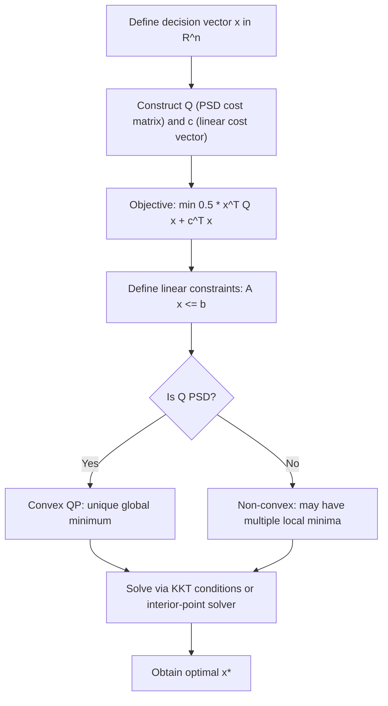

# Quadratic Programming Matrix Formulation

$$
\min_{x \in \mathbb{R}^n} \frac{1}{2} x^T Q x + c^T x \quad \text{subject to } Ax \le b
$$

_(Where $Q$ is a positive semi-definite matrix, resulting in elliptical contour lines)_.

## Deep Breakdown

What it tells me *(Situation Awareness)*:
Quadratic Programming (QP) is the class of optimisation problems where the objective is quadratic in the decision variable $x$ and the constraints are linear. QP arises in ML at the heart of Support Vector Machines (the SVM dual is a constrained QP), in portfolio optimisation, and in the implicit regularisation of ridge regression. When $Q$ is positive semi-definite (PSD), the objective is convex — any local minimum is the global minimum. The elliptical contour lines of a convex quadratic objective allow gradient-based and interior-point solvers to converge reliably and efficiently.

## Flowchart



## Real-world use

### Where it is used

SVM training (dual formulation is a QP over Lagrange multipliers), Markowitz mean-variance portfolio optimisation, budget allocation across marketing channels subject to spend limits, ridge regression expressed as a constrained minimisation, and model-predictive control.

### Problem it solves

Many ML problems minimise a sum-of-squares objective (quadratic) subject to operational constraints (non-negativity, budget caps, fairness limits). QP is the unified framework that handles all of these with strong theoretical guarantees when $Q$ is PSD.

### How it solves the problem

$Q$ encodes all quadratic interactions between decision variables; $c$ encodes linear costs. The constraint $Ax \leq b$ restricts the feasible region to a polyhedron. KKT conditions provide necessary and sufficient optimality conditions for convex QPs. Solvers like CVXPY, OSQP, or scipy handle this class efficiently.

### Example in a business

A DS builds a media budget allocation model: allocate spend across $n=5$ channels to minimise portfolio-style return variance minus expected revenue, subject to total budget and channel minimums. $Q$ = return covariance matrix, $c$ = negative expected returns, $Ax \leq b$ = budget constraints. The QP solver returns the optimal spend per channel in milliseconds.

## The formula, piece by piece

| Symbol | Meaning |
|--------|---------|
| $x \in \mathbb{R}^n$ | Decision variable vector |
| $Q \in \mathbb{R}^{n \times n}$ | PSD matrix encoding quadratic costs |
| $\frac{1}{2} x^T Q x$ | Quadratic objective term |
| $c \in \mathbb{R}^n$ | Linear cost vector |
| $c^T x$ | Linear objective term |
| $A \in \mathbb{R}^{m \times n}$ | Constraint matrix ($m$ constraints) |
| $b \in \mathbb{R}^m$ | Constraint right-hand side |
| $Ax \leq b$ | $m$ linear inequality constraints |

Full problem: $\min_x \frac{1}{2} x^T Q x + c^T x \quad \text{s.t.} \quad Ax \leq b$ KKT stationarity: $Qx^* + c + A^T\lambda = 0$, $\lambda \geq 0$, $\lambda^T(Ax^* - b) = 0$

## The formula in words

"Minimise a bowl-shaped quadratic cost surface (defined by matrix $Q$ and linear tilt $c$) while keeping the solution inside a polyhedron of linear constraints."

## Critical Concepts

- **PSD guarantees convexity**: if all eigenvalues of $Q$ are non-negative, any local minimum is global. If $Q$ is positive definite (all eigenvalues strictly positive), the minimum is unique.
- **SVM dual is a QP**: the SVM training dual maximises $\sum \alpha_i - \frac{1}{2}\alpha^T H \alpha$ where $H_{ij} = y_i y_j x_i^T x_j$ — a sign-flipped QP.
- **CVXPY for prototyping**: expresses QPs declaratively; automatically verifies convexity via disciplined convex programming rules and dispatches to appropriate solvers (OSQP, SCS, MOSEK).
- **Ridge as unconstrained QP**: ridge regression minimises $\|y - Xw\|^2 + \lambda\|w\|^2$, equivalent to a QP with $Q = 2(X^TX + \lambda I)$ and no inequality constraints.
- **Scaling**: interior-point QP solvers handle $n$ in the thousands; specialised sparse solvers handle millions.

## Step-by-step calculation (tiny example)

Minimise $f(x_1, x_2) = \frac{1}{2}(x_1^2 + x_2^2) - 3x_1 - 2x_2$ subject to $x_1 + x_2 \leq 4$, $x_1 \geq 0$, $x_2 \geq 0$. $Q = I_2$, $c = [-3, -2]^T$.

*Step 1: Unconstrained minimum*
$\nabla f = x + c = 0 \Rightarrow x^* = [3, 2]^T$

*Step 2: Check feasibility*
$3 + 2 = 5 > 4$: constraint violated. The unconstrained minimum is outside the feasible region.

*Step 3: Solve on the active constraint boundary $x_1 + x_2 = 4$*
With Lagrange multiplier $\lambda$: $x_1 = 3 - \lambda$, $x_2 = 2 - \lambda$. Substituting: $(3-\lambda) + (2-\lambda) = 4 \Rightarrow \lambda = 0.5$ $x_1^* = 2.5$, $x_2^* = 1.5$, $f^* = 4.25 - 7.5 - 3 = -6.25$

## Code examples

### Beginner example (Python)

```python
import numpy as np
from scipy.optimize import minimize

# min 0.5 x^T Q x + c^T x  s.t. x1+x2 <= 4, x >= 0
Q = np.eye(2)
c = np.array([-3.0, -2.0])


def objective(x):
    return 0.5 * x @ Q @ x + c @ x


def gradient(x):
    return Q @ x + c


constraints = [{"type": "ineq", "fun": lambda x: 4.0 - (x[0] + x[1])}]
bounds = [(0, None), (0, None)]
result = minimize(
    objective,
    x0=[1.0, 1.0],
    jac=gradient,
    method="SLSQP",
    bounds=bounds,
    constraints=constraints,
)
print(f"Optimal x: {result.x.round(4)}")
print(f"Optimal value: {result.fun:.4f}")
```

### Beginner example (R)

```r
# install.packages("quadprog") if needed
library(quadprog)
# solve.QP minimises 0.5 x^T D x - d^T x (note sign flip: d = -c)
D <- diag(2)
d <- c(3, 2)  # negated c
# Constraints: x1+x2 <= 4 becomes -x1-x2 >= -4; x >= 0 becomes diag(2) x >= 0
A_mat <- cbind(c(-1, -1), diag(2))
b_vec <- c(-4, 0, 0)
result <- solve.QP(D, d, A_mat, b_vec)
cat("Optimal x:", round(result$solution, 4), "\n")
cat("Optimal value:", round(result$value, 4), "\n")
```

### Professional example (Python)

```python
import numpy as np
import cvxpy as cp


def solve_budget_allocation_qp(
    expected_returns: np.ndarray,
    cov_matrix: np.ndarray,
    total_budget: float,
    risk_aversion: float = 1.0,
) -> dict[str, object]:
    # Mean-variance media budget QP:
    # min risk_aversion * x^T Sigma x - r^T x
    # s.t. sum(x) <= total_budget, x >= 0
    n = len(expected_returns)
    x = cp.Variable(n)
    objective = cp.Minimize(risk_aversion * cp.quad_form(x, cov_matrix) - expected_returns @ x)
    constraints = [cp.sum(x) <= total_budget, x >= 0]
    problem = cp.Problem(objective, constraints)
    problem.solve(solver=cp.OSQP, warm_start=True)
    if problem.status not in ("optimal", "optimal_inaccurate"):
        raise ValueError(f"QP solver failed: {problem.status}")
    x_opt = x.value
    return {
        "allocation": x_opt.round(2),
        "expected_return": round(float(expected_returns @ x_opt), 4),
        "portfolio_risk": round(float(x_opt @ cov_matrix @ x_opt), 6),
        "objective_value": round(float(problem.value), 4),
        "solver_status": problem.status,
    }


if __name__ == "__main__":
    rng = np.random.default_rng(seed=42)
    n_channels = 5
    expected_returns = rng.uniform(0.05, 0.25, n_channels)
    raw_cov = rng.standard_normal((n_channels, n_channels))
    cov_matrix = raw_cov.T @ raw_cov / n_channels  # PSD by construction
    result = solve_budget_allocation_qp(
        expected_returns=expected_returns,
        cov_matrix=cov_matrix,
        total_budget=100_000.0,
        risk_aversion=2.0,
    )
    print("QP budget allocation:")
    for key, val in result.items():
        print(f" {key}: {val}")
```

---
`` Domain knowledge.

## Self-check: mathematical verification

- If $Q$ is symmetric PSD, the objective $\frac{1}{2}x^\top Q x + c^\top x$ is convex on $\mathbb{R}^n$, so any KKT point for a feasible linearly constrained QP is **globally** optimal.
- Stationarity reads $Qx^\star + c + A^\top \lambda = 0$ with multipliers $\lambda \ge 0$ complementing $Ax^\star \le b$.
- The toy two-dimensional example in this note satisfies the constraint with equality on the optimum, consistent with a **binding** budget hyperplane.

## Common Pitfalls and Edge Cases

- **Indefinite $Q$:** multiple local minima possible; convex solvers may fail or return wrong answers without PSD verification.
- **Equality constraints:** rewrite as two inequalities or use a solver that supports $Ax=b$ directly.
- **Scaling:** badly scaled rows of $A$ or huge entries in $Q$ hurt numerical conditioning; rescale variables and constraints in production.
- **Unbounded problems:** if $Q$ is only PSD (not PD) and $c$ lies in a direction with zero curvature in the recession cone of the feasible set, the infimum may be $-\infty$.

## References and Standard Results

- Convex quadratic programming and KKT optimality under Slater-type conditions for linear inequalities.
- SVM dual as a QP; relationship to **OSQP**, **CVXPY**, and interior-point methods.
- Ridge regression and **Tikhonov** regularization as (unconstrained) quadratic minimization.
