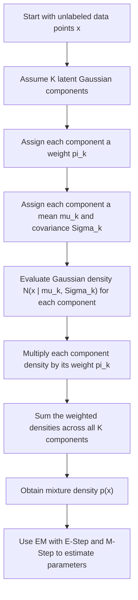

# Mixture Density

$$
p(x)=\sum_{k=1}^{K}\pi_k\,\mathcal{N}(x\mid \mu_k,\Sigma_k)
$$

We are working on the **Gaussian mixture density**, defined by

$$
p(x)=\sum_{k=1}^{K}\pi_k\,\mathcal{N}(x\mid \mu_k,\Sigma_k),
$$

where $\pi_k$ are mixing weights, $\mu_k$ are component means, and $\Sigma_k$ are component covariance matrices. This is an unsupervised probabilistic model in which the overall density is a weighted sum of $K$ Gaussian components, with

$$
\pi_k \ge 0 \quad \text{and} \quad \sum_{k=1}^{K}\pi_k=1.
$$

It is central to Gaussian Mixture Models, GMMs, density estimation, soft clustering, and the EM algorithm.

## Deep Breakdown

A Gaussian Mixture Model assumes that the data are generated by several hidden Gaussian sources rather than by one single Gaussian distribution. This matters because many real datasets are **multi-modal**, which means they have multiple peaks or latent subgroups. A single Gaussian can represent one ellipsoidal cloud well, but it struggles when the data contain several overlapping groups. The mixture density solves this by combining several Gaussian densities:

$$
p(x)=\sum_{k=1}^{K}\pi_k\,\mathcal{N}(x\mid \mu_k,\Sigma_k)
$$

This means the density at point $x$ is built from the contribution of all $K$ components.

Each component has three ingredients:

- a **mixing weight** $\pi_k$, which says how common component $k$ is overall,
- a **mean** $\mu_k$, which says where that component is centered,
- a **covariance matrix** $\Sigma_k$, which says how spread out and oriented that component is. So a mixture model is a weighted average of several Gaussian densities. A useful generative interpretation is: 1. choose a hidden component index $z=k$ with probability $\pi_k$,
2. generate $x$ from the Gaussian for that component,
3. ignore the hidden label $z$ after generation.

This is why GMM is a **latent-variable model**. The component identity exists conceptually, but it is not observed in the data. That latent structure leads to one of the most important differences between GMM and K-means:

- **K-means** gives each point a hard cluster assignment,
- **GMM** gives each point a soft probabilistic relationship to each component.

This makes GMM especially useful when clusters overlap. A point near the boundary between two groups does not need to be forced into one group with certainty.

Instead, GMM can say:

- 70% likely from component 1,
- 30% likely from component 2.

That soft assignment is one of the main reasons GMM is widely used in clustering and density estimation.

## Why the weights must sum to 1

The mixture weights are probabilities over the hidden component index.

Therefore they must satisfy:

$$
\pi_k \ge 0
$$

and

$$
\sum_{k=1}^{K}\pi_k=1
$$

This ensures that the overall mixture is still a valid probability density.

## Why covariance matters

The covariance matrix $\Sigma_k$ controls the shape of each Gaussian component.

This allows GMM to represent:

- spherical clouds,
- stretched ellipses,
- tilted clusters,
- differently sized components.

This is more flexible than K-means, which effectively assumes equal spherical behavior under Euclidean distance.

## Why EM is needed The log-likelihood of a GMM contains terms like

$$
\log\left(\sum_{k=1}^{K}\pi_k\,\mathcal{N}(x_i\mid \mu_k,\Sigma_k)\right)
$$

That log-of-sum structure makes direct optimization difficult. So GMM is commonly fit with the **Expectation-Maximization**, EM, algorithm:

- **E-step**: compute component responsibilities, soft assignments,
- **M-step**: update weights, means, and covariances.

So the mixture density formula is the mathematical core from which the entire EM procedure is built.

## DA/DS relevance

In DA/DS practice, mixture densities are useful for:

- soft customer segmentation,
- anomaly detection through low-density regions,
- latent subgroup discovery,
- probabilistic clustering,
- flexible density estimation.

For example, in customer analytics, some customers may behave like a blend of two segment types rather than belonging cleanly to one segment. GMM handles that naturally.

## Flowchart



## Real-world use

### Where it is used

Mixture density is used when the data are believed to come from several overlapping latent subpopulations and the analyst wants either probabilistic clustering or a flexible density model.

### Problem it solves

It solves the problem that one Gaussian is often too simple to describe real data. Many datasets contain multiple hidden groups with different centers and spreads. A single Gaussian merges them all into one blunt approximation.

### How it solves the problem

It represents the full density as a weighted sum of several Gaussian components. Each component models one latent subgroup, and the full mixture combines them into one coherent probabilistic model.

### Example in a business

Suppose a subscription company wants to segment users by monthly spend and product usage intensity. The user base may contain light users, heavy users, and seasonal users, but these groups overlap. A Gaussian mixture density can model the entire population as several latent Gaussian components and provide soft assignment probabilities for CRM targeting, pricing experiments, or lifecycle analysis.

## The formula, piece by piece

| Symbol | Meaning |
| --- | --- |
| $x$ | Data point, usually a vector |
| $K$ | Number of Gaussian components |
| $\pi_k$ | Mixing weight for component $k$ |
| $\mu_k$ | Mean vector of component $k$ |
| $\Sigma_k$ | Covariance matrix of component $k$ |
| $\mathcal{N}(x\mid \mu_k,\Sigma_k)$ | Gaussian density of component $k$ evaluated at $x$ |
| $p(x)$ | Overall mixture density at point $x$ |
| $z$ | Hidden component label |

Canonical mixture-density formula:

$$
p(x)=\sum_{k=1}^{K}\pi_k\,\mathcal{N}(x\mid \mu_k,\Sigma_k)
$$

Mixing-weight constraints:

$$
\pi_k \ge 0 \quad \text{for all } k
$$

$$
\sum_{k=1}^{K}\pi_k=1
$$

Latent-variable interpretation:

$$
p(x)=\sum_{k=1}^{K}p(z=k)\,p(x\mid z=k)
$$

with:

$$
p(z=k)=\pi_k
$$

and

$$
p(x\mid z=k)=\mathcal{N}(x\mid \mu_k,\Sigma_k)
$$

Multivariate Gaussian density:

$$
\mathcal{N}(x\mid \mu_k,\Sigma_k)
=
\frac{1}{(2\pi)^{d/2}|\Sigma_k|^{1/2}}
\exp\left(
-\frac{1}{2}(x-\mu_k)^\top \Sigma_k^{-1}(x-\mu_k)
\right)
$$

## The formula in words

To compute the density at point $x$, look at every Gaussian component. For each component $k$: 1. compute how dense $x$ is under that Gaussian,
2. multiply that density by the component’s weight $\pi_k$,
3. add all these weighted contributions together.

So the final density is not produced by one single Gaussian. It is the sum of several Gaussian explanations, each weighted by how important that component is in the overall model.

## Critical Concepts

- **A mixture density is a weighted sum of component densities.** This is the defining idea of GMM.
- **The weights must sum to 1.** Otherwise the model would not represent a valid probability distribution over components.
- **Each component has its own mean and covariance.** This allows different subgroup locations and shapes.
- **GMM gives soft assignments.** A point can partially belong to multiple components.
- **The component label is latent.** It exists in the model but is not observed in the raw data.
- **EM is the standard fitting algorithm.** The mixture formula leads naturally to E-step and M-step updates.
- **GMM is both a clustering model and a density model.** Clustering is one use case, but density estimation is equally fundamental.

## Step-by-step calculation (tiny example)

Suppose we have a one-dimensional Gaussian mixture with:

- $K=2$ components,
- mixing weights:

$$
\pi_1=0.7,\qquad \pi_2=0.3
$$

- Gaussian density values at a specific point $x$:

$$
\mathcal{N}(x\mid \mu_1,\sigma_1^2)=0.20
$$

$$
\mathcal{N}(x\mid \mu_2,\sigma_2^2)=0.50
$$

We compute the mixture density.

### Step 1, compute the weighted contribution of component 1

$$
\pi_1 \mathcal{N}(x\mid \mu_1,\sigma_1^2)=0.7 \cdot 0.20=0.14
$$

### Step 2, compute the weighted contribution of component 2

$$
\pi_2 \mathcal{N}(x\mid \mu_2,\sigma_2^2)=0.3 \cdot 0.50=0.15
$$

### Step 3, add the contributions

$$
p(x)=0.14+0.15=0.29
$$

### Interpretation The overall density at point $x$ is 0.29. Even though component 2 has the smaller weight, it contributes more locally at this particular point because its Gaussian density is higher there.

### Tiny plain-language reading

A point can be explained partly by one component and partly by another. The final density combines both influences.

## Code examples

### Beginner friendly Example \[Python\])

```python
# Mixture density from two Gaussian component contributions
pi_1 = 0.7
pi_2 = 0.3
gaussian_1 = 0.20
gaussian_2 = 0.50
p_x = pi_1 * gaussian_1 + pi_2 * gaussian_2
print("Mixture density p(x):", p_x)
```

Explanation
:

- `gaussian_1` and `gaussian_2` are component density values at the same point.
- Each component contribution is weighted by its mixing probability.
- Adding them gives the overall mixture density.

### Beginner friendly Example \[R\])

```r
# Mixture density from two Gaussian component contributions
pi_1 <- 0.7
pi_2 <- 0.3
gaussian_1 <- 0.20
gaussian_2 <- 0.50
p_x <- pi_1 * gaussian_1 + pi_2 * gaussian_2
cat("Mixture density p(x):", p_x, "\n")
```

Explanation
:

- This directly implements the mixture-density formula.
- It is the core computation behind Gaussian Mixture Models.

### Final Professional Example \[Python\])

```python
# Reference example with a numerical check.
import math

def mixture_density(x, weights, means, deviations):
    if not weights or not len(weights) == len(means) == len(deviations):
        raise ValueError("Component arrays must be equally sized and nonempty.")
    if any(w < 0 for w in weights) or not math.isclose(sum(weights), 1):
        raise ValueError("Mixture weights must be nonnegative and sum to one.")
    if any(s <= 0 for s in deviations):
        raise ValueError("Standard deviations must be positive.")
    components = [w * math.exp(-0.5 * ((x - mean) / s) ** 2) / (s * math.sqrt(2 * math.pi))
                  for w, mean, s in zip(weights, means, deviations)]
    return sum(components)

value = mixture_density(0, [0.4, 0.6], [0, 2], [1, 1])
assert math.isclose(value, (0.4 + 0.6 * math.exp(-2)) / math.sqrt(2 * math.pi))
print("Mixture density at zero:", value)
```

The density is a weighted sum of normalized Gaussian component densities. Standard deviations are positive, weights sum to one, and the result is a density rather than the probability of one exact point.

## Self-check: mathematical verification

### Re-derivation from the latent-variable model

Let $z$ be a hidden categorical variable representing the component index.

Assume:

$$
p(z=k)=\pi_k
$$

and conditional on $z=k$:

$$
p(x\mid z=k)=\mathcal{N}(x\mid \mu_k,\Sigma_k)
$$

Using the law of total probability:

$$
p(x)=\sum_{k=1}^{K}p(z=k)\,p(x\mid z=k)
$$

Substituting the component definitions gives:

$$
p(x)=\sum_{k=1}^{K}\pi_k\,\mathcal{N}(x\mid \mu_k,\Sigma_k)
$$

This matches the canonical formula exactly.

### Valid-density check Each Gaussian component is a valid density, so

$$
\int \mathcal{N}(x\mid \mu_k,\Sigma_k)\,dx = 1
$$

Now integrate the full mixture:

$$
\int p(x)\,dx
=
\int \sum_{k=1}^{K}\pi_k\,\mathcal{N}(x\mid \mu_k,\Sigma_k)\,dx
$$

By linearity of integration:

$$
=
\sum_{k=1}^{K}\pi_k \int \mathcal{N}(x\mid \mu_k,\Sigma_k)\,dx
$$

$$
=
\sum_{k=1}^{K}\pi_k \cdot 1
=
\sum_{k=1}^{K}\pi_k
=
1
$$

So the mixture is a valid probability density, provided the weights sum to 1.

### Non-negativity check

Because:

$$
\pi_k \ge 0
$$

and each Gaussian density is non-negative, every term in the sum is non-negative.

Therefore:

$$
p(x)\ge 0
$$

for all $x$.

### Why soft assignment arises

The posterior probability that component $k$ generated point $x$ is:

$$
p(z=k\mid x)=\frac{\pi_k\,\mathcal{N}(x\mid \mu_k,\Sigma_k)}{p(x)}
$$

This quantity is generally between 0 and 1 and can be nonzero for multiple components at once. That confirms the soft-assignment interpretation.

### EM connection check The sample log-likelihood is

$$
\sum_{i=1}^{n}\log\left(\sum_{k=1}^{K}\pi_k\,\mathcal{N}(x_i\mid \mu_k,\Sigma_k)\right)
$$

The inner sum makes direct optimization difficult. This is exactly the structure that motivates the EM algorithm, where latent component probabilities are introduced and iteratively updated.

### Verbal-to-algebra consistency

The verbal explanation says the mixture density is a weighted sum of Gaussian components, each corresponding to a latent subgroup, and that points can be softly associated with more than one component. The algebra confirms all of this directly.

## Common Pitfalls and Edge Cases

- **Confusing mixing weights with observation-specific responsibilities:** $\pi_k$ are global component probabilities, while responsibilities depend on the individual point.
- **Thinking GMM is only a clustering method:** It is fundamentally a probabilistic density model.
- **Using too many components without validation:** The model can overfit the data distribution.
- **Ignoring covariance structure choice:** Full, diagonal, spherical, and tied covariance assumptions change model flexibility.
- **Forgetting that weights must sum to 1:** Otherwise the model is not a valid probability density.
- **Confusing hard assignment with soft assignment:** GMM naturally supports partial membership.
- **Ignoring initialization sensitivity:** EM can converge to local optima depending on initial parameter values.
- **Assuming Gaussian components always match real subgroup shape:** Real data may violate Gaussian assumptions substantially.

## References and Standard Results

- Gaussian mixture density, $p(x)=\sum_{k=1}^{K}\pi_k,\mathcal{N}(x\mid \mu_k,\Sigma_k)$
- Mixing-weight constraints, $\pi_k \ge 0$ and $\sum_{k=1}^{K}\pi_k=1$
- Multivariate Gaussian density formula
- Law of total probability for latent-variable mixtures
- Responsibility formula, $p(z=k\mid x)$
- EM algorithm connection through latent-variable optimization
- Soft clustering interpretation of GMM
- Difference between density estimation and hard partition clustering
